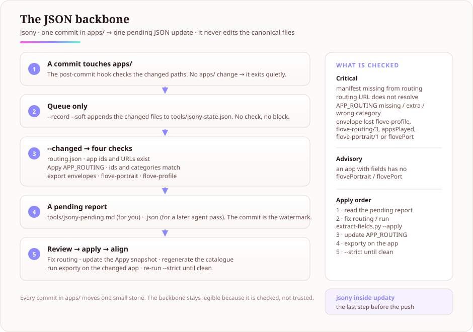

There is a file in this repo that nobody opens for pleasure: `tools/routing.json`.
It is the map of every app — id, name, url, description, tags, folder, category,
fields, status, and who consumes what. It reads like plumbing. Today it behaved
like a lamp.

This is the story of a long polishing session that began with colours, went down
into every app in `apps/`, and ended up re-mining that file from a side we had
left in the dark. By the end, the plumbing was checking itself every time we
publish.

## It started with two names for one thing

Identities were placed, not just drawn: brandy (sketch → study) grew an
extension, `brandy-flove`, that takes a chosen mark and puts it in the catalogue,
the tree, the launcher and the tab — the same procedure, backwards, for when a
mark or a name changes.

## The day we went into the apps

Then the work moved from the map to the territory. 

**The apps stopped borrowing other people's plumbing.** 

**Accessibility stopped being an afterthought.** The numbers are the honest way
to say it, and they are in the table below: every app now has a main landmark, a
page heading, reduced-motion support, and controls with names. 

## By the numbers

| What | Before today | Now |
|---|---|---|
| Apps with an embedded field manifest | 48 / 51 (94%) | **54 / 54 (100%)** |
| Apps marked `complete` | 50 / 51 (98%) | **54 / 54 (100%)** |
| Catalog-only apps | 3 | **0** |
| Apps with a main landmark | 38 (70%) | **54 (100%)** |
| Apps with a page `<h1>` | 17 (31%) | **54 (100%)** |
| Apps with reduced motion | 47 (87%) | **54 (100%)** |
| Bilingual spans missing `lang` | 986 in 14 apps | **0** |
| Placeholder links (`href="#"`) | 60 in 22 apps | **0** |
| Form controls without a name | 151 in 24 apps | **0** |
| External webfont / icon links | 22 / 11 apps | **0 / 0** |
| Tier references in trunk code | Puzzy, flove.js, catalogue, distro | **0** |

## What came out of the apps

Then we went looking for weight that no longer had a purpose. The summary panels
had accumulated three generations of export code: Markdown, CSV, XML, HTML and
JPEG serializers, each with its own escaping helpers, alongside the JSON that
everything now uses. Some apps carried hidden Publish bridges and Save cycles
that had been superseded twice over. We deleted them.

**The numbers, measured across 60 commits touching `apps/`:**

| What | Count |
|---|---|
| Lines deleted from `apps/` | **6,602** |
| Lines added back | 3,021 |
| **Net reduction in `apps/`** | **−3,581 lines** |
| Apps that *gained* a summary section in the same pass | 8 |
| Biggest single clean-ups | PracSys −516 · Inventary −495 · MyFamily −402 · Keys −371 · Souls −348 |

The eight additions matter as much as the subtractions: Sensy, Poly, Raty, Comby,
Lowy, Wisy, Minioffer and Offer had no summary export at all. They got one —
a phrase, Magic, Share, and a `flove-portrait.json` — while the old apps were
losing four formats apiece. The folder still ends the day around **201,000 lines
across 79 HTML files**, every app a single self-contained file.

## Why tidy is a feature

None of that code was shared. There is no runtime, no bundle, no common
JavaScript that every app imports. Each app is still freely designed: its own
layout, its own palette, its own way of asking questions, its own little
metaphor. The tidying happened in the *contract*, not in the design.

That is exactly what lets the skills cross-operate. `jsony` can walk the app
folder and read the same `flove-portrait/1` envelope from Goddy, Crafty or
Souls. `exporty` can ask the same question of every summary section because it
now exposes the same two buttons and the same filename. `optimizy` can polish one
app without knowing the others, and still leave the family consistent. A narrow
waist — `schema`, `app`, `phrase`, `rows` — holds the whole collection together
while the bodies stay as different as they like.

The exceptions stay exceptions on purpose: Keys, Blogy, Souls and Worthing keep
their full multi-format exports and their rich displays, with JSON normalised and
first in the menu. Consistency here is a grammar everyone can read, not a uniform.

## Questy becomes a place

The quiet milestone of the day: **questy is no longer only a skill.** Its form —
the one that interviews you about a project, picks the thinking hats, sets the
volume, writes the config — is now an app in its own right: 17 fields, category
`social`, listed in the psychosocial launcher with its own question-mark glyph,
and reachable at
[flove.org/development/standards/skills/questy](https://flove.org/development/standards/skills/questy/).

Nothing was duplicated. The same file is the skill's front door and the app's
page. That is the first time a skill has crossed over into the catalogue, and it
feels right: questy was always the one asking the questions.

## questy-flove: the whole thing in one card

If questy is the skill that asks, **questy-flove** is the one that carries flove
into someone else's conversation. Not as documentation, not as a link — as a
small, live instrument.

The idea is almost annoyingly simple. Any project conversation already has an
agent asking questions. questy-flove adds **one section** to that conversation:
a dial from 0 to 4 that says how much flove you want present. At 0 the questions
are generic and flove never appears. At 1–2 it is a flavour: a word, a category,
a colour. At 3 it quotes an app's own field page, in that category's hat. At 4
the flove data model drives the pass — related apps' fields become influent data,
still under their own category's hat. And a fifth degree, **Very much**, stops
being a number and becomes a door: *Browse flove*, the whole model or just the
parts you need.

Two more dials sit under it, and both are deliberately tiny:

- **Category weights** at 0/1/2. Only a `2` enters the agent prompt; the rest is
  presence, not instruction.
- **Voice** — Love, Joy, Wisdom, each at 0/1/2. They are not moods for the
  writing; they are the three families flove already uses to tell what a thing
  is for.

That is the whole state. One object:

```json
{
  "schema": "flove-influence/1",
  "influence": 0,
  "categoryWeights": { "inside": 0, "mating": 0, "ling": 0, "social": 0, "economy": 0 },
  "voice": { "love": 0, "joy": 0, "wise": 0 },
  "surface": "compact"
}
```

The output is a **`flove-profile` JSON** — the apps played, the answers keyed by
each app's own questions or input fields, plus `influence`, `categoryWeights`,
`voice` and a visibility block. That file is what appy-basic imports. So the
distance between "a stranger's agent conversation" and "a flove profile" is one
small card and one JSON.

The minimalism is the point. The same state has **four surfaces**, and they are
the same object wearing different clothes:

| Surface | Shape | Where it goes |
|---|---|---|
| **Full** | the whole section: degrees, weights, voice, browse, copyable agent YAML | onboarding, first run |
| **Compact** | the gauge and the voice | a sidebar |
| **Minimal** | the gauge and one human line | an inline card next to content |
| **Micro** | the gauge alone | a header, a footer, a phone |

Any agent conversation can host the micro one — a `flove · degree` chip — and
still be able to grow into the full model when the conversation gets deep. That
is how flove travels quickly *and* deeply: the door is small, the house is
large, and you never have to explain the house to walk through the door.

## Wizy, specified into an estate

The voice needed somewhere to live, and that is where the other milestone comes
in: **Wizy**.

We had a suggestion engine with a good instinct and a vague constitution. The
influence work forced it to be specified — a solid, extended estate rather than a
clever prompt. The result is a page that says what Wizy is and what it reads:

- a **compact card** with suggestion depth `0–4` — the same degrees as
  questy-flove, in the place where the suggestions actually appear;
- a **micro chip** in the inline suggestions (`flove · degree`), so the degree is
  visible where it acts;
- **category weights** that focus what Wizy reads, with the doubled categories
  leading;
- **Love / Joy / Wisdom** mapped to its labeler families, each anchored on the
  page ([#love](https://flove.org/apps/sys/wizy/index.html#love),
  [#joy](https://flove.org/apps/sys/wizy/index.html#joy),
  [#wise](https://flove.org/apps/sys/wizy/index.html#wise));
- a **full setup disclosure** with the category grid and a copyable **agent
  YAML**, so the same configuration can leave the page and enter any agent;
- state persisted at `wizy:flove-influence` through `floveStore`.

And a naming decision that had been floating for months settled with it:
**Wizy** is the Social app / suggestion engine; **Wisy** is the wise Wizy — a
separate Linguistics app and its own labeler collection. Two words, two homes, no
more guessing in the routing.

That is what "specified into an estate" means here: not more features, but a
boundary. Wizy now knows what it reads, what it suggests, what it remembers —
and the rest of flove can point at it without ambiguity.

## The JSON backbone, drawn

The whole day kept returning to one question, so we drew it. On the
[development page](https://flove.org/development/) there is now a small diagram
of the **JSON backbone**, and it is the honest map of what happens after a
commit:



```text
apps/ commit → post-commit → jsony_check → tools/jsony-pending.md → review / apply
```

Five steps, no magic:

1. **A commit touches `apps/`.** The post-commit hook looks at the changed
   paths; no app change, it exits quietly.
2. **Queue only.** `--record --soft` appends the changed files to
   `tools/jsony-state.json`. No check, no block.
3. **`--changed` runs four checks:** `routing.json` ids and URLs; Appy's
   `APP_ROUTING` ids and categories; the export envelopes (`flove-portrait`,
   `flove-profile`).
4. **A pending report** lands in `tools/jsony-pending.md` (for you) and `.json`
   (for a later agent pass). The processed commit becomes the watermark.
5. **Review → apply → align:** fix routing, update the Appy snapshot, regenerate
   the catalogue, run exporty on the changed app, re-run `--strict` until clean.

What it treats as **critical**: a manifest missing from routing, a routing URL
that does not resolve on disk, an Appy snapshot missing an app or carrying the
wrong category, an export envelope that lost `flove-profile`, `flove-routing/3`,
`appsPlayed`, `flove-portrait/1` or `flovePort`. What it treats as **advisory**:
an app with fields that has no portrait adapter.

The diagram lives at
[jsony/index.html](https://flove.org/development/standards/skills/jsony/index.html)
— open it before your next release; it is the shortest honest description of the
backbone we have.

## The last pearl: jsony inside updaty

And then the small thing that ties the whole day shut.

Because `routing.json` is now the backbone of everything — fields, portraits,
exports, the Appy profile, the catalogue — we put jsony **inside updaty-web**, as
the last step before the push. So the publish path now ends like this: commit the
source → push to Gitea → **check that the JSON still agrees with itself** →
publish the site. The lamp is checked every time we turn it on.

That is the pearl of the journey: the plumbing we started the day complaining
about is now the thing that guards the door.

Come poke around: [the catalogue](https://flove.org/apps/), the
[standards](https://flove.org/development/standards/), or the
[workshop](https://flove.org/development/). If you find a
drawer that opens onto another drawer, that is probably the point — or a bug we
would love to hear about. Either way, it was one determined human and one
alarmingly patient robot today, and the robot has finally learned to check its
own JSON — jsony inside updaty, as the last pearl of the journey.

_slow it · flow it · love it._
