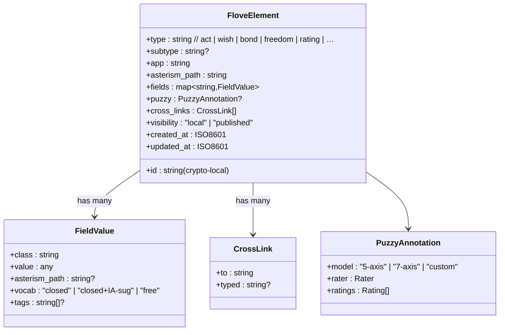

<!-- CONTEXT:BEGIN
schema: flove-page/1
id: data/schemas
path: development/standards/data/schemas/schemas.md
trunk: data
topic: schemas
kind: topic
status: stable
html_place: ["#data"]
owns: ["Schemas", "storage keys", "flove-auth"]
updated: 2026-11-26
read_next: ["#data-classes-and-privacy-invariants","#schema-envelopes","#development-workflow-schemas","#workflow-schema-auditors","#floveelement-schema","#palette","#identity-registry","#validation","#collect-contract","#oasis-classes","#messages-schema","#puzzy-schema","#puzzy-aggregation","#schema-plan"]
CONTEXT:END -->

# Schemas

```text
data/
├─ content/json.md                    JSON backbone
├─ schemas/schemas.md · schemas/puzzy.md  ★ YOU
└─ ai/flows/flows.md · ai/models/models.md
See also: ↑ README.md · → frontend.md#1312-model · → frontend.md#1318
```


## Data classes and privacy invariants

| Class | Meaning | Movement |
|---|---|---|
| **P — Personal** | private data and keys; **Private** visibility | encrypted vault; never leaves unencrypted |
| **L — Local** | records **shareable** with named peers or groups | direct, encrypted per recipient, session by session |
| **S — Social = Public** | published data; **Social** and **Public** are synonyms | Nety (and optional Central mirror) |
| **D — Derived** | Wizy outputs | local by default; shared only by explicit export |
| **M — Metadata** | grants, peer list, audit | encrypted vault; minimal disclosure |

Invariants:

1. P is never present in an S bundle.
2. L is a projection under a signed grant; no “share whole vault” path.
3. Revocation is forward-only; copies cannot be recalled. TTL + key rotation
   are the mitigations.
4. Every received bundle is signature-checked before merge.
5. Defaults are private; widening is an explicit user act.
6. Nety never learns who pulls from whom locally.
7. Linking a channel never re-derives the identity root.
8. Promotion is explicit: P → L or S, and L → S, only by the owner. L never
   becomes Public automatically; S is the only class that reaches Nety.

## Schema envelopes


| ID | Shape |
|---|---|
| `flove:authy/1` (schema `flove-authy/1`) | `{schema, level, identities[], channels{...}, updatedAt}` |
| `flove-bundle/0.1` (proposed) | owner, class, documents[], grants[], signature |
| `flove-group/0.1` (proposed) | id, name, kind, memberIds, roles, defaultClass, visibility, projection, keyId, version, signature |
| `flove-consult/1` (proposed) | owner, member, wizy, scope{personIds, groupIds, paths, capabilities}, purpose, expiresAt, version, signature |
| `flove-auth/1` (portable auth) | `{schema, handle, levels{self,telegram,phone,bio}, claims[], visibility, updatedAt}`; signed by Authy; no secrets/raw phone/Telegram tokens |
| `flove-identity/1` (Q010) | `{schema, hash, publicKey, source, createdAt, label?}`; `flove-browsy/1` is a read-only view; `flove:authy.self.browsyHash` is a display cache |

The identity hash formula and its generation rules are owned by
[`apps.md#browsy-extension-standards-draft`](../../frontend/apps/apps.md#browsy-extension-standards-draft).

<a id="development-workflow-schemas"></a>
## Development workflow schemas

> Owner: schemas. One row per development envelope; each generated artifact
> carries a `schema_doc` pointer back to this chapter. This catalog does **not**
> restate the task axes: [AGENTS.md](https://flove.org/development/AGENTS.md)
> owns `effort` and `stage`, while `section`, `path` and `sectionMeta` are
> lookup fields on the register, not axes. Source of truth is
> `development/tasks/milestones.json`, which has no `schema` field and is never
> catalogued as an envelope.

### Layer 1 · data-flow vocabularies

| Schema id | Artifact | Owner / generator | Role |
|---|---|---|---|
| `flove-tasks/1` | `#tasks-data` in `development/index.html` | `tools/dev/tasks/build-work-tracker.py` | Compiled Work register; tasks, hitos and archive drawers |
| `flove-common/1` | `development/tasks/common.json` | `tools/dev/tasks/build-common.py` | Page-facing projection of the same register |
| `flove-tasks-moves/1` | `development/tasks/tasks-moves.json` (optional patch) | Work `Export moves`, applied by the tracker builder | Reviewed moves with one fully specified replacement each |

### Layer 2 · derived views and maps

| Schema id | Artifact | Owner / generator | Role |
|---|---|---|---|
| `flove-pages-manifest/1` | `development/pages.json` | docs map, checked by `check-docs-manifest.py` | Live page, plan, redirect and alias map |
| `flove-register-inventory/1` | `development/register-path-inventory.json` | `tools/dev/checks/page-inventory.py` | Path audit of the register and its sources |
| `flove-port-ledger/1` | `development/port-ledger.json` | dev map, checked by `check-content.py` | Port and anchor ledger for routed apps |
| `flove-archive/1` | `development/archive/manifest.json` and dated partitions | `tools/dev/checks/check-archive.py` | Opaque checksummed snapshots; never an owner, never ingested |
| `flove-page/1` | `CONTEXT` header of a stable page | page author | Local identity, ownership and navigation for a standards page |

<a id="workflow-schema-auditors"></a>
### Layer 3 · auditors and checkers

These tools consume or verify the envelopes above; they are not new schemas.

| Tool | Reads / writes | Contract |
|---|---|---|
| `tools/dev/checks/jsony.py` | `flove-tasks/1`, `flove-common/1`, `flove-tasks-moves/1` | Compares the compiled block, projection and patch against the canonical register |
| `tools/dev/checks/check-archive.py` | `flove-archive/1` | Verifies manifest checksums and partition contents |
| `tools/dev/checks/page-inventory.py` | register → `flove-register-inventory/1` | Generates the inventory and its source hash |
| `tools/dev/checks/page-resolve.py --check` | inventory, archived paths | Resolves register paths and rejects archived-away or moving paths |
| `tools/dev/checks/check-archived-paths.py --check` | live source files | Fails when live code still names an archived-away path |
| `tools/dev/checks/check-paths.py` | scripts and tooling paths | Strict gate for path references in live code |
| `tools/dev/checks/check-doc-paths.py` | live Markdown docs | Strict gate for path references in prose |

## Work

11 hitos · 66 tasks · 9 open · 2 closed. This page owns the `data/schemas`
chapter.

## FloveElement schema



The F0 snapshot already follows the top-level shape; §3 adds per-field metadata,
the upper-class mapping and the per-sub-field `asterism_path`.

<a id="palette"></a>
## Palette out of routing.json

> Owner: schemas. The palette has its own schema id and storage key; routing no
> longer carries it.

<a id="identity-registry"></a>
## Identity registry

> Owner: schemas. `flove-identity/1` is the one writer; `flove-browsy/1` is a
> read-only view; legacy migration is explicit.

<a id="validation"></a>
## Per-app validation

> Owner: schemas. `collect-schemas.json` validates payloads; malformed data is
> rejected with a readable reason.

<a id="collect-contract"></a>
## collect() contract

> Owner: schemas. The `collect()` payload conforms to declared `flove-fields/1`;
> PEN005 is closed or explained.

<a id="oasis-classes"></a>
## FloveElement and Oasis classes

> Owner: schemas. `FloveElement` and `asterism_path` map to universal Oasis
> classes: one flove concept → one Oasis type.

<a id="messages-schema"></a>
## Messages and chat_ephemeral

> Owner: schemas. The messages schema names sender, recipient/room, body,
> timestamp and the ephemeral policy; it reuses flove-profile vocabulary.

<a id="puzzy-schema"></a>
## Puzzy schema

> Owner: schemas. Entries, senses and frames have one schema decision and one
> storage key; see `puzzy.md` for the model.

<a id="puzzy-aggregation"></a>
## Puzzy aggregation decisions

> Owner: schemas. Aggregation is mean + dispersion; compute is hybrid with
> offline cache; no rule is chosen twice.

<a id="schema-plan"></a>
## Schema plan

> Owner: schemas. All schema ids and storage keys resolve to one owner and no
> archived alias remains.

## Sources

Source history is owned by `development/plans/`; this page holds the accepted facts.

