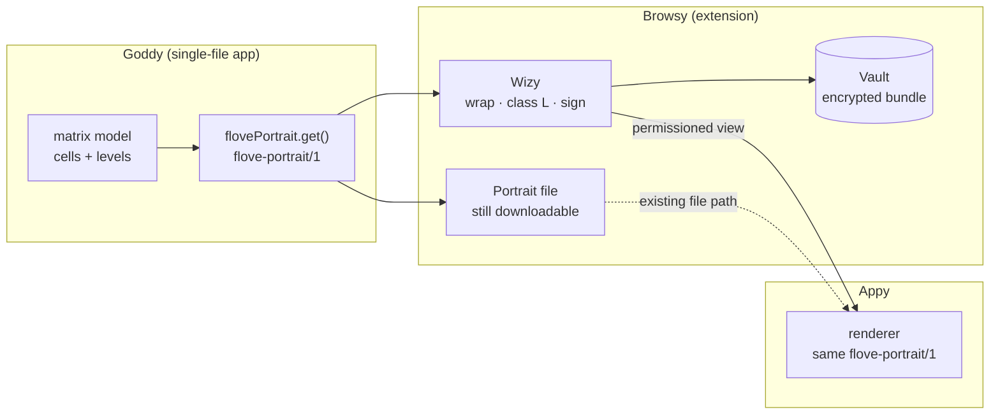
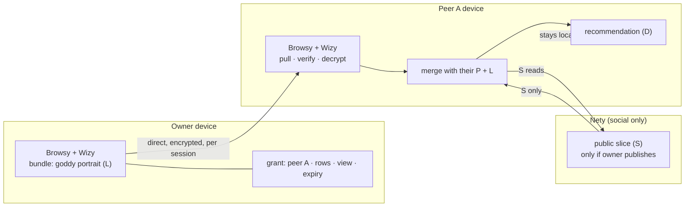
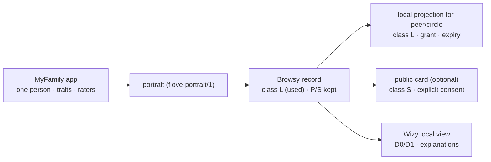
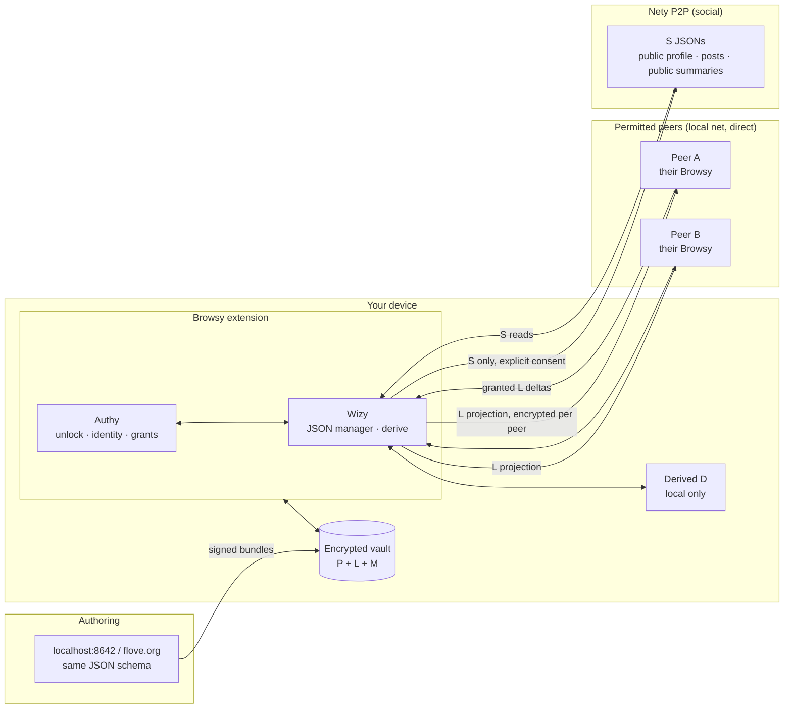
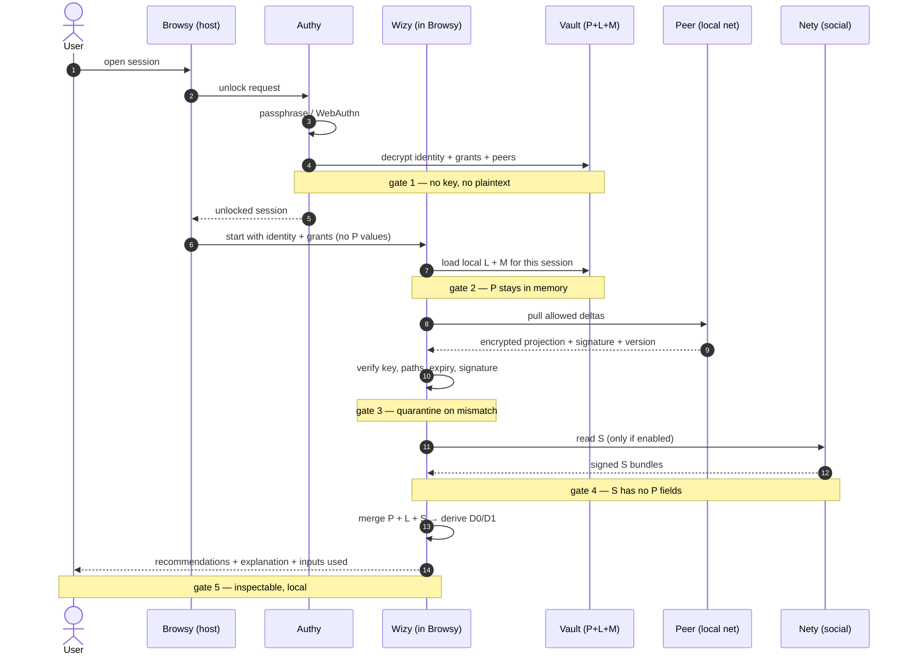

# Rationale — Browsy (auth + Wizy), Nety (social): privacy-first data mesh

> Status: **design rationale** (2026-11-17). Implementation spec:
> [`spec.md`](spec.md).
>
> Draft origin: This is the new north star for the P2P /
> identity / JSON-sharing story. It does **not** replace anything yet; when the
> milestones below reach a stable shape, it overwrites the current presentations
> in `development/index.html` (P2P · Browsy/Nety/Wizy) and absorbs the older
> browsy/nety plans.
>
> Location: `development/standards/debates/browsy/rationale.md`.
> Companion visual: `apps/sys/browsy/2026-11-17-browsy-wizy-nety.html`.
> Companions: `apps/sys/authy/index.html` (Authy index) ·
> `apps/sys/browsy/index.html#myfamily` (MyFamily use case) ·
> `development/standards/debates/browsy/browsy-questions.md` (future questy survey).
>
> Usability is deliberately deferred: the privacy rules come first, then each
> milestone ends with a usability pass once the gate is green.

---

## 1. One-line vision

**Browsy is the browser extension that authenticates you (Authy), hosts Wizy,
and guards the door; Wizy is the JSON manager living inside Browsy that merges
your private, permissioned and public data and derives recommendations; Nety is
the P2P network that only carries the social/global layer.** Personal data never
leaves the device unencrypted; local JSONs travel directly between permitted
users, session by session; the global JSONs travel through Nety. Wizy reaches the
local net and the Nety social layer from inside Browsy, only when the user asks
it to.

---

## 2. Chapter 1 — Personal, local, social, and the apps in play

This is the introduction the rest of the document assumes. Read it as three
concentric worlds plus the tools that touch them.

### 2.1 Personal — the world that never leaves

**What it is:** the raw material of you — journal answers, health and body data,
identity proofs, precise location, private messages, keys and recovery material.
It is not "data about an app"; it is data about a person.

**Where it lives:** the encrypted vault inside Browsy. At rest it is ciphertext;
in use it exists only in Browsy/Wizy memory. No Nety node, no Central server, no
peer, no analytics endpoint ever sees it.

**Who can touch it:** only Authy (to unlock and sign) and Wizy (to derive, in
memory). Apps never receive raw personal JSON; they receive a derived answer or
nothing.

**Why this bar:** "supersafe" is a promise that must be testable, so the plan
turns it into invariants (P never leaves unencrypted, no P in an S bundle,
unlock required before any plaintext). The bar is intentionally higher than the
local and social layers.

**Examples by app:** Sensy answers, Pracsys practice logs, DieSafe directives,
Souls private rows, Keys private words, free-text notes in any app.

### 2.2 Local — the world you share by permission

**What it is:** JSONs that are meaningful to specific people: app portraits,
extended profile fields, shared playlists, project data, circle posts. They are
not public by default; they are "yours, shared with X until date Y".

**Where it lives:** encrypted at rest in the vault, plaintext only in memory
during a session. Copies may live on permitted peers' devices after a share,
encrypted to their key.

**How it moves:** directly, peer to peer, at session start. Browsy's Wizy pulls
the deltas each peer is allowed to give and pushes the projections the owner
allowed. It does **not** ask Nety for permission and does not put L plaintext on
Nety. Discovery/transport is an explicit option (Q3): QR/endpoint, local
network, WebRTC, or Nety DHT for addresses only.

**Who can read it:** the owner and the named peers/circles in a signed grant,
for the listed paths, until expiry or revocation. Revocation stops future reads;
already-copied data cannot be unlearned (honest UI).

**Examples by app:** Goddy ratings, Trusty family data, Inventary shared lists,
Lovy relationship fields, Puzzy shared lexicons, Any app portrait shared with a
circle.

### 2.3 Social — the world you publish

**What it is:** the public or group-visible layer: published posts, the public
profile, public app summaries, public recommendations, the social bundle other
people can read without a private grant.

**Where it lives:** a local copy plus Nety (and optionally Central as a mirror).
It uses the **same JSON structure as local data**; the difference is the class
tag and the grant (public/group), not a different format.

**How it moves:** through Nety's gateway/topics. Nety may store, index and rank
it; Nety never receives P or L plaintext, and its reputation/WoT is a ranking
signal, not an access-control system.

**Who can read it:** anyone the grant says — usually everyone. Publication is an
explicit act with consent, never a side effect of using an app.

**Examples by app:** published Goddy summaries, public profile, Blogy articles,
public playlists, social recommendations (if the user exports D as S).

### 2.4 The apps in play

| App / piece | Lives in | Role in this plan | Data classes it touches |
|---|---|---|---|
| **Browsy** | Browser extension (MV3 + Firefox polyfill) | The host: Authy, Wizy, vault, peer pulls, grants, enforcement | P, L, S, D, M |
| **Authy** | Module inside Browsy | Identity, channels/proofs, levels, sessions, recovery, signing | P (keys), M (grants) |
| **Wizy** | Module + workspace inside Browsy (not a separate network client) | JSON manager, merge, derive, projection, "others view" | P, L, S, D |
| **Nety** | Rust daemon/gateway + libp2p | Social/global transport, storage, compute for public data, WoT | S (and D if published) |
| **Localhost / web** | `localhost:8642` or flove.org apps | Authoring and export; same schema; signs via Authy | L, S (authored) |
| **Appy** | flove.org / localhost | Renders portraits and profiles; asks Browsy for a view | L, S |
| **flovePortrait apps** | Any single-file app | Produce `flove-portrait/1` documents (Goddy, Souls, ...) | L by default |
| **MyFamily** | Browsy person-record use case (app stays editor) | New person P; Wizy reads locally; L when shared; 7×5 profile → 5 percentages | P default · L shared · S public |
| **Central (optional)** | FastAPI/Turso | Public mirror/host, discovery, optional aggregation | S only |

### 2.5 The rule of thumb for every screen

For any JSON or field, ask three questions in order:

1. **Class:** is this P, L, S, D or M?
2. **Reader:** who is allowed to read it, under which grant and expiry?
3. **Derivation:** what may be computed from it, and where does that computation
   happen?

If a screen cannot answer all three, it is not ready.

---

## 3. What changes against what exists today

| Today (source) | In this plan |
|---|---|
| `apps/sys/browsy` is a skeleton: identity/trust stubs, Central as the trust/permissions hub (`browsy/README.md`, `port-nety.md`). | Browsy becomes the **auth + vault + Wizy + peer-pull engine**. Permissions are signed local manifests, not a Central table. |
| `apps/sys/wizy` is a separate agent UI that reads portraits; Wizy mini is a tier feature (old appy-normal plan, removed 2026-11-17). | Wizy **moves inside Browsy** and becomes the JSON manager + recommender, in every tier. The old page becomes one workspace view, not a separate client. |
| Nety v4 is a Rust/libp2p network with gateway, storage and trust; daemon and gateway are **not connected yet** (`apps/sys/nety/README.md`). | Nety carries **only social/global JSON**. It is not the permission layer and not the transport for local shares. |
| Permissions live in Central (`port-nety.md` §10–13): permissions table, obfuscated URLs, groups, encrypted content, key rotation. | Permissions travel **with the JSON** (signed grant manifests). Optional Central stays a mirror/host, never the authority. |
| Trust = Central aggregation + local score (old nety-trust plan, removed 2026-11-17). | Trust is computed **locally (Browsy)** and, for the social layer, from Nety's WoT/reputation. Central becomes optional. |
| `flove-portrait/1` is one extractive file per app (`frontend/export.md`). | A user owns a **bundle of JSONs** (personal/local/social) with one envelope + per-path permissions. Portraits become one document type inside it (see §7). |
| Authy exists only as risaliberada levels/claims (`risaliberada/plan-v2.md` §A5). | **Authy is the cross-cutting identity module inside Browsy**: channels, proofs, levels, sessions, recovery, grant signing. |

**Not in scope yet:** building the extension crypto, wiring Nety's daemon, or
replacing the UI presentations. The Authy index and the MyFamily use case are specifications,
not shipped code; the plan stops at a specification plus milestones.

---

## 4. Actors and components

| Component | Where it runs | Owns | Never does |
|---|---|---|---|
| **Browsy** | Browser extension (MV3 + Firefox polyfill) | Authy unlock, key storage, peer list, per-session pulls, signature verification, outbound projection, permission enforcement, hosting Wizy | Plaintext telemetry, background sync of private data |
| **Authy** (module of Browsy) | Inside the extension | Identity(s), channels/proofs, levels, sessions for apps, recovery/rotation, signing grants | Re-derive keys when linking a channel (`D17`) |
| **Wizy** (inside Browsy) | Extension module + its own workspace UI; no separate keys or network stack | The user's JSON bundles, merge/filter, recommendation logic, "others view", visible explanations | Upload personal data to a model or server without explicit consent; open its own peer connections bypassing Browsy |
| **Personal vault** | Encrypted storage inside Browsy (optional encrypted localhost mirror) | Supersafe JSON, keys, grants, peer list | Leave the device unencrypted |
| **Localhost / web authoring** | `localhost:8642` or flove.org apps | Produce and sign the same JSON schema; preview; export | Write identity without Authy's signature |
| **Trusted peers** | Other users' Browsy installations | Their own local bundles, their grants, their direct endpoints | See anything not granted |
| **Nety** | Rust daemon/gateway + libp2p | Global/social JSON distribution, storage, compute for public data, WoT/reputation | Receive personal/local plaintext; act as the permission authority |
| **Central (optional)** | FastAPI/Turso | Host/mirror public bundles; discovery | Store plaintext personal/local data; be required for the mesh to work |

---

## 5. Data classes (the core of the privacy spec)

Every JSON document and every field gets exactly one class. The class determines
where it may live, who can read it, and what may be derived from it.

| Class | Examples | At rest | In transit | Who can read |
|---|---|---|---|---|
| **P — personal / supersafe** | raw journal answers, health, identity proofs, keys, precise location, private messages | Encrypted vault (passphrase/WebAuthn-derived key) | **Never** leaves unencrypted; normally never leaves at all | Only the owner's Browsy/Authy/Wizy |
| **L — local / permissioned** | app portraits, extended profile fields, shared playlists, project JSONs | Encrypted vault; plaintext only in memory | Direct to named peers, encrypted per recipient; no Nety plaintext | Owner + explicitly granted peers/circles |
| **S — social / global** | published posts, public profile, public recommendations, public app summaries | Local copy + Nety/Central | Nety (public or encrypted-to-group) | Anyone the grant says; usually public |
| **D — derived** | Wizy recommendations, match scores, "others view" | Local by default | Only if the user exports/shares it as L or S | Owner; recipients only if shared |
| **M — metadata** | grants, peer list, pull log, tombstones | Encrypted vault | Minimal, only what a pull needs | Owner; counterpart sees only its own grant |

**Candidate invariants** (to be confirmed by the questions):

1. **P never leaves unencrypted.** No P field is ever in an S bundle.
2. **L leaves only as an encrypted projection** to a named key or circle, under a
   signed grant with an expiry.
3. **S contains no P by construction** — the projection code refuses P paths.
4. **Every outbound byte is traceable** to a grant: peer, paths, capability,
   expiry, signature. Local log, not a remote one.
5. **Defaults are private.** Widening is explicit, per path and per principal.
6. **Revocation is forward-only.** Once copied, data cannot be unlearned;
   encryption + short TTL + key rotation are the mitigations.
7. **Every received document is signed and verified.** Unsigned or unknown-key
   data is quarantined, never merged.
8. **Wizy computes locally by default.** Remote compute needs separate consent
   and a de-identified/D-only payload.
9. **Metadata minimization.** Nety must not learn who pulls from whom locally.
10. **Linking a channel never re-derives identity keys.**

---

## 6. What is derived? — the options

"Derived" (D) is anything Wizy produces from inputs rather than copying them.
The plan deliberately keeps several options so the user can choose how much
computation — and therefore how much exposure — is acceptable.

| Option | Where it runs | Inputs it sees | What leaves the device | Output | Shareable? | Main risk | Use when |
|---|---|---|---|---|---|---|---|
| **D0 — No derivation** | Wizy in Browsy | P, L, S for filtering/merging only | Nothing | Filtered views, "what I see / what X sees" | Only as a projection (L/S) | Lowest; still leaks by over-sharing | Default until rules are proven |
| **D1 — Deterministic rules** | Wizy in Browsy | P + L + S, tagged by class | Nothing | Scores, matches, explanations (auditable rules) | D as L/S if exported | Rule leakage / gaming | First recommendations; explainable |
| **D2 — On-device model** | Wizy in Browsy (WASM/small model) | P + L + S, or a de-identified subset | Model updates only (no user payload) | Natural-language advice, richer matches | D as L/S if exported | Device cost; prompt/log leakage | Personal assistant features |
| **D3 — Remote compute, de-identified** | Nety compute or approved server | D-only payload (no P/L raw) | De-identified feature vector + query | Recommendation result | D as L/S if exported | Inference, metadata, provider trust | Heavy models; explicit opt-in per request |
| **D4 — Remote compute, encrypted** | Nety node / enclave (future) | Encrypted P/L payload | Ciphertext only | Encrypted result, decrypted locally | D as L/S if exported | Enclave trust, availability | Later, when Nety supports it |
| **D5 — Peer-assisted** | A permitted peer's Browsy | Only the grant's L projection | The granted projection | Peer's derived answer returned | D unless exported | Trust + extra exposure | Collaborative recommendations |

**Others view** (what another user can see/derive) has its own options:

| Option | What it is | Exposure | Suggested |
|---|---|---|---|
| **O0 — Raw projection** | The owner's signed view, filtered by the grant | Exactly the granted paths | ✅ v1 default |
| **O1 — Recomputed view** | The recipient's Wizy recomputes from granted L | More personalization, more inference | Opt-in per relationship |
| **O2 — Social comparison** | Nety-ranked comparison using S only | Public/social only | Later |

**Defaults proposed:** D0/D1 locally, D2 optional on-device, D3 only with a
per-request consent screen, D4 future, D5 experimental. Others view = O0.

---

## 7. flovePortrait — the actual case, and how it extends

`flove-portrait/1` is the real, shipped envelope (reference: Goddy, validated by
`jsony --app` and rendered by Appy). It is the smallest complete case of
"JSON produced by an app" and therefore the best test for Browsy/Wizy.

### 7.1 The envelope as it exists today

```jsonc
{
  "schema": "flove-portrait/1",
  "app": "goddy",
  "version": 1,
  "generatedAt": "2026-11-17T00:00:00.000Z",
  "lang": "en",
  "phrase": "<one italic line from the summary>",
  "rows": [
    { "key": "from:to", "kind": "cell", "title": "from → to", "items": ["2"] }
  ],
  "completeness": { "layers": 7, "total": 9 },
  "stats": { "count": 7, "intensity": 0.62, "max": 3 },
  "consent": { "share": "app", "purposes": ["self-reflection", "export"] },
  "source": { "url": "https://flove.org/apps/metas/goddy.html" }
}
```

API today: `get()`, `validate(payload)`, `consult({purpose, enforceConsent,
from, to, maxItems})`, `merge(payload, {mode})`, `selfTest()`, `toSummary()`,
`toAgent()`; `window.flovePort`/`floveNet` expose `export`/`consult`/`import`.
The file is downloaded or shared as `<app>-portrait.json`; Appy renders it.

### 7.2 How it extends inside Browsy

| Today | With Browsy/Wizy | Class |
|---|---|---|
| `flovePortrait.get()` returns the portrait | unchanged — the app keeps producing the same document | L |
| The file is downloaded/shared directly | Wizy wraps it as a document in a **bundle**, adds owner, class, signatures, grants | L |
| `consent.purposes` is informational | Authy signs it; Wizy enforces it per purpose and per grant | M |
| Appy imports the file | Appy asks Browsy/Wizy for a view; the same renderer is used | L/S |
| `consult()` filters by `from`/`to`/`maxItems` | `consult(grant)` intersects with grant paths, expiry and capabilities | L |
| No encryption | per-recipient envelope encryption; key rotation on revoke | L |
| No provenance | bundle id + version + signature + pull log | M |

Proposed additions (names to be decided in Q9):

```jsonc
{
  "schema": "flove-bundle/0.1",
  "bundleId": "<id>",
  "owner": "<ed25519 pubkey>",
  "class": "L",
  "version": 3,
  "documents": [
    { "id": "goddy", "schema": "flove-portrait/1", "path": "documents.goddy", "portrait": { } }
  ],
  "grants": [ { "grantee": "<peer>", "paths": ["documents.goddy.rows"], "capabilities": ["view"] } ],
  "signature": "<ed25519>"
}
```

### 7.3 Two scaled diagrams

**Scale 1 — one portrait, one device (today → extension).**



**Scale 2 — the same portrait across the mesh.**



### 7.4 The `flovePortrait` API, explained

Every app exposes the same seven functions. They are the seam Browsy/Wizy hooks
into, and the reason the app does not need to know about bundles or grants.

| Function | What it does | Input → output | Who calls it |
|---|---|---|---|
| **`get()`** | Reads the app's live model and builds the portrait document | `() → flove-portrait/1` | App UI (Save/Share), Browsy/Wizy capture |
| **`validate(payload)`** | Checks schema, app id and that `rows` is an array | `(object) → {ok, errors[]}` | Appy import, Wizy before storing, tests |
| **`consult(sel)`** | Returns a filtered read-only view for a purpose | `({purpose, enforceConsent, from, to, kinds, group, maxItems}) → flove-consult/1` | Wizy projections, agents, cross-app reads |
| **`merge(payload, opts)`** | Writes a portrait back into the app (fill-empty or replace) | `(portrait, {mode}) → {ok, applied, mode}` | Import, restore, peer sync into the app |
| **`selfTest()`** | Runs `get → validate → consult` and reports counts | `() → {ok, rows, consultRows, errors}` | App load with `?selftest`, CI checks |
| **`toSummary()`** | Returns the app's own summary model (not the envelope) | `() → app model` | Appy legacy renderer, Wizy agent context |
| **`toAgent()`** | Returns the agent block: prompt, schema, context, suggestions | `() → floveAgentBlock` | Local MyWizy / Flove AI |

How they fit the plan:

- **`get()` unchanged** — the app keeps producing the same document; Browsy wraps
  it, it does not rewrite it.
- **`validate()` is the first gate** — a peer's portrait is rejected before it
  can reach `merge()`.
- **`consult()` becomes permission-aware** — with a grant, Wizy passes the grant
  path set and purpose; the function returns only the intersection. Without a
  grant it behaves as today.
- **`merge()` is the only writer** — and only from a verified bundle; it never
  receives P fields because the projection cannot contain them.
- **`selfTest()` is the CI/test hook** — the acceptance test for M1.
- **`toSummary()` / `toAgent()` stay local** — they are for Wizy/Appy, not for
  Nety; if their output is shared it becomes D/L/S by the normal rules.

### 7.5 MyFamily — the first local data manager, and third-party data

MyFamily is the hardest and most useful test: its portrait is **about another
person** (a friend or family member), not only about the owner. It is the person
record use case of Browsy: a new person is **P** (private) by default, Wizy may
read P locally on the owner’s device, and sharing is an explicit **L** or **S**
act.

Today (`apps/trusty/myfamily.html`):

- one person per page: `friend` + 7 trait groups (attention, contact, influence,
  feedback, gifting, sharing, money) with booleans and a free-text nuance;
- five affinity raters (`raters[]`, 0–100) plus a points total;
- `flove-portrait/1` rows: `friend`, `trait:*`, `nuance:*`, `rater:*`;
- `toAgent()` already produces a warm reflection prompt for Wizy.

**As a Browsy local data manager:**

- **Record model:** `personId`, `displayName`, the **7 areas × 5 replies**
  profile, the **5 type percentages**, `notes`, `updatedAt`, `subjectConsent`,
  `class: P | L | S`. Multiple records live in the vault, not one page per
  person.
- **A new person is P by default.** Wizy may read P locally on the owner’s
  device; L is shared with named peers/groups; S is Social = Public. There is
  no automatic promotion.
- **Sharing is explicit.** The owner shares the 5 percentages (and optionally
  the raw 7×5) with named peers/circles, with expiry, and only if the
  subject-consent state allows it. There is no "share whole portrait" button.
- **P stays private:** the same record can be marked P and never leave the
  vault; **S publishes only a minimal public card**, never the raw record.
- **Permissions over a P2P network are another planned trunk.** Today L means
  locally federated sharing between Browsy instances; it does not claim a
  global P2P permission system.
- **Wizy can use L records locally** for recommendations; P records stay in the
  private working set; O1 recomputation must respect `subjectConsent`; O2 social
  comparison uses S only.
- **Erasure:** deleting a person deletes the record, its grants and its cached
  projections; peers are notified on next pull.
- **Local groups:** MyFamily people are also the source for MyNet local groups.
  A group references `personId`s and carries a projection (display name + the
  **5 type percentages** from the 7×5 MyFamily profile), roles, a per-group key
  and L visibility. Groups are flat; there are no public groups in v1. The full
  model is in the spec §3.4.1 (BSP-M05–M12); MyNet is the group editor and
  MyFamily remains the person editor.

Flow:



**Open third-party issues** (tracked in `pendings.md`): subject consent and
erasure, children, sensitive categories, whether the subject can see or correct
the record, and whether a public card needs the subject's approval.

---

## 8. Diagram A — the simple system



ASCII twin:

```
            ┌──────────── your device ─────────────────┐
            │  ┌──────── Browsy extension ─────────┐   │
            │  │  Authy  ⇄  Wizy (JSON + derive)   │   │
            │  └───────────────┬───────────────────┘   │
            │          encrypted vault (P + L + M)     │
            │                  │                       │
            │              D (local only)              │
            └───┬──────────────────────────┬───────────┘
                │ L (encrypted, direct)    │ S (opt-in)
                ▼                          ▼
        permitted peers               Nety P2P (social)
        (local net, per session)      public/group JSON only
                ▲
                │ localhost / web authoring (same schema)
```

**Reading it:** Browsy is the only host; Authy and Wizy are its two organs. The
vault is the only place P/L/M rest. Peers receive encrypted L projections; Nety
only receives S. D never leaves unless the user exports it.

---

## 9. Diagram B — the long thread

### 9.1 Session thread (pull → merge → recommend)



### 9.2 Share thread (publish → grant → revoke)

```mermaid
sequenceDiagram
  autonumber
  actor U as User
  participant W as Wizy (in Browsy)
  participant A as Authy
  participant P as Peer (local net)
  participant N as Nety (social)

  U->>W: choose JSON + recipients + paths
  W->>W: build projection (P not selectable)
  W->>A: request signature + grant
  A->>A: sign grant (paths, capability, expiry)
  A-->>W: signed envelope
  W->>P: direct encrypted push (or pull next session)
  P->>P: verify + store in their L cache
  Note over P: gate 6 — only granted paths readable
  opt social share
    W->>N: publish S-only bundle (explicit consent)
    Note over N: gate 7 — public by decision
  end
  U->>A: revoke peer / shorten expiry
  A->>A: version++ and sign new manifest
  A->>P: notify next pull (or let TTL expire)
  Note over U,P: gate 8 — future reads stop; copies remain
```

### 9.3 Thread as a numbered checklist

1. Unlock Authy → identity + grants.
2. Load L/M from the vault; P stays in Wizy memory.
3. Pull L deltas directly from permitted peers over the local net.
4. Read S from Nety only if the user enabled it.
5. Merge into a working set tagged by class and provenance.
6. Derive D locally; show the explanation and the exact inputs used.
7. Share: build a projection that cannot include P; sign a grant; encrypt per recipient.
8. Push directly (or pull next session); publish S to Nety only with explicit consent.
9. Revoke: bump manifest version, rotate the content key, stop future pulls; accept copy limits.
10. Lose keys: Authy rotation (self-backup or social quorum), never silent re-derivation.

---

## 10. Permission model (proposal to validate)

A grant is a signed JSON object attached to a bundle or path:

```jsonc
{
  "schema": "flove-grant/1",
  "grantor": "<ed25519 pubkey>",
  "grantee": "<pubkey | circle id | group id>",
  "bundle": "<bundle id>",
  "paths": ["documents.goddy.rows", "profile.name", "playlists.favs"],
  "capabilities": ["view", "derive", "aggregate"],
  "expiry": "2027-01-01T00:00:00Z",
  "contentKey": "<encrypted-to-grantee key or key id>",
  "version": 3,
  "signature": "<ed25519 over the canonical form>"
}
```

Decisions: granularity (file/path/slice/field), principal (key/circle/group),
capabilities (`view`/`derive`/`aggregate`; no `copy` by default), revocation
(version + TTL + rotation), enforcement (Browsy on send/receive; Wizy on
projection; apps never get vault access).

---

## 11. Pull model: local net and Nety, both from inside Browsy

**Local (L):** Wizy, running inside Browsy, pulls directly from permitted peers
at every session and pushes allowed projections. It does not ask Nety for
permission and does not route L through Nety. Discovery options (Q3): manual
QR/endpoint, LAN discovery, WebRTC signaling, or Nety DHT for addresses only
(no payload).

**Social (S):** Wizy reads signed public/social bundles from Nety (gateway or
topics) only when the user enables the social connection. Nety may rank/filter
with WoT/reputation; it never grants access to L.

**Explicit switches:** "local net" and "Nety social" are two separate toggles in
Browsy. Turning both off leaves Wizy fully functional on P + cached L.

**Offline:** last signed snapshots stay readable; outgoing shares queue until
the next session. No background sync of P.

---

## 12. Authy (identity and sessions)

- **Keys:** Ed25519 identity, one per human (masks optional later).
- **Channels:** Telegram, email, phone, OAuth, biometrics; channel-agnostic core
  with drivers (`risaliberada/plan-v2.md` §A5, `D17`).
- **Levels:** anonymous → presence → verified → phone → bio (final set in Q6).
- **Sessions:** apps receive scoped tokens/attestations, never the private key.
- **Grants:** signs permissions, bundle versions and revocations.
- **Recovery:** self-backup rotation; social quorum fallback; probation after
  social recovery; never a central reset.
- **Binding:** same key maps to the Nety PeerId for S publishing; L peer
  addresses are separate and minimized.

### 12.5 Authy index and refined model

The current authentication UI lives in `apps/appy/appy-basic.html` as the
**Authenticate** card (was "Extend profile"): a five-bar ladder — Self, Email,
Telegram, Phone, Bio — with badges, point labels and per-step forms. A bare
Telegram link is **SelfAuth L1**; a **risa signed claim** or the **Authy
nonce+DM** flow reaches **L3 verified**. `linkIdentity()` stores the key in
`state.linkedIdentities`, awards Personal points and persists to
`flove:authy/1` (legacy `flove:authy` is migrated once); the export carries
`identities[]`.

That UI is now **displayed and extended** in
[`../../../../apps/sys/authy/index.html`](../../../../apps/sys/authy/index.html), which becomes the reference page
for Authy from now on. The app keeps its card as the entry point; the index owns
the model.

**Telegram also enables MyNet.** In appy-basic, MyNet is gated by **L3
verified Telegram** (risa or Authy claim), not a bare link: no L3, no
people/groups/feed. MyNet uses the **MyFamily profile** — 7 areas × 5 replies,
summarised as **5 type percentages** (Cousin · Sibling · Grandparent · Parent ·
Partner) — stored as **L**. The Authy index has two diagrams for this model;
the app keeps the gate and the MyFamily app stays the full editor.

Refined model:

| Layer | Current appy-basic | Extended Authy |
|---|---|---|
| Root | device state + optional ids | Ed25519 identity, one per human; masks later |
| Channels | email, telegram, phone, bio (self is not a channel) | same + future OAuth; each proof is signed and stored as P |
| Levels | ladder position = highest linked id | risa model: **L1 SelfAuth · L2 verified email · L3 Telegram verified · L4 verified phone**; bio is profile completeness, not a level |
| Telegram | link → `publishUnlocked` | bare link → **L1 SelfAuth**; risa signed claim or claim (nonce + DM) → **L3 verified**; publish only at L3 |
| Persistence | none | `flove:authy/1` in `localStorage` on localhost; appy-basic and the Authy index share it |
| Sessions | none (the app holds state) | scoped tokens/attestations; the private key never leaves Browsy |
| Grants | none | Authy signs bundle versions, grants and revocations |
| Recovery | none | self-backup rotation; social quorum fallback; probation |
| Binding | local only | Nety PeerId for S publishing; MyFamily person ids for L records |
| Keepers | none | send the signed summary to **local** first, **social** only after L3 |
| Points | per-step labels (+4/+12/+6/+8) vs awards (20/50/100/200) — inconsistent | one table, one source; the index documents both until fixed |

---

## 13. Wizy inside Browsy (JSON manager and recommender)

Responsibilities:

1. **Registry:** bundles, classes, versions, provenance, grants.
2. **Views:** "what I see", "what others see", "what I share with X".
3. **Merge:** P + L + S into a working set with class tags.
4. **Derive:** D0–D5 options (§6), local by default, explanations.
5. **Projection:** L/S exports; refuse P; sign via Authy; encrypt per recipient.
6. **Network:** local-net pull/push and Nety social read, each behind its own
   toggle; no sockets of its own outside Browsy.
7. **Audit:** local log of pulls, shares, denials; no remote analytics by default.

The old Wizy page becomes one workspace surface. Wizy mini/full can remain UX
levels, but the manager exists from day one.

---

## 14. JSON generation and schema

Two authoring paths, one schema:

- **Localhost** (`flove-localhost`, `localhost:8642`) — offline, file-based,
  signed export.
- **Web** (flove.org apps) — same envelope, same validation, download or hand to
  Browsy.

Proposed bundle envelope (name in Q9): `flove-bundle/0.1`, with `documents[]`
holding `flove-portrait/1` docs, plus `owner`, `class`, `version`, `consent`,
`grants`, `signature`. `flove-portrait/1` remains unchanged for apps and Appy.

---

## 15. Threat model (v0)

| Threat | Mitigation | Still open |
|---|---|---|
| Stolen laptop / browser profile | Vault encrypted; unlock via passphrase/WebAuthn; no plaintext on disk | Coerced unlock; memory scraping |
| Malicious peer | Signed grants; path allow-list; quarantine; per-recipient keys | Screen capture; authorized-but-leaky peer |
| Revoked peer keeps a copy | TTL, key rotation, no-copy capability; honest UI warning | Unrecallable copies |
| Extension compromise / malicious update | Minimal permissions, no remote code, signed builds, review | Supply chain; store compromise |
| XSS on flove.org | Bridge only on known origins; no vault access from page; scoped messages | Same-origin app bugs |
| Nety node / gateway | S only; E2E encryption for groups; no P/L plaintext | Metadata graph |
| Inference leakage | Local derivation; explanation; opt-in sharing of D | Model inversion |
| Lost keys | Authy rotation + social quorum; continuity mapping | Hijacked quorum |
| Over-broad grants | Private defaults; per-path UI; audit log | Usability pressure |

---

## 16. Milestones — specified

| ID | Milestone | Goal | Spec deliverables | Entry criteria | Privacy gate / acceptance test | Depends on |
|---|---|---|---|---|---|---|
| **M0** | Spec & taxonomy | Agree what P/L/S/D/M mean before code | Field-by-field classification table for every shipped JSON; grant schema v0; invariants; threat model v0 | This document reviewed; Q1–Q3 answered | No unclassified field; every JSON mapped; invariants signed off | — |
| **M1** | Browsy shell + Wizy local manager | A working local manager with no network | Browsy MV3 shell; Wizy workspace; bundle read/write; portrait wrapping; import/export; class tags | M0 accepted | Goddy portrait round-trips unchanged; P cannot be selected for export; vault refuses plaintext write | M0 |
| **M2** | Authy + vault | Identity and unlock | Ed25519 root; passphrase/WebAuthn unlock; encrypted vault; signed bundle; grant signing; recovery start | M1 accepted | Tampered bundle rejected; wrong passphrase reveals nothing; key rotation keeps grants valid | M1 |
| **M3** | Local net L pulls | Direct per-session pull/push | Peer discovery option; transport; delta format; verify/decrypt; revoke; offline queue; local audit log | M2 accepted; Q3 answered | Two browsers exchange only granted paths; revoke stops next pull; no Nety traffic for L | M2 |
| **M4** | Nety social S | Read/write public bundles | Opt-in Nety toggle; S schema/validation; signed reads; gateway prerequisite check | M3 accepted; Nety gateway/daemon connected (currently not) | S contains no P/L; disabling the toggle produces zero Nety calls; public publish requires consent | M3 |
| **M5** | Derivations + others view | Make D useful without leaking | D0/D1 implemented; D2 spike; D3 consent flow; O0 projection; explanation UI | M4 accepted; Q7/Q8 answered | Default run is fully offline; D3 shows exactly what leaves; O0 shows only granted paths | M4 |
| **M6** | Hardening + overwrite | Ready to replace presentations | Threat-model review; a11y/mobile pass; docs; rewrite `development/index.html` P2P/Wizy/Nety; retire superseded plans | M5 accepted | External review checklist; no open critical privacy bug; usable on Chrome + Firefox | M5 |
| **M7** | Usability passes | Sharpen UX after real use | Per-milestone usability checkpoints; peer onboarding; grant editor; explanation readability; error states | First 3 real peers using M3+ | Task success and time-to-share measured; no privacy setting hidden behind a default | M3+ |

Every milestone ends with a **usability pass**, but only M7 turns those into
measured goals. Privacy gates are binary: no gate, no next milestone.

---

## 17. Sources read (evidence for this plan)

| Source | What it contributes |
|---|---|
| `development/index.html` §p2p (≈2806–2980) | Current Browsy v3 / Nety v4 / Wizy presentation; MV3 bridge, central trust hub, daemon/gateway gap |
| `apps/sys/browsy/manifest.json`, `background.js`, `content.js` | Real extension state: flove.org/localhost only, stubs for crypto/trust |
| `development/standards/debates/browsy/README.md` | On-demand rule, central vs extension split, data structures, implemented/stubbed list |
| `.../browsy/port-nety.md` | Permission levels, URL obfuscation, groups, auto-decrypt, key rotation; the port plan |
| `.../browsy/browsy-questions.md` | 244 decisions: privacy all-local+encrypted, auth flows, storage, badges, tiers |
| `.../making-of/superpowers/specs/2026-06-18-nety-access-ecosystem-design.md` | Three access axes (invites, trust, permissions), private-first, field-level visibility, key recovery |
| old Nety plans (removed 2026-11-17) | Browsy base + Nety extension split; local vs central trust; masks |
| `.../plans/central-backend.md` | Central persistence, progressive identity, browsy sync, CRDT trust |
| old appy-normal plan (removed 2026-11-17) | Wizy mini at normal; MyNet managed by Browsy |
| `development/standards/frontend/export.md` | `flove-portrait/1` envelope, consent field, Appy as renderer |
| `apps/metas/goddy.html` §portraitBridge | Real `flovePortrait` fields and API (`get`, `consult`, `merge`) |
| `apps/appy/appy-basic.html` §Authenticate | Current 5-step ladder, `linkIdentity`, points, `identities[]` export |
| `apps/trusty/myfamily.html` §portraitBridge | Third-party portrait model: friend, 7 trait groups, nuances, 5 raters |
| `development/standards/risaliberada/plan-v2.md` §A5, D17 | Authy levels/claims, channel-agnostic core, no re-key on link |
| `apps/sys/nety/README.md` | Real Nety state: libp2p/Rust/Wasmtime, daemon and gateway not connected |

**Will be overwritten/absorbed when ready:** the P2P section of
`development/index.html`; the old browser-extension plan (removed 2026-11-17); the browsy docs
(`README`, `browsy-questions`, `port-nety`); parts of `nety-frontend`,
`nety-trust`, `central-backend` (permissions/trust authority); the Wizy
description. No edits until M6. The new
[`../../../../apps/sys/authy/index.html`](../../../../apps/sys/authy/index.html) and
[`index.html#myfamily`](../../../../apps/sys/browsy/index.html#myfamily) indexes are the reference
surfaces from now on, even before the apps are rewired.

---

## 18. The 10 questions to solve next

Ordered by dependency. Each needs a decision before the next milestone.

### Q1 — What exactly is P, L and S, field by field?
**Why:** every other rule depends on the class of a field. Ambiguity leaks data.
**Decide:** a table mapping each existing JSON (`portrait`, `profile`, app
summaries, `routing.json`, grants) and each app field to a class; default for
new fields. **Suggested default:** P unless explicitly listed; L for app
portraits; S only for fields already published today.

### Q2 — What is the permission unit: file, JSON path, array slice or field?
**Why:** enforcement cost and UX. Field-level is precise but brittle; file-level
is coarse but shippable.
**Decide:** one unit for v1 and the matching grant schema. **Suggested:** JSON
path with array ranges; field-level later.

### Q3 — How does the local net find and authenticate a peer without a server?
**Why:** "directly from users" needs transport. Browsy's Wizy must connect from
inside the extension.
**Decide:** QR/invite endpoints, LAN discovery, WebRTC signaling, or Nety DHT
for addresses only. **Suggested:** manual peer endpoint + signature first;
WebRTC second; Nety never for L payloads.

### Q4 — What does revocation actually guarantee?
**Why:** copied JSON cannot be recalled; pretending otherwise is a privacy bug.
**Decide:** TTL, key rotation, no-copy capability, UI wording, and whether
revocation triggers re-encryption. **Suggested:** forward-only, short TTL for L,
rotate content keys on removal, state the limit in the UI.

### Q5 — What is the "supersafe" bar for personal data?
**Why:** "supersafe" needs a testable definition.
**Decide:** unlock factor (passphrase, WebAuthn, OS keychain), at-rest format,
memory rules, whether P may ever be backed up encrypted, and the threat model
owner. **Suggested:** WebAuthn + passphrase fallback; encrypted vault; P only
decrypted in Browsy/Wizy memory; optional encrypted backup.

### Q6 — What is Authy's final identity and recovery set?
**Why:** it binds grants, peers and Nety identity.
**Decide:** channels/levels, session token shape, masks, multi-device, recovery
quorum, binding to Nety PeerId, and level→capability matrix. **Suggested:**
Ed25519 root + channel proofs; self-backup rotation; social quorum fallback;
same key for Nety S publishing.

### Q7 — Which derivation options ship first, and where do they run?
**Why:** recommendations are the point where P, L and S meet.
**Decide:** D0/D1 first, D2 spike, D3 consent flow; explanation format; whether
D can be shared. **Suggested:** D0/D1 in Wizy inside Browsy; D2 optional; D3
explicit per request; D4/D5 later.

### Q8 — What is the "others view" exactly?
**Why:** it can be a filtered projection (safe) or a computed profile about the
other person (inference risk).
**Decide:** projection vs recomputation, who signs it, what the recipient can
infer, and consent. **Suggested:** O0 signed projection of the owner's bundle;
O1 only with explicit consent; O2 later.

### Q9 — What is the bundle schema and who signs it?
**Why:** local, social and peer JSONs must be the same shape "structured like
local data".
**Decide:** envelope name/version, document types, consent block, signature
scope, and compatibility with `flove-portrait/1`. **Suggested:**
`flove-bundle/0.1` with portraits inside `documents[]`; Authy signs the bundle
and each grant.

### Q10 — What are the sync and freshness rules when peers are offline?
**Why:** "pull at every session" needs a deterministic fallback.
**Decide:** delta format, vector clocks/CRDT, tombstones, cache TTL, conflict
display, and the maximum stale window for L. **Suggested:** per-bundle version +
vector clock; keep last signed snapshot; surface age and conflicts in Wizy; no
background sync for P.

**Also worth a later question:** how Nety's reputation/WoT ranks S results without
learning the user's L graph (privacy-preserving ranking).

---

## 19. Open decisions log

| Date | Decision | Status |
|---|---|---|
| 2026-11-17 | Browsy hosts Authy + Wizy + vault; Wizy has no separate network stack | Draft |
| 2026-11-17 | Local net and Nety social are two independent toggles inside Browsy | Draft |
| 2026-11-17 | Permissions as signed grants travelling with bundles, not a Central table | Draft |
| 2026-11-17 | Local pulls direct per session; Nety not the L transport | Draft |
| 2026-11-17 | P never leaves unencrypted; defaults private | Draft |
| 2026-11-17 | Derivation options D0–D5 and others view O0–O2 tabled | Draft |
| — | Q1–Q10 | Open |

---

## 20. Next action

Answer **Q1–Q3** first: they unlock the schema, the grant object and the peer
transport. Q4–Q6 can run in parallel. Q7–Q8 settle the derivation surface. After
Q1–Q6, this plan can replace the current P2P presentation; the HTML companion
renders the same decisions visually. Unresolved items from this round are parked in
[`pendings.md`](browsy-questions.md) for a future questy survey.
