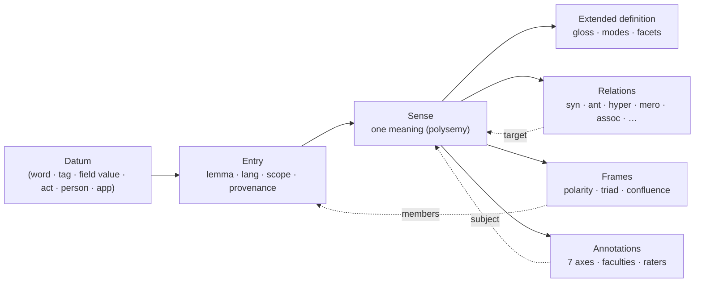
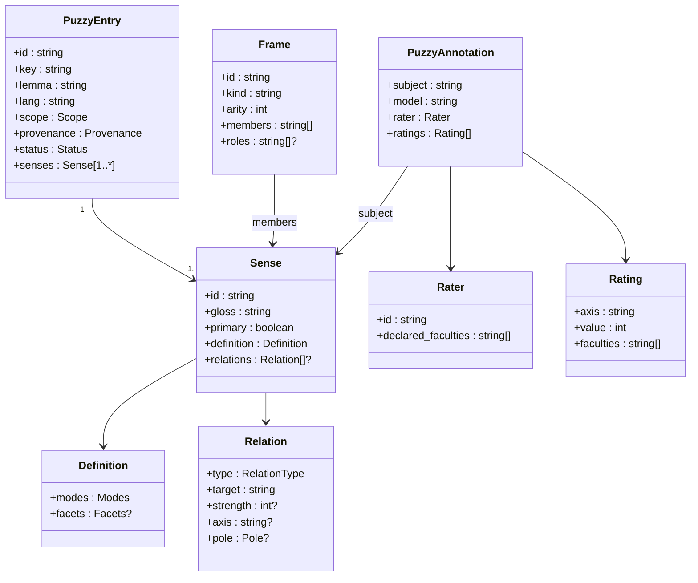

# flove · Puzzy — extended definitions, thesaurus & polysemic dictionary

**Status:** normative draft **v1** · 2026-11-15 · ships in Work phase
**F4 · Full** (archived `root/backend.md` §9). F5 is retired.
Promoted out of the archived `root/backend.md`; the `§8.x` labels below are self-contained to this
chapter. Shallower view: `README.md`.

**Work:** open items PZ04–PZ06 live in
[`work/pendings.md` §Puzzy](../wiki/work/pendings.md); Work filter:
[docs · work](https://flove.org/development/index.html#work?tab=docs&view=r2&subtab=work&category=docs&section=work).

This is the **one standard behind the whole puzzy family**: not a folder of
separate tools, but a family of *views* over one model. It defines how flove stores
an **extended definition** — a word or concept with several meanings, a rich
thesaurus of relations, and measurable relational annotations — and how that
same model is attached to **data people add inside flove apps** (a tag, a free
field, a custom value), so a definition written once can be read everywhere.

Machine-readable companions:

- [`puzzy/puzzy.schema.json`](puzzy/puzzy.schema.json) — JSON Schema 2020-12 for the wire format.
- [`puzzy/example-water.json`](puzzy/example-water.json) — a worked, valid bundle.

Conformance keywords (**MUST**, **SHOULD**, **MAY**) follow RFC 2119. A standard
sentence is normative only where it uses one of them.

---

## 8 · Puzzy

The puzzy model lets a rater express **how an object stands in relation to other
objects**, along several axes at once, grounded in the faculties, and it lets an
author express **what an object means**, in depth, with its senses and its
neighbours. The two halves share one spine: the **sense**.



### 8.1 · The abstraction — five layers, one rule

| Layer | Answers | Record |
|-------|---------|--------|
| **Datum** | *what is being defined?* | the app's own field value — never copied into puzzy |
| **Entry** | *which word/concept is it?* | `PuzzyEntry` (lemma, lang, scope, provenance) |
| **Sense** | *which of its meanings?* | `Sense` (one truth-conditional meaning) |
| **Definition** | *what does that meaning mean, in depth?* | `Definition` (gloss, modes, facets) |
| **Relation / Frame / Annotation** | *how does it stand to others?* | `Relation`, `Frame`, `PuzzyAnnotation` |

**The one rule:** *relations, frames and ratings hang off **senses**, never off
bare words.* A word with two meanings is not one node with blurred edges; it is
one entry with two sense nodes, each with its own neighbours and its own ratings.

The model is deliberately **layered, not monolithic**: an app may adopt only
the layers it needs (an app that only reads a gloss stops at P2, see §8.15) without
implementing axes or frames.

### 8.2 · Entries — identity, scope, provenance

An **entry** is the canonical record of a term. It is not the datum: the app
keeps authority over the value the user typed; the entry is its extended
definition.

| Field | Type | Rule |
|-------|------|------|
| `schema` | string | MUST be `"flove-puzzy/1"`. |
| `id` | string | Stable, never reused. Lexicon: `pz:<lang>:<slug>`; app data: `pz:app:<app>:<slug>`. |
| `key` | string | Normalised surface: NFC, trimmed, internal whitespace collapsed, casefolded, diacritics kept. |
| `lemma` | string | The display form, in the entry's language. |
| `lang` | BCP-47 | Language of the lemma. One entry per language; translations are relations (§8.5), not extra senses. |
| `pos` | enum? | Dominant part of speech. A sense MAY override it (water *n.* / to water *v.*). |
| `scope` | `Scope` | Where the entry lives and who may see it. |
| `provenance` | `Provenance` | Who or what produced it. |
| `status` | enum | `draft · suggested · published · merged · deprecated · orphaned`. |
| `senses` | `Sense[1..*]` | At least one. Order is meaningful; the first SHOULD be the primary sense. |
| `relations` | `Relation[]?` | **Entry-level only** for `same`, `trans`, `deriv`, `see`. Meaning-bearing relations go on senses. |
| `dataRefs` | `DataRef[]?` | Back-pointers to the app data that uses this entry. |
| `mergedInto` | string? | Present when `status = merged`; the surviving entry id. |
| `created` / `updated` | date-time | ISO-8601 UTC. |

**Scope**

| `kind` | Meaning | Required extras |
|--------|---------|-----------------|
| `lexicon` | a shared dictionary entry (the puzzy corpus) | — |
| `app-data` | the definition of a value a person added in an app | `app`, `field` |
| `frame` | the definition of a frame itself (a polarity, triad…) | — |
| `person` | a person, bond or rater profile | `owner`? |

`scope.privacy` is one of `private` (default), `shared`, `public`.
`scope.owner` is the rater's crypto-local pubkey when known.

**Provenance**

`source` ∈ `user · wizy · import · canon`. `author` (pubkey), `importedFrom`
(URI) and `note` are optional. Anything a machine proposes MUST carry
`source: "wizy"` and `status: "suggested"` until a human accepts it.

**Identity rules**

1. Identity is `(key, lang, scope.kind)` inside one privacy boundary. Two entries
   with the same triple in the same boundary MUST be merged, not kept side by
   side.
2. `slug` is `key` with every run of non-alphanumerics collapsed to `-`, trimmed,
   lowercased, capped at 64 chars. If the result is empty or collides, append
   `-<first 4 hex of sha1(key)>`.
3. Sense ids are `<entry id>#<ordinal>`, 1-based (`pz:en:water#1`). **Ordinals are
   never renumbered.** A new sense appends; a merged sense keeps its id and gains
   `mergedInto`.
4. Merging two entries keeps the older id, repoints every relation and
   annotation, sets the loser to `status: "merged"` with `mergedInto`. Merging
   across privacy boundaries is forbidden.
5. Splitting a sense appends new senses and leaves old ids resolvable through
   `mergedInto`.
6. An entry that is linked across apps keeps the `id` it was minted with;
   `dataRefs` are the record of every app that uses it.

**Why entries are worth the ceremony:** the alternative — six apps each storing
their own `{word, synonyms, rating}` blobs — is what this standard replaces.
One entry means a definition authored in Wisy is readable by Raty, Linky and a
tag field in Worthing without translation.

### 8.3 · Senses — the polysemic dictionary

A **sense** is *one meaning* of an entry. Polysemy is the default, not an edge
case: `water` is a substance, a body of water, and the act of irrigating. A
dictionary that collapses them is a list of homonyms pretending to be a word.

| Field | Type | Rule |
|-------|------|------|
| `id` | string | `<entry>#<n>` (§8.2). |
| `name` | string? | Short human label for the sense (`affection`, `romance`). Used by compact UIs; the gloss remains normative. |
| `gloss` | string | One neutral sentence. **MUST NOT** evaluate, praise or recommend. |
| `primary` | boolean? | True for at most one sense; the UI orders it first. |
| `pos` | enum? | Part of speech for this sense when it differs from the entry's. |
| `register` | enum? | `neutral · formal · informal · slang · technical · poetic · archaic`. |
| `domain` | string? | Free label or a Whole `field` path (`../contract.md#worldview`). |
| `definition` | `Definition` | The extended definition (§8.4). |
| `examples` | string[]? | Usage examples, in the entry's language. |
| `relations` | `Relation[]?` | Meaning-bearing edges (§8.5). |
| `note` | string? | Free editorial note; not part of the definition. |
| `status` | enum? | `active · deprecated · merged`; `mergedInto` when merged. |
| `mergedInto` | string? | The sense id that absorbed this one. |

**When is it a new sense?** Apply these tests; a "yes" on two or more means a
separate sense:

- **Zeugma** — "the water is cold and the water is long" reads as a pun.
- **Contradiction** — one sense can be true while the other is false of the same
  referent ("the water is rising" vs "the water is tasty").
- **Translation** — another language uses different words for the two meanings.
- **Predicate** — the two meanings select different typical predicates or
  arguments.

If swapping the glosses preserves truth conditions, it is **one sense** and the
difference belongs in `register`, `domain` or `examples`. If the difference is
only grammatical (mass vs count), it is one sense with a `note`.

**False friends are two entries, not two senses** when the forms merely look
alike across languages; they are linked with `same` only when they are truly the
same lexical item.

### 8.4 · The extended definition

A **definition** is what the puzzy dictionary means by "extended": a gloss plus
as many of the classical definition modes as the author needs, plus the
perspective facets that locate the meaning.

```json
{
  "modes": {
    "ostensive": ["the liquid in rain, rivers and glass"],
    "operational": "if it flows, freezes at 0 °C and dissolves salt, it is water",
    "contrastive": ["not ice (same substance, solid state)", "not brine (solution)"],
    "etymological": "OE wæter, PIE *wed- ‘wet’",
    "formal": "H₂O",
    "narrative": "the thing a city is built around and a desert is defined by lacking"
  },
  "facets": {
    "prism": { "stance": "objective", "scope": "general" },
    "tone": "normal",
    "teleology": "fine",
    "field": "science",
    "time": { "span": "present", "length": "long" },
    "warrant": "evidence"
  }
}
```

**Definition modes** (all optional except the gloss, which lives on the sense):

| Mode | What it adds | Canonical wing |
|------|--------------|----------------|
| `ostensive` | points: examples, instances, non-examples | Wisy · Fivy |
| `operational` | a test: how to tell whether something is an X | Wisy · Comby |
| `contrastive` | what it is not: nearest opposites and complements | Poly |
| `etymological` | origin, formation, sound-shape | Loly |
| `formal` | symbolic or axiomatic statement | Wisy · Comby |
| `narrative` | a story or scenario of use | Fugy |
| `relational` | *derived*, not authored: the sense's thesaurus position (§8.5) | Vizy2 · Linky |
| `sensory` | *derived*: how the meaning presents to the faculties (§8.9) | Raty · Fivy |

**Definition facets** — the perspective layer, taken from Wisy's five rails and
Comby's warrant:

| Facet | Values | Meaning |
|-------|--------|---------|
| `prism.stance` | `subjective · objective` | whose side the definition speaks from |
| `prism.scope` | `momentual · general` | whether it holds now or in general |
| `tone` | `normal · funny · formal · trivial` | how it is said |
| `teleology` | `experimental · random · fine · fatal` | where the definition is heading |
| `field` | `metaphysics · science · biology · psychology · sociology`, a lowercase Whole field id, or `x-…` | the discipline the meaning belongs to |
| `time.span` | `past · present · future` | when the meaning holds |
| `time.length` | `short · mid · long` | over what horizon |
| `warrant` | `evidence · axiom · prediction · proposal · challenge · case-study · review · sources` | the epistemic standing of the claim |

Facets are **optional**. A definition with only a gloss is valid; it is simply
**minimal**. Completeness is reported, never enforced:

- **minimal** — gloss only.
- **standard** — gloss + at least one of `ostensive · operational · contrastive · formal · narrative`.
- **rich** — standard + at least two modes + one facet group + either two
  relation types or one frame.

**Neutrality rule.** The gloss states what the word means, not whether it is
good. Evaluation belongs in annotations (a rating) or in `examples` clearly
attributed to a speaker. This is what keeps a public thesaurus from becoming an
opinion feed.

### 8.5 · The thesaurus — relations between senses

Relations are **edges**, not copies. Each edge is stored once, in one direction;
readers derive the inverse. This is the part that makes puzzy a *rich thesaurus*
rather than a list of synonyms.

| `type` | Inverse | Symmetric | Attaches to | Meaning | Wing |
|--------|---------|-----------|-------------|---------|------|
| `syn` | `syn` | yes | sense | substitutable in some context (declare the context in `note`) | Linky |
| `near` | `near` | yes | sense | close but not substitutable | Linky |
| `ant` | `ant` | yes | sense | opposite; `axis`/`pole` recommended | Poly · Raty |
| `comp` | `comp` | yes | sense | complementary, not opposite (yin/yang, give/take) | Poly |
| `hyper` | `hypo` | no | sense | broader term (water → liquid) | Linky |
| `hypo` | `hyper` | no | sense | narrower term (water → rain) | Linky |
| `holo` | `mero` | no | sense | whole (river → water) | Linky |
| `mero` | `holo` | no | sense | part (water → river) | Linky |
| `deriv` | — | no | entry | derived form (water → watery) | Loly |
| `coll` | `coll` | yes | sense | habitual co-occurrence (water → still) | Linky |
| `assoc` | `assoc` | yes | sense | free association, strength 0–10 | Linky |
| `see` | `see` | yes | either | editorial "see also" | Vizy2 |
| `trans` | `trans` | yes | entry | same lexical item in another language | — |
| `frame` | — | no | sense | member of a named frame (§8.6) | Fivy · Confluenty |
| `same` | `same` | yes | entry | duplicate/merge link; strength ignored | — |
| `x-…` | — | — | either | app-defined extension; MUST be documented by the app | — |

**Relation object**

```json
{
  "type": "ant",
  "target": "pz:en:dry#1",
  "strength": 9,
  "axis": "x-moisture",
  "pole": "left",
  "source": "user",
  "note": "water is wet"
}
```

- `target` MUST be a sense id, except for `deriv · trans · same · see`, which may
  point at an entry id.
- `strength` is an integer 0–10 (`Linky`'s scale) and is **optional**. Its
  absence means the relation is asserted absolutely, not measured.
- `axis` + `pole` (`left · mid · right`) turn an antonym into a position on a
  known spectrum; `axis` MAY name one of the seven canonical axes (§8.7) or a
  custom axis id.
- `source` ∈ `user · wizy · import · canon`; `wizy` relations are suggestions
  until accepted, like every machine contribution.
- `external: true` + `label` allow an edge to a target outside the current
  bundle without inventing a dangling id.

**Rules**

1. **Sense-level synonymy.** `syn` asserts substitutability *of a sense*, not of
   a word. Two words that share one sense but differ in another MUST be linked
   at the shared sense only.
2. **Antonyms need an axis when one exists.** `ant` without `axis` is allowed,
   but a canonical axis SHOULD be named; `pole` makes the direction explicit.
3. **Do not store both directions.** If both `hyper` and `hypo` edges are found
   on import, keep one and drop the duplicate.
4. **Strength is not confidence.** Confidence belongs in `source` + the rating
   model; `strength` is how strongly the two terms link.
5. **Relations are themselves ratable.** A relation MAY carry
   `annotations` in implementations that want to record disagreement about an
   edge; the v1 bundle keeps this out of the wire format to stay small.

### 8.6 · Frames and the relational primitives

Three primitives operate over the same object, each at a different relational
cardinality and each presented as an **independent view**:

| Primitive | Arity | View question | Wing |
|-----------|-------|---------------|------|
| Polarity | 2-ary | What is its opposite? | Poly |
| Triad | 3-ary | What three terms form a complete frame? | Keys · Triady |
| Confluence | 5- or 7-ary | What family of complementary opposites holds it? | Confluenty · Fivy |

Confluence at 5 and at 7 are **distinct levels** (mirroring §8.8).
**Combos are explicitly out of the standard**: each app may run its own
combinatorial generator over selected words (Comby), but combos are not part of
the inter-app schema.

A **frame** is a first-class object because it can be named, defined and rated:

```json
{
  "id": "pz:frame:water-fire",
  "kind": "polarity",
  "arity": 2,
  "members": ["pz:en:water#1", "pz:en:fire#1"],
  "mid": null,
  "roles": ["left", "right"],
  "note": "the classical element pair",
  "scope": { "kind": "frame", "privacy": "public" }
}
```

`kind` ∈ `polarity · triad · confluence`; `arity` ∈ `2 · 3 · 5 · 7`. `members`
SHOULD be sense ids; `roles` is an optional label per member (Confluenty's
dimensions: organism, inner/middle/outer, past/present/future, the faculties,
the elements, vowels, tastes). A frame's own definition is an ordinary entry with
`scope.kind: "frame"` — the model is recursive, so "what is a triad?" is a
definable question.

### 8.7 · The seven canonical bipolar axes

The seven axes are **universal** — the same axes apply to every kind of object.
They are taken from the original `Puzzy/Relate/Rate` prototype; the reference
implementation is [`apps/puzzy/raty.html`](../../apps/puzzy/raty.html):

| # | Left pole  | Mid (if any) | Right pole  |
|---|------------|--------------|-------------|
| 1 | INTENSE    | EQUAL        | BANAL       |
| 2 | SIMILAR    | COMPLEMENT   | DIFFERENT   |
| 3 | ABSTRACT   | —            | CONCRETE    |
| 4 | POSITIVE   | —            | NEGATIVE    |
| 5 | CLOSE      | —            | FAR         |
| 6 | PRIMARY    | —            | SECONDARY   |
| 7 | UNKNOWN    | —            | KNOWN       |

Each axis takes an integer **1–7**. Axes 1 and 2 carry a meaningful mid-value;
on the other five, 4 means "balanced / undecided". Users may add custom axes;
wizy suggests new axis pairs as the corpus grows. Custom axis ids MUST use the
`x-` prefix so they never collide with canonical axes.

**Metascales.** The seven axes and the five faculties together form the
**metascales** — the invariant layer every sense is viewed through, whatever its
domain. A full view renders them as one grid: rows are the faculties, columns are
the axes, and a marked cell means that faculty informed that axis rating. The
grid is **derived** from the annotation (§8.11), never stored twice. Reference
full view: [`apps/puzzy/love.html`](../../apps/puzzy/love.html).

### 8.8 · 5-axis and 7-axis are different relational models

The two cardinalities are **distinct relational levels, not nested**: a 5-axis
rating is *not* a 7-axis rating with two missing values. An annotation is made
under exactly one model and records which one in its `model` field. The
reference UI exposes this as a top-level toggle.

### 8.9 · Faculties — the five senses as meta-rater

> **Naming note (v1).** The dictionary already uses *sense* for a meaning
> (§8.3). To end the collision, the five perceptual channels — hearing, touch,
> sight, taste, smell — are called **faculties** in this standard. The legacy
> wire keys `senses` / `declared_senses` are accepted as aliases of `faculties`
> / `declared_faculties`; writers SHOULD emit the new names.

The five faculties (`hear · touch · view · taste · smell`) operate on two planes
at once:

1. **Rater profile.** Each rater declares the faculties they relate to. This is
   a property of the rater, persisted alongside the `pubkey` in their identity.
2. **Per-rating meta-rater.** Inside any single rating, the rater multi-selects
   which of their declared faculties informed *that* particular rating.

A faculty the rater has not declared in their profile cannot be selected on a
rating; the reference UI dims those pills to make this visible.

### 8.10 · Multiplicity within one rater

In flove, "multi-rater" means **multi-selection inside a single rater's
annotation** — multiple faculties, multiple terms, multiple frame members. Each
human contributes one and only one annotation per subject; editing replaces it
and bumps `updated`. Aggregation across human raters is a *view* over the
collection (§8.12), never a mutation of anyone's annotation.

### 8.11 · `PuzzyAnnotation` schema



**Legacy compatibility.** The original `PuzzyAnnotation.primitives`
(`polarity · triad · confluence_5 · confluence_7`) is **deprecated**: its content
moves to `Frame` objects and `Relation{type:"frame"}`. Readers MUST accept
`primitives` and map it; writers SHOULD NOT emit it.

Annotation JSON:

```json
{
  "subject": "pz:en:water#1",
  "model": "7-axis",
  "rater": {
    "id": "pk:7f3a…",
    "declared_faculties": ["view", "touch", "taste"]
  },
  "ratings": [
    { "axis": "INTENSE-BANAL", "value": 2, "faculties": ["view", "touch"] },
    { "axis": "CLOSE-FAR", "value": 3, "faculties": ["touch"] }
  ],
  "created": "2026-11-15T09:00:00Z",
  "updated": "2026-11-15T09:00:00Z"
}
```

### 8.12 · Aggregation and compute

- **Aggregation across raters** → **mean + dispersion** (statistical summary:
  average + spread), resolved in `../wiki/archive/old/plans/puzzy.md`. Never a "winner".
  Display example: `4.2 ± 0.8` or `★★★☆☆ (±1.2)`.
- **Where the compute lives** → **hybrid with offline cache**: client-first,
  server fallback, cache invalidated on a new rating.
- **Consensus vs dissent** is a derived view (spread), not a separate record.
- **Temporal trajectories** of a rating are a replay of `updated` snapshots, not
  an extra field.

### 8.13 · Applying puzzy to data added in flove apps

This is the part that makes puzzy a *project-wide* standard rather than a family
of dictionary toys. Any value a person adds inside an app — a free tag, a custom
label, a named idea, a word in a list — can carry an extended definition, and
that definition is the same object the dictionary uses.

#### 8.13.1 · Annotability is declared, never assumed

A field becomes puzzy-annotable through its `flove-fields` manifest. The block
is optional and defaults to *off*:

```json
{
  "id": "tags",
  "label": "Tags",
  "type": "text[]",
  "puzzy": {
    "annotate": true,
    "free": true,
    "kinds": ["word", "concept"],
    "auto": false
  }
}
```

| Key | Default | Meaning |
|-----|---------|---------|
| `annotate` | `false` | values in this field may be minted as `PuzzyEntry` records |
| `free` | `false` | values are user-authored (not an enumerated `pick`/`multi` list) |
| `kinds` | `["word"]` | what the value is: `word · concept · act · person · app · place · frame` |
| `auto` | `false` | mint on first use without an explicit gesture — **MUST stay false** in v1 |

`tools/extract-fields.py` copies field objects verbatim into
`tools/routing.json`, so the block survives extraction without a schema change.
Consumers that do not understand `puzzy` MUST ignore it.

**Enumerated (`pick`/`multi`) fields** are controlled vocabulary: the app SHOULD
reference an existing lexicon entry rather than mint an `app-data` entry. Free
text is where `app-data` entries belong.

#### 8.13.2 · Mint on intent, link before mint

1. A value MUST NOT be turned into an entry silently. It is minted on a user
   gesture (define, relate, rate, open-in-puzzy), or when the app opens a puzzy
   wing with the value pre-filled.
2. Before minting, the app MUST look for an entry visible to the user with the
   same `key + lang` — preferring a `lexicon` entry, then one in the same privacy
   boundary — and **link** it instead (`dataRefs`), never duplicate it.
3. Minting creates `scope: { kind: "app-data", app, field, owner, privacy }`,
   `provenance.source: "user"`, `status: "draft"` and `dataRefs[0]` describing
   the datum.
4. A machine suggestion (wizy) is `status: "suggested"` and does not count as
   minted until accepted.

#### 8.13.3 · The datum stays authoritative

The app's own field value remains the source of truth for *what the user typed*.
The entry is the definition of *what it means*. Concretely:

- Editing the datum updates the value in the app; it does not rewrite the entry's
  lemma or key. If the surface changes materially, the app unlinks the datum and
  MAY mint a new entry.
- Deleting the datum removes its `DataRef`; the entry becomes `orphaned` when it
  has no refs left and lives only in `app-data` scope. Orphans MAY be reaped after
  the user confirms; `lexicon` entries are never reaped this way.
- The entry MUST NOT be used as the app's storage for the value. Two apps
  sharing a definition still own their own rows.

#### 8.13.4 · Privacy inherits, publication is explicit

- An `app-data` entry's privacy is at most the privacy of the datum it defines:
  a private row never produces a `public` entry through the normal path.
- Publishing (to Appy, nety, the common area) is a separate, explicit action.
- Local-first storage (`window.floveStore`, §8.14) is the default; sync is opt-in.
- A `public` lexicon entry may be referenced by private app data, but the reverse
  is forbidden: a public entry MUST NOT contain private `dataRefs`.

#### 8.13.5 · Where the hooks live

| Surface | Hook | Contract |
|---------|------|----------|
| `flove-fields` manifest | `field.puzzy` | annotability, §8.13.1 |
| `tools/routing.json` | `apps[].fields[].puzzy` | copied by the extractor; read by questy/appy |
| `flove-portrait/1` | optional `puzzy` arrays | entries travel with the export, §8.14 |
| `flove-puzzy/1` | standalone bundle | share / merge / import, §8.14 |
| `window.floveStore` | `puzzy:*` keys | local persistence, §8.14 |
| Appy profile | `puzzy.entries` ids | profile references, never copies |

**What apps MUST NOT do:** invent a parallel thesaurus format, copy definitions
into their own export as prose, mint entries for every keystroke, or treat the
entry as a replacement for their fields. Puzzy is a *shared definition layer*,
not a CMS.

**Worked case — a tag in Worthing.** A person adds the tag `abundance` to a
spending row (field declared `puzzy: {annotate:true, free:true}`). They tap
"Define". The app finds no visible entry, mints
`pz:app:worthing:abundance` with one sense, `scope.app: "worthing"`,
`scope.field: "tags"`, and a gloss. They add a contrastive mode ("not excess")
and a `comp` relation to `scarcity`. Later, Wisy opens the same entry by id; a
second person rates its first sense on Raty. Nothing was copied; all three apps
read one record.

### 8.14 · Wire format and persistence

**The bundle** is the only interchange shape:

```json
{
  "schema": "flove-puzzy/1",
  "version": 1,
  "generatedAt": "2026-11-15T09:00:00Z",
  "app": "worthing",
  "entries": [],
  "frames": [],
  "annotations": [],
  "note": "optional"
}
```

Rules:

- `schema` MUST be `"flove-puzzy/1"`; `version` is the integer of the same major.
- `entries`, `frames`, `annotations` are always arrays, even when empty.
- Unknown keys MUST be preserved on import (§8.17).
- The bundle is the JSON payload; the human formats are renderings of it. Per
  §13.12 the summary may render definitions as Markdown/HTML/CSV/JPG, but JSON
  is the authoritative shape.

**Local storage** (through `window.floveStore`):

| Key | Value |
|-----|-------|
| `puzzy:entry:<id>` | one entry JSON |
| `puzzy:frame:<id>` | one frame JSON |
| `puzzy:annotation:<subject>` | annotation array for that subject |
| `puzzy:index` | `[{id, lemma, lang, scope.kind, status}]` for fast listing |

**Envelope integration:** `flove-portrait/1` MAY carry
`"puzzy": { "entries": [...], "frames": [...], "annotations": [...] }` (the same
arrays, not a second schema). Appy imports the ids; it does not flatten the
definitions into its profile text. The six-format export (§13.12) adds a
**Definitions** section to the summary when the app has annotable data.

### 8.15 · Conformance levels

The standard is adopted in steps. An app is conformant at the highest level it
meets; **no app is required to go past P0**. Levels are cumulative — P2 implies
P0 and P1.

| Level | Name | Requirement |
|-------|------|-------------|
| **P0** | Aware | Declares `field.puzzy` for its free fields; links to this chapter; ignores unknown puzzy keys safely. |
| **P1** | Mint | Can create or link a local `PuzzyEntry` for an annotable datum, on gesture. |
| **P2** | Read | Renders the gloss and top relations where the datum appears (no writing). |
| **P3** | Rate | Exposes axis ratings + faculties on a sense, and stores a `PuzzyAnnotation`. |
| **P4** | Share | Imports/exports a `flove-puzzy/1` bundle and merges by id without duplicates. |

**Adoption checklist**

- [ ] Free-text fields declare `puzzy.annotate` + `puzzy.free`; enumerated fields
      do not (§8.13.1).
- [ ] No silent minting; link-before-mint (§8.13.2).
- [ ] Privacy inherited; publication explicit (§8.13.4).
- [ ] `flove-puzzy/1` round-trips; unknown keys preserved (§8.14, §8.17).
- [ ] Legacy `senses`/`declared_senses`/`primitives` accepted on read (§8.9, §8.11).
- [ ] At least one worked definition exists in the app's own domain.

**State at v1:** the wings author definitions (Wisy, Raty, Linky, Poly,
Confluenty, Fivy, Comby, Keys) and the puzzy launcher declares its 44 fields, but
no app yet writes a `flove-puzzy/1` bundle. P0 is therefore the current ceiling
across the distro; the P0→P4 path is tracked in `../wiki/work/pendings.md` (§ Puzzy).

### 8.16 · The wings — one model, many views

| App | Role in the standard | Layer | Target level |
|-----|----------------------|-------|--------------|
| **Wisy** | authors the extended definition: prism, tone, teleology, field, time, formalise | Definition | P1 → P4 |
| **Raty** | rates a sense on the seven axes with the faculties as meta-rater | Annotation | P3 |
| **Poly** | polarity frames and the contrastive mode (bias balancing) | Frame · Definition | P1 |
| **Linky** | free association with 0–10 strength; the thesaurus seed | Relation | P1 |
| **Confluenty** | 5- and 7-ary confluence frames with role columns | Frame | P1 |
| **Fivy** | orders decks, lists and cycles; maps senses to confluences | Frame · ordering | P1 |
| **Keys / Triady** | triad frames and rank orderings | Frame | P1 |
| **Comby** | combinations and the `warrant` facet; **combos stay out of the wire format** | Definition (facets) | P1 |
| **Loly** | phonology and sound-shape: the etymological mode | Definition | P1 |
| **Fugy** | weaves a definition as a fugue: the narrative mode | Definition | P1 |
| **Vizy / Vizy2** | render the model: the woven phrase, the semantic mind-map | Read | P2 |
| **Sety** | language, scales and defaults for the whole tool | Config | — |

[`apps/puzzy/index.html`](../../apps/puzzy/index.html) is the launcher;
[`apps/puzzy/raty.html`](../../apps/puzzy/raty.html) is the reference rating
implementation (and the pruned-inline template named in `contract.md`).
[`apps/puzzy/love.html`](../../apps/puzzy/love.html) is the reference **full
view** (the `love` seed: grouped entrance cards, metascales, senses with the
faculty cards, Linky's hypernym/hyponym intro, frames, extended definition with
the Music field).

### 8.17 · Versioning, extension, and what stays open

- **Extension.** App-defined relation types, axes and fields use the `x-` prefix.
  Unknown keys MUST be preserved through read → merge → write. A reader MUST NOT
  drop an object it does not understand.
- **Deprecation.** A field or relation type is deprecated by documentation first;
  an entry by `status: "deprecated"`. Removal requires a major bump; `mergedInto`
  keeps old ids resolvable forever.
- **Breaking changes** bump `flove-puzzy/<major>`; additive changes keep the same
  major.
- **Identity across scripts.** Slug collisions and non-Latin surfaces are
  resolved by the hash suffix in §8.2, not by transliteration; `lemma` keeps the
  original script.
- **Deliberately out of scope:** combos as an inter-app type; tiers; the Whole
  taxonomy itself (puzzy references it, never duplicates it); central sync and
  moderation (backend concerns, not the dictionary model).

<a id="aggregation-and-compute-decisions"></a>

**Open questions**

- ✅ **Aggregation across human raters** → **Mean + dispersion** (statistical summary: average + spread)
- ✅ **Where the puzzy compute lives** → **Hybrid with offline cache** (client-first, server fallback)
- **Which app fields admit free tags** — declared per-app in the `flove-fields`
  manifest / `routing.json` (§8.13.1); the canonical catalogue fills as each app
  declares its `puzzy` block.
