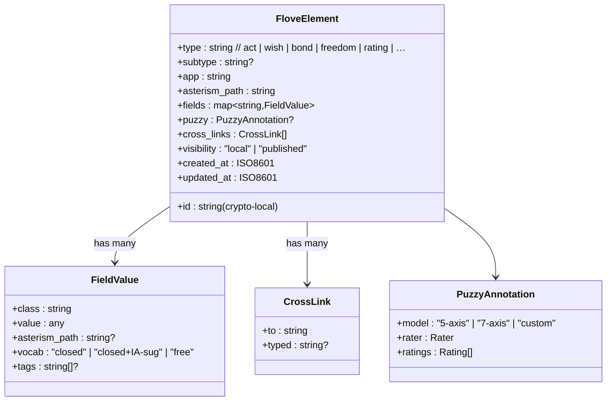

<!-- CONTEXT:BEGIN
schema: flove-page/1
id: data/schemas
path: development/standards/schemas.md
trunk: data
topic: schemas
kind: topic
status: stable
html_place: ["#data"]
owns: ["Schemas", "storage keys", "flove-auth"]
updated: 2026-11-21
read_next: ["#data-classes-and-privacy-invariants","#schema-envelopes","#floveelement-schema","#palette","#identity-registry","#validation","#collect-contract","#oasis-classes","#messages-schema","#puzzy-schema","#puzzy-aggregation","#schema-plan"]
supersedes:
  - development/wiki/archive/old/apps/README.md
  - development/wiki/archive/old/bridges/oasis.md
  - development/wiki/archive/old/browsy/browsy-questions.md
  - development/wiki/archive/old/browsy/pre-build/02-authy-levels.md
  - development/wiki/archive/old/browsy/pre-build/03-schemas.md
  - development/wiki/archive/old/browsy/pre-build/04-myfamily-profile.md
  - development/wiki/archive/old/browsy/pre-build/09-consult-agreements.md
  - development/wiki/archive/old/browsy/rationale.md
  - development/wiki/archive/old/browsy/spec.md
  - development/wiki/archive/old/plans/2026-11-17-appy-authy-mynet.md
  - development/wiki/archive/old/plans/2026-11-21-app-database-stages.md
  - development/wiki/archive/old/plans/central-backend.md
  - development/wiki/archive/old/plans/puzzy.md
  - development/wiki/archive/old/root/backend.md
heavy: false
CONTEXT:END -->

# Schemas

> **Pilot migration (phase 2).** This page imports `browsy/spec.md` §3.2, the
> schema half of §3.7 and the identity record from §3.8.

## Data classes and privacy invariants

> Source: `development/wiki/archive/old/browsy/spec.md#32-data-classes-and-privacy-invariants` (archived 2026-11-21).

| Class | Meaning | Movement |
|---|---|---|
| **P — Personal** | private data and keys; **Private** visibility | encrypted vault; never leaves unencrypted |
| **L — Local** | records **shareable** with named peers or groups | direct, encrypted per recipient, session by session |
| **S — Social = Public** | published data; **Social** and **Public** are synonyms | Nety (and optional Central mirror) |
| **D — Derived** | Wizy outputs | local by default; shared only by explicit export |
| **M — Metadata** | grants, peer list, audit | encrypted vault; minimal disclosure |

Invariants:

1. P is never present in an S bundle.
2. L is a projection under a signed grant; no “share whole vault” path.
3. Revocation is forward-only; copies cannot be recalled. TTL + key rotation
   are the mitigations.
4. Every received bundle is signature-checked before merge.
5. Defaults are private; widening is an explicit user act.
6. Nety never learns who pulls from whom locally.
7. Linking a channel never re-derives the identity root.
8. Promotion is explicit: P → L or S, and L → S, only by the owner. L never
   becomes Public automatically; S is the only class that reaches Nety.

## Schema envelopes

> Source: `development/wiki/archive/old/browsy/spec.md#37-interfaces-and-files`
> and `#38-browsy-extension-standards-draft` (archived 2026-11-21).

| ID | Shape |
|---|---|
| `flove:authy/1` (schema `flove-authy/1`) | `{schema, level, identities[], channels{...}, updatedAt}` |
| `flove-bundle/0.1` (proposed) | owner, class, documents[], grants[], signature |
| `flove-group/0.1` (proposed) | id, name, kind, memberIds, roles, defaultClass, visibility, projection, keyId, version, signature |
| `flove-consult/1` (proposed) | owner, member, wizy, scope{personIds, groupIds, paths, capabilities}, purpose, expiresAt, version, signature |
| `flove-auth/1` (portable auth) | `{schema, handle, levels{self,telegram,phone,bio}, claims[], visibility, updatedAt}`; signed by Authy; no secrets/raw phone/Telegram tokens |
| `flove-identity/1` (Q010) | `{schema, hash, publicKey, source, createdAt, label?}`; `flove-browsy/1` is a read-only view; `flove:authy.self.browsyHash` is a display cache |

The identity hash formula and its generation rules are owned by
[`apps.md#browsy-extension-standards-draft`](apps.md#browsy-extension-standards-draft).

## Work

11 hitos · 66 tasks · 9 open · 2 closed. This page owns the `data/schemas`
chapter.

## FloveElement schema

> Source: `development/wiki/archive/old/root/backend.md#35--floveelement-schema-canonical` (archived 2026-11-21).

The F0 snapshot already follows the top-level shape; §3 adds per-field metadata,
the upper-class mapping and the per-sub-field `asterism_path`.

## Palette out of routing.json

> Owner: schemas. The palette has its own schema id and storage key; routing no
> longer carries it.

## Identity registry

> Owner: schemas. `flove-identity/1` is the one writer; `flove-browsy/1` is a
> read-only view; legacy migration is explicit.

## Per-app validation

> Owner: schemas. `collect-schemas.json` validates payloads; malformed data is
> rejected with a readable reason.

## collect() contract

> Owner: schemas. The `collect()` payload conforms to declared `flove-fields/1`;
> PEN005 is closed or explained.

## FloveElement and Oasis classes

> Owner: schemas. `FloveElement` and `asterism_path` map to universal Oasis
> classes: one flove concept → one Oasis type.

## Messages and chat_ephemeral

> Owner: schemas. The messages schema names sender, recipient/room, body,
> timestamp and the ephemeral policy; it reuses flove-profile vocabulary.

## Puzzy schema

> Owner: schemas. Entries, senses and frames have one schema decision and one
> storage key; see `puzzy.md` for the model.

## Puzzy aggregation decisions

> Owner: schemas. Aggregation is mean + dispersion; compute is hybrid with
> offline cache; no rule is chosen twice.

## Schema plan

> Owner: schemas. All schema ids and storage keys resolve to one owner and no
> retired alias remains.

## Sources

- `development/wiki/archive/old/browsy/spec.md` §3.2, §3.7, §3.8.
- `development/wiki/archive/old/browsy/pre-build/03-schemas.md`,
  `04-myfamily-profile.md`, `09-consult-agreements.md`.

## Source map

| Archived source | Date | Stable home |
|---|---|---|
| `apps/README.md` | undated | development/standards/schemas.md |
| `bridges/oasis.md` | undated | development/standards/schemas.md |
| `browsy/browsy-questions.md` | undated | development/standards/schemas.md |
| `browsy/pre-build/02-authy-levels.md` | undated | development/standards/schemas.md |
| `browsy/pre-build/03-schemas.md` | undated | development/standards/schemas.md |
| `browsy/pre-build/04-myfamily-profile.md` | undated | development/standards/schemas.md |
| `browsy/pre-build/09-consult-agreements.md` | undated | development/standards/schemas.md |
| `browsy/rationale.md` | undated | development/standards/schemas.md |
| `browsy/spec.md` | undated | development/standards/schemas.md |
| `plans/2026-11-17-appy-authy-mynet.md` | 2026-11-17 | development/standards/schemas.md |
| `plans/2026-11-21-app-database-stages.md` | 2026-11-21 | development/standards/schemas.md |
| `plans/central-backend.md` | undated | development/standards/schemas.md |
| `plans/puzzy.md` | undated | development/standards/schemas.md |
| `root/backend.md` | undated | development/standards/schemas.md |

Chapters without a separate source row are `milestone-only`: they are
specified from the register (hitos and tasks) and remain owned here.
