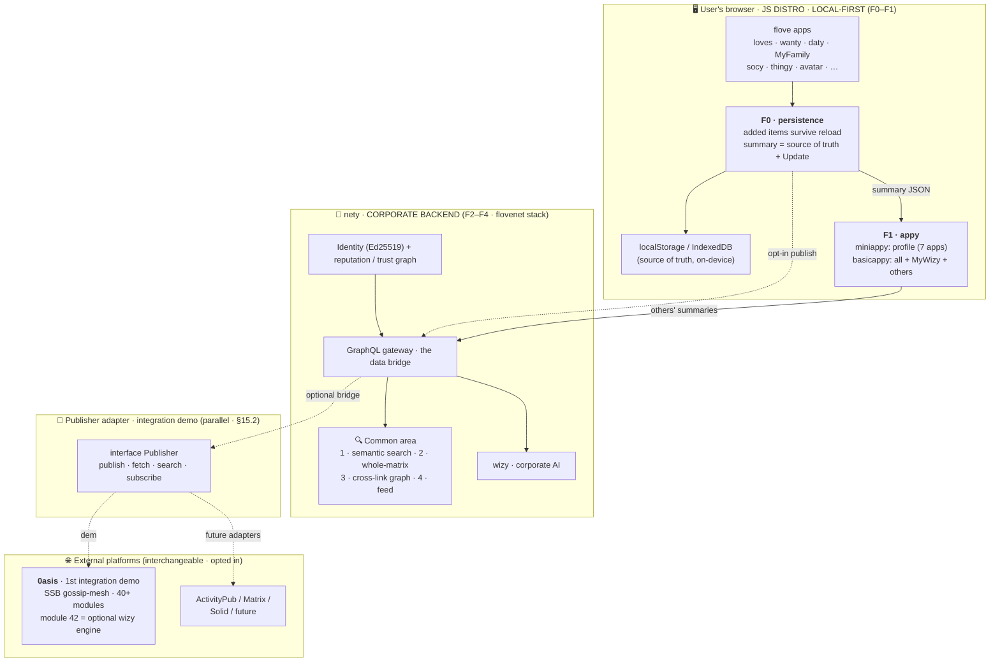
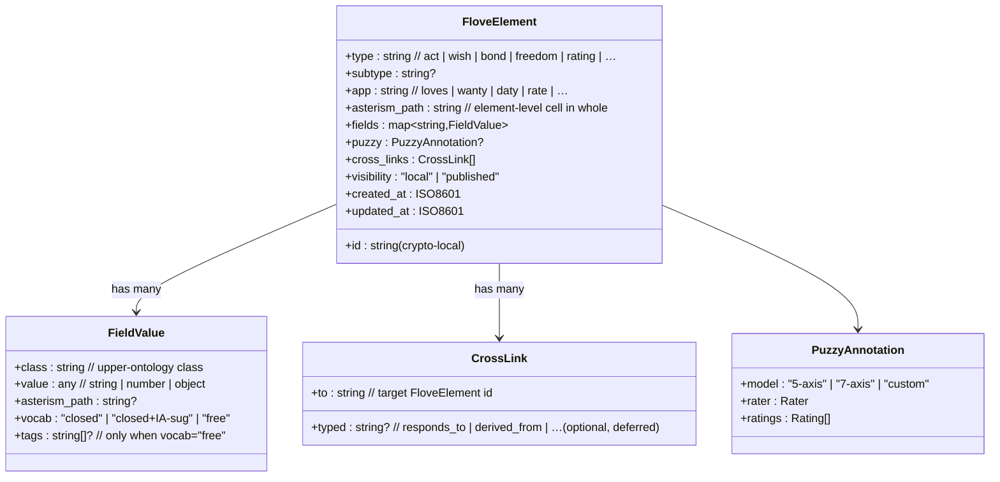
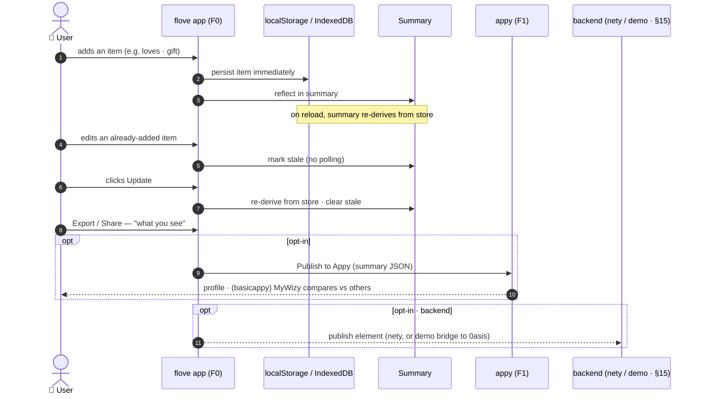
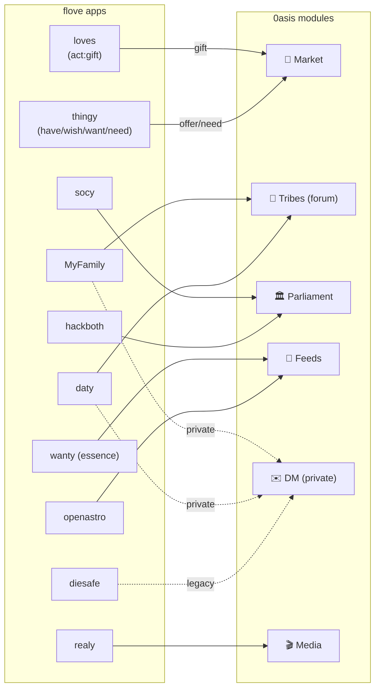
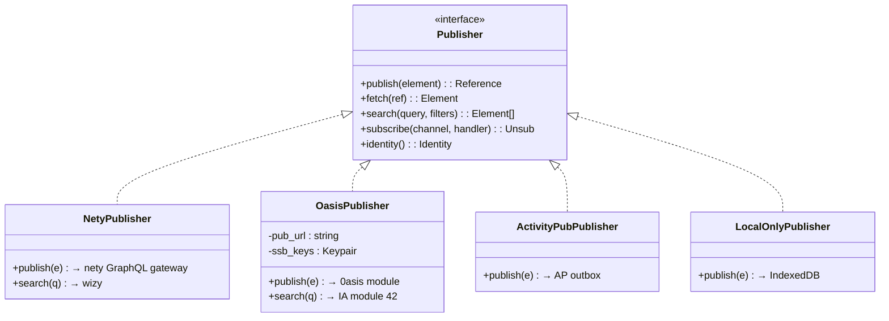
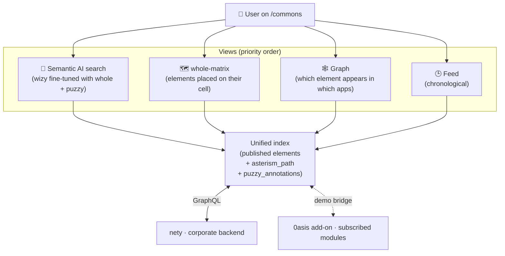

# flove · Specification & Backend Roadmap

> **Quick map:** the standards index is `README.md`; this file is the deep reference.
> **Implementation plans & conflicts:** [`plans/index.md`](debates/plans/index.md)

> Living document. Captures the **design decisions, architecture and phased
> roadmap** for turning
> the constellation of flove demos into a portable, local-first system
> that can publish to **0asis** and to other distributed platforms in
> the future.

> **Architecture note (2026-08-01):** the roadmap below predates the
> central-first reorganisation. **This file is now the all-backends overview.**
> The live architecture is **Central + Browsy = CORE** (§11):
> Central (FastAPI + Turso) is the data bank + frontend home, browsy is the
> main navigation + identity/trust bridge, and **nety** is a P2P extension
> (`decentral/`), not the corporate backend. §2 and §15 remain as the historical
> roadmap — for the current spec see §11, `adoption.md`, and
> `plans/central-backend.md`. The Work register uses five phases **F0–F4** (old
> F5 and Next are retired; phases are F0–F4), so its F2–F4 labels stay historical.
>
> ### Backends overview (2026-08-01)
>
> flove has three backends, each at a different layer:
>
> - **Central (FastAPI + Turso)** — the canonical data bank + frontend home.
>   Serverless on Railway (`flove.org/api/*` via GitHub Pages proxy), full CRUD,
>   web-first. Source: planned `addons/backend/` (not present yet). Deep spec: `plans/central-backend.md`.
> - **Decentral (nety)** — the P2P network layer, SQLite per peer
>   (`apps/sys/nety/`, separate repo floveorg/nety). Serves the community side.
> - **Browsy** — the main navigation app: a browser extension
>   (`apps/sys/browsy/`) that fetches HTML from Central (or solo fallback) and
>   bridges identity/trust (the pro-enrichment gift gate). Updates via
>   `addons/` (JS and CSS).
>
> **Canonical development** now lives in `apps/`; `central/apps/` is retired.

Status: **draft v0.3** · Owner: Marc · Updated: 2026-06-25

---

## In this file

| § | Chapter |
|---|---|
| 0–1 | Executive summary · decisions already closed |
| 2–4 | Architecture · the flove element · its life cycle |
| 5–8 | Routing · Publisher adapter · traceable area · puzzy engine |
| 9 | Roadmap — index + plans; the 2026-06 phases are archived |
| 10 | Strategic persistence — P0/P1/P2, storage; long form in debates |
| 11 | Central distro — summary; full plan in `debates/plans/central-backend.md` |

## 0 · Executive summary

**flove** is a local-first constellation of small client-side apps
expressing a relational worldview ("flow + love").  This plan turns
that constellation into a backed-by-the-network experience **without
breaking its local-first nature**.

Two principles drive every decision:

1. **Local-first.** Nothing leaves the user's device unless they
   explicitly publish. Each app **persists what you add** (it survives
   reload / close / reopen), the summary is the source of truth you
   **export "as you see it"**, and an **Update** button reconciles
   edits — no background polling.
2. **A corporate backend, plus portability.** flove's own backend is
   **`nety`** (on the flovenet stack), which serves the community side.
   flove stays a *portable semantic layer*: a `Publisher` adapter also
   lets it **integrate into existing external backends** — [**0asis**](https://0asis.net)
   first (a demo), then ActivityPub / Matrix / Solid. 0asis is an
   add-on, not the corporate backend.

The plan runs on **three strands** (§9, detail in §15): the **JS distro**
that ships today — **F0** = the **`mini` tier + its `minifull` variant**
of every app, fully-local + persisted (the `miniappy`/`minifull` profiles
aggregate your own summaries offline), and **F1** = the **`basic` tier** +
light enrichment (query the *local* AI **`MyWizy`** + punctual content
download). *(Tiers = horizontal stepper; `-full`/`-raw`/`-one`/`-css`
variants = vertical axis — §13.1.)* The **`nety` corporate backend** (**F2–F4**)
that serves identity, the common area, the global AI (**wizy** of Athenea)
and puzzy aggregation; and the parallel, deferred **external-platform
integration demo** (0asis et al.).

The end-state is a **polysemic dictionary** built from the bottom up:
every published element becomes a multi-rated, multi-related object
in a community-curated vocabulary, searchable via an AI fine-tuned on
the flove corpus (the **Whole** taxonomy in `docs/index.html` + the puzzy
primitives).

---

## 1 · Decisions already closed

| # | Topic | Decision |
|---|---|---|
| 1.1 | Accounts | No registration to use; an account appears **only when publishing** |
| 1.2 | Puzzy protocol | A multi-dimensional, relational, polysemic annotation system on user-defined objects (1–7 bipolar scales × 7 axes × sensory meta-raters × multi-rater aggregation × polarity / confluence / triad / combo primitives × WISE epistemic framework) |
| 1.3 | Corporate backend | **`nety`** — flove's own backend, on the flovenet stack (Ed25519 identity, reputation / trust graph, resources, GraphQL gateway). *Updated 2026-06-23:* nety is the corporate backend; **0asis is no longer "the backend of reference"** but the **first integration demo** (§1.7) |
| 1.7 | External-platform integration | **0asis.net** (and later ActivityPub / Matrix / Solid) is an **optional add-on / integration demo** reached via the `Publisher` adapter — proving flove plugs into existing backends. Not a runtime dependency of the corporate backend |
| 4.1 | What is an "element" | A **puzzy object** OR a **person/bond** |
| 4.2 | Cross-app sharing | **Common pool** PLUS **direct field-to-field cross-links** between specific apps |
| 4.3 | Common area priority | Semantic AI search → whole-matrix → graph → feed |
| 4.4 | Traceability scope | Only over **published** elements.  Local data never crosses out of the browser |
| 5.1 | Forms quick-win | All of: persist, export/import, cross-link, publish |
| 5.3 | Local persistence (F0) | Each app **persists added items across closing & reopening** the file/tab, but a **Reload or Reset always starts fresh** (they override persistence — see §10.3a); the summary re-derives from store + an **Update** button; export "what you see" — the user owns the data on-device (supersedes the old Copy/Save/Share framing) |
| 5.4 | Cross-link example (canonical) | A `loves` act of type *gift* surfaces in a **Market** view served by nety; the 0asis-Market mapping is the integration **demo** |
| 6.1 | What nety brings | Corporate backend on the flovenet stack: Ed25519 identity + encrypted keystore, reputation → 4 derived facets, trust graph (2nd-order + decay), resource roles + scheduler, GraphQL gateway as the data bridge |
| 6.1b | What the 0asis add-on brings (demo) | Identity (crypto-local), storage (ssb-blobs), federation (gossip mesh), 40+ feature modules, public PUBs — opted in via the `Publisher` adapter, not required |
| 6.2 | AI strategy | nety ships **wizy** (corporate AI), fine-tuned with the flove corpus, for **search** + **suggestions**. 0asis's **module 42** is usable as an *optional* wizy engine when the add-on is installed. (Local **`MyWizy`** in F1 is a separate, on-device finetuner.) |
| 6.3 | Visibility model | Private-first on nety (default inversion vs SSB public-default); local until the user publishes |
| 6.4 | Additional thematic views | **Messages** (DM) and **Forum** (circles/tribes) served by nety; the 0asis add-on can bridge to SSB tribes/DM as a demo |
| 7   | Scope of flove vs nety vs 0asis | flove is a **portable semantic layer**; **nety** is its corporate backend; **0asis** (and AP / Matrix / Solid) are interchangeable **integration demos**, not the only possible target |

---

## 2 · Architecture overview



**Key:** the dotted `opt-in publish` arrow is dotted because publishing
is always a deliberate user act — local data is never auto-uploaded. The
**corporate backend is nety**; the Publisher adapter and 0asis are an
**integration demo** (§15.2), not a runtime dependency.

---

## 3 · The flove element

A single schema flows through every app, every adapter, every view.
Section 3 fixes both the **upper ontology** (what kinds of things
exist) and the **wire shape** of a `FloveElement` used by the F0
persistence layer, the `appy` profile (F1), the `nety` corporate backend
(common area) and — on the integration-demo track — the Publisher adapter.

### 3.1 · Upper ontology — universal classes

Every concrete app field maps to one of a small set of universal
classes. Apps may add their own subclasses, but the upper classes are
the only thing the common-area views, the cross-link graph and module
42 are required to understand.

| Class      | What it represents                                  | Example emitting apps              |
|------------|-----------------------------------------------------|------------------------------------|
| `Act`      | An action performed by a person on/with something   | loves (gift), thingy (offer)       |
| `Wish`     | A desire / pending act                              | thingy (need/want), wanty (essence)|
| `Bond`     | A relationship between two persons                  | MyFamily, daty                     |
| `Place`    | A spatial location (point or region)                | openastro, MyFamily, daty          |
| `Person`   | A human (self or other), pseudonymous OK            | MyFamily, daty, avatar             |
| `Time`     | A point or interval in time                         | daty, openastro, realy            |
| `Object`   | A thing/concept being rated or referenced           | rate, realy                       |
| `Freedom`  | A declared right or boundary                        | socy, hackboth, diesafe        |
| `Rating`   | A puzzy annotation (see §8)                         | rate, any other app via attach     |

Mapping rule: every leaf field of every app declares which universal
class it carries. This is what lets the common area treat fields from
different apps as queryable peers.

### 3.2 · Per-app mapping

Each app ships a small `mapping.json` next to its HTML that declares,
for every field name, which upper class the field carries:

```json
{
  "app": "loves",
  "type": "act",
  "subtype": "gift",
  "fields": {
    "from":    { "class": "Person", "vocab": "person",  "free_tags": false },
    "to":      { "class": "Person", "vocab": "person",  "free_tags": false },
    "thing":   { "class": "Object", "vocab": "object",  "free_tags": true  },
    "context": { "class": "Place",  "vocab": "place",   "free_tags": false },
    "motive":  { "class": "Wish",   "vocab": "essence", "free_tags": false }
  }
}
```

This file is the bridge between the app's free-form HTML and the
upper ontology; the F0 persistence layer reads it to populate
`FloveElement.fields` correctly.

### 3.3 · Vocabulary policy

Three vocabulary modes, declared per field in `mapping.json`:

| Mode              | Meaning                                                          | Updateable by                  |
|-------------------|------------------------------------------------------------------|--------------------------------|
| `closed`          | Versioned canonical list; only project releases add terms        | flove release                  |
| `closed + IA-sug` | Same as closed but **wizy** may **suggest** new terms inline    | flove release (after curation) |
| `free`            | User-typed tags, no validation, indexed as-is                    | every user                     |

`free_tags: true` on a field opts that field into the `free` mode in
addition to its declared closed vocabulary. Module 42 suggestions are
always proposals — a release cycle decides whether they enter the
canonical list.

### 3.4 · `asterism_path` per sub-field

Every field carries its **own** coordinate inside the **Whole** taxonomy
(`docs/index.html`), not just the element as a whole. This lets a single element
appear simultaneously in several cells of the whole-matrix view (one
per field) and lets cross-link search hit the right granularity.

```json
{
  "asterism_path": "puzzy/relate/rate",
  "fields": {
    "subject": { "class": "Object", "value": "TRUE",
                 "asterism_path": "puzzy/relate/rate/subject" },
    "anchor":  { "class": "Object", "value": "LOVE",
                 "asterism_path": "puzzy/relate/rate/anchor" }
  }
}
```

### 3.5 · `FloveElement` schema (canonical)



The element snapshot persisted by F0 already follows the top-level
shape; what §3 adds is the per-field metadata, the upper class mapping
and the per-sub-field `asterism_path`.

---

## 4 · Element life cycle



---

## 5 · Routing (apps → backend modules)

> **Backend strands (deferred behind the JS distro).** §6 (Publisher
> adapter) and the routing below belong to the **external-platform
> integration demo** (§15.2); §7 (common area) is served by the **`nety`
> corporate backend** (§15.1). The module map below shows the **0asis
> demo** mapping — the same elements route to nety's own modules
> natively. Phased detail in **§15**.



This map lives as a **declarative `routing.json`** file, never as
hard-coded logic inside each app.

---

## 6 · Publisher adapter (portability)



One interface, several implementations. **`NetyPublisher` is the
corporate backend** (the default target); `OasisPublisher` /
`ActivityPubPublisher` are the **integration demos** showing flove plugs
into existing platforms; `LocalOnlyPublisher` is for tests. The app
never knows which one is running.

---

## 7 · Common traceable area

> Served by the **`nety` corporate backend** (§15.1). The 0asis add-on
> can mirror it as an integration demo, but the authoritative common
> area lives on nety.



---

## 8 · Puzzy engine → `puzzy.md`

> The puzzy abstraction — the **extended-definition, thesaurus and polysemic
> dictionary** standard, including the relational multi-axis / multi-rater
> engine (§8.x) and how entries attach to data added in flove apps — now lives
> in its own chapter, **`puzzy.md`**. It ships in F4 · Full (§9).

---

## 9 · Roadmap

The roadmap lives in the development index and the plans, not here.

- **Shipped:** F0 JS distro (local persistence, Update, export); the Appy profile;
  the portrait JSON with Save HTML and the shared renderer; the routing backbone.
- **Active:** Central (FastAPI + Turso) — §11 and `debates/plans/central-backend.md`;
  the Browsy spec; Authy → MyNet.
- **Deferred:** the nety backend (F2–F4) and external-platform integration (0asis).

→ https://flove.org/development/index.html (Plan · Work)
→ https://flove.org/development/standards/debates/plans/
The June 2026 phase detail is archived at `debates/roadmap-2026-06.md`.

## 10 · Strategic persistence

The Ephemerall rule: **survive close, reload resets**. Data divides into three
tiers; the enforceable minimum is `frontend/frontend.md` §13.18.

| Tier | Survives | Resets on | Holds |
|---|---|---|---|
| **P0 permanent** | everything | manual delete | identity, settings, trust scores |
| **P1 session** | tab close | browser restart | active tab, current mask |
| **P2 ephemeral** | — | reload | selections, drafts, UI state |

Storage: `localStorage` for P0 and small data (5–10 MB), IndexedDB for larger
records and offline queues, `chrome.storage` in Browsy, Turso in Central.

Rules: one explicit key per record; version the payload; reset clears P2 and
leaves P0; export before a migration; a failed write falls back to memory and
says so.

→ Long form: https://flove.org/development/standards/debates/ephemerall/strategicpersistence.html

## 11 · Central distro

Central is the network home: **FastAPI + Turso** on Railway, served through the
GitHub Pages proxy at `flove.org/api/*`. Apps stay single-file; the **Browsy**
extension carries identity (Ed25519, email + Telegram), trust (3-hop web of
trust) and sync (batched, IndexedDB queue).

| Property | Value |
|---|---|
| Backend | FastAPI + Turso (libSQL), serverless on Railway |
| Serving | GitHub Pages with an API proxy |
| Apps | single-file HTML, self-contained, no build step |
| Identity | Browsy (Ed25519, email + Telegram) |
| Trust | 3-hop web of trust, CRDT vector clocks |
| Sync | batched 5 min, offline queue in IndexedDB |

The extension does the heavy lifting; apps are thin presentation layers. The
**full plan** — API contract, extension bridge, app structure, navigation, auth,
persistence and sync — lives in
[`debates/plans/central-backend.md`](debates/plans/central-backend.md). Publishing
is `frontend/publish.md`; per-page adoption is `adoption.md`.

## 12 · Data depth levels

> Exported from `development/index.html` (Data → Data) by
> `tools/dev/build-depth-md.py`; `updaty4` runs it. Edit the source, not this table.

<!-- depth:start -->
| Level | Name | What it covers | Commands |
|---|---|---|---|
| 1 | Surface | Every string the reader sees: headings, prose, buttons, hints, empty and error states, text read aloud. | texty1 · translaty1 |
| 2 | Labels | Metadata and field labels: <title>, description, aria-label, title, placeholder, field labels, data-aria-* / data-ph-*, i18n display values. | texty2 · translaty2 |
| 3 | Names | Internal names: classes, ids, JS identifiers, data and i18n keys. Rename or translate their display values; never the keys. | texty3 · translaty3 |
| 4 | Data | Display values inside manifests and envelopes: flove-fields, routing descriptions and tags, flove-portrait values, i18n tables. Keys stay untouched. | texty4 · translaty4 |
| 5 | Contracts | Canonical identifiers and contracts: routing.json, flove-fields, the export schema, routes and enum names. Read-only for text and translation. | texty5 · translaty5 |
<!-- depth:end -->

## 13 · MyNet subsection

MyNet is the Appy feature set that opens over `claims` and the `profiles` row.
It is specified in [`debates/plans/2026-11-21-app-database-stages.md` §4.7](debates/plans/2026-11-21-app-database-stages.md)
and its hitos and tasks are owned by [`debates/milestones.json`](debates/milestones.json)
under section `mynet` of the Backend axis. The Work page renders it in the
Backend → MyNet tab; no section of this file restates that table.

| Hito | Stage | Deliverable | Task range |
|---|---|---|---|
| `mynet-01` | seed | Read-only mynet preview and myfamily json export owned by appy | `mynet-01.1b`–`mynet-01.3c` |
| `mynet-02` | infant | Claim rows from the authy and browsy handoffs | `mynet-02.1b`–`mynet-02.3c` |
| `mynet-03` | infant | Mynetflags(), socialenabled() and publishunlocked derived from claims | `mynet-03.1b`–`mynet-03.3c` |
| `mynet-06` | mature | The profiles/claims row as the single source chatland reads, so the mature database enables 1:1 chat | `mynet-06.1b`–`mynet-06.3c` |
| `mynet-04` | grown | Row-backed people, circles, feed, follow and local sharing | `mynet-04.1b`–`mynet-04.4` |
| `mynet-05` | full | A signed portable mynet profile and its edges | `mynet-05.1b`–`mynet-05.4` |

All 44 tasks carry a concrete title, a done-criterion, one owner path and a
machine-readable evidence pointer. The preview reads the existing
`flove-profile` envelope; no new envelope, no feature-flags envelope and no
third control surface are added.

## 14 · Chatland cross-axis hitos

The `mature` database enables Chatland; the later stages add MUC, the 3D room
and federation. The canonical map and its owner live in
[`debates/plans/2026-11-21-app-database-stages.md` §4.8](debates/plans/2026-11-21-app-database-stages.md);
the rows live in [`debates/milestones.json`](debates/milestones.json).

| Hito | Stage | Axis · domain | Deliverable | Task range |
|---|---|---|---|---|
| `mynet-06` | mature | Backend · mynet | The profiles/claims row as the single source chatland reads, so the mature database enables 1:1 chat | `mynet-06.1b`–`mynet-06.3c` |
| `schemas-11` | mature | Data · schemas | A canonical schema for messages and chat_ephemeral with one owner doc | `schemas-11.1b`–`schemas-11.3c` |
| `storage-08` | mature | Backend · storage | A persistent messages table backing chatland 1:1 chat | `storage-08.1b`–`storage-08.3c` |
| `shell-13` | mature | Frontend · shell | A thin opt-in xmpp adapter in appy chat over websocket/bosh | `shell-13.1b`–`shell-13.3c` |
| `work-25` | mature | Docs · work | One canonical map of the chatland enablement chain and its owner in docs → work | `work-25.1b`–`work-25.3c` |
| `channels-09` | grown | Community · channels | Muc zones with group visibility driven by m08 | `channels-09.1b`–`channels-09.4` |
| `systems-25` | grown | Backend · systems | A thin prosody bridge for presence and muc | `systems-25.1b`–`systems-25.4` |
| `channels-10` | full | Community · channels | A short-lived jwt room for colyseus + filament | `channels-10.1b`–`channels-10.4` |
| `systems-26` | full | Backend · systems | A portable profile and edges that carry chatland identity between nodes | `systems-26.1b`–`systems-26.4` |

Enablement chain: `mynet-06` + `schemas-11` → `storage-08` → `shell-13` → `channels-09` / `systems-25` → `channels-10` / `systems-26` + `mynet-05`.
Docs → Work (`work-25`) owns the map. AI has no new model, skill, flow or depth
level and therefore no hito.
