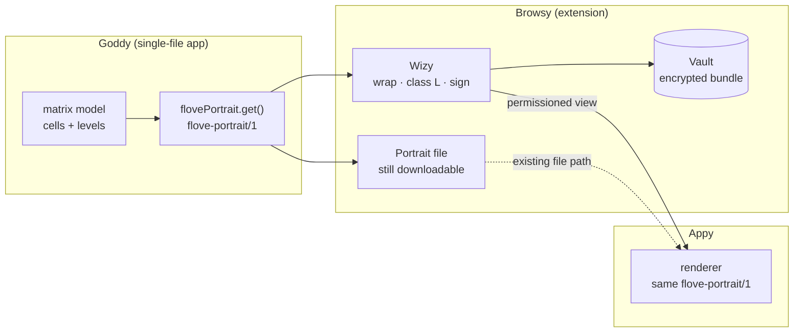
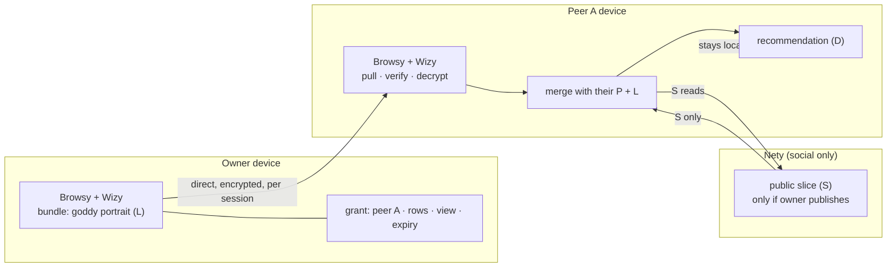
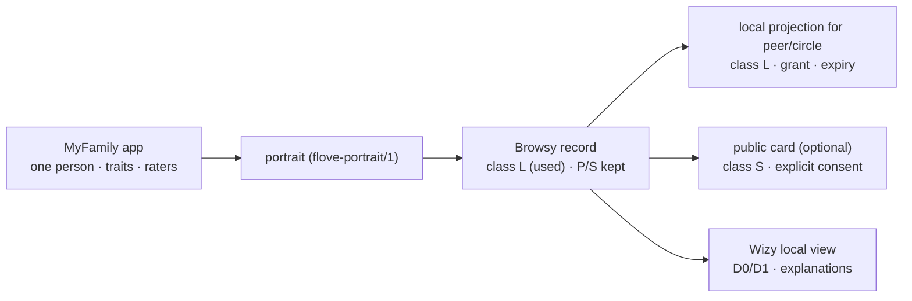
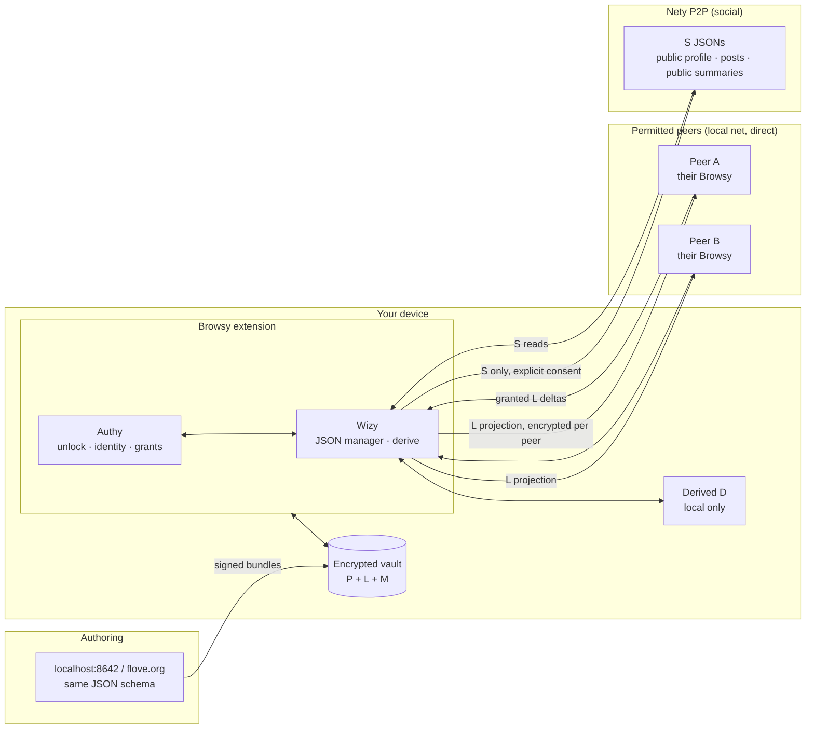
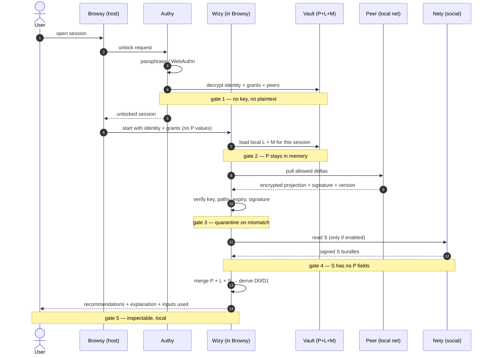
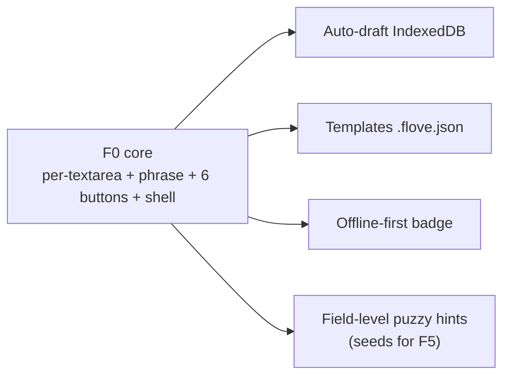
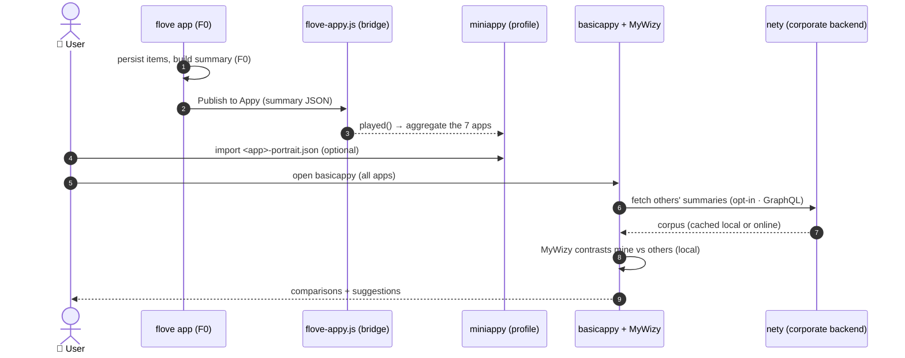
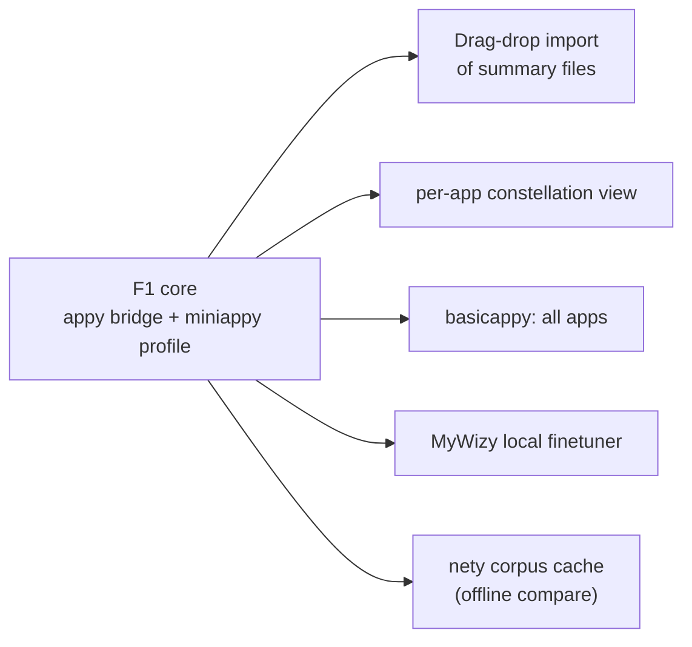
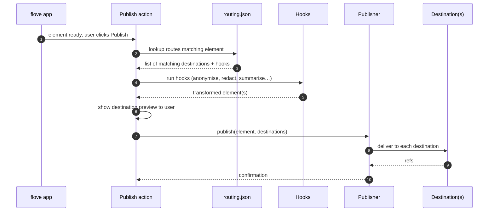

# docs/plan — Browsy spec phases

> Source: `development/wiki/archive/old/browsy/spec.md#5-old-plans--reconciliation`,
> `#6-development-plan`, `#9-changelog` (archived 2026-11-21).
> The stable page is `development/standards/plan.md`.

## Old plans — reconciliation

> Source: `development/wiki/archive/old/browsy/spec.md#5-old-plans--reconciliation`.

| Old document | Old assumption | Status now | What to keep |
|---|---|---|---|
| removed 2026-11-17 (browser-extension plan) | Broad extension MVP: discovery, save-to-flove, badges, profile scoring, sync. | **Superseded in scope** by BSP-A/U. Discovery features are backlog, not current spec. | Extension skeleton, on-demand rule, size/performance constraints. |
| `browsy/README.md` | Central is the trust/permissions hub; extension is thin. | **Superseded in authority** by BSP-A/P. | MV3 architecture, storage split, crypto primitives, F2F. |
| `browsy/browsy-questions.md` | 244 decisions across tiers, UI, sync. | **Historical decision log**; use BSP IDs for current work. | Questions still open; pointers to old surveys. |
| `browsy/port-nety.md` | Port crypto/store now; Central permissions layer. | **Port mechanics kept; permissions layer superseded** by BSP-P. | `lib/crypto.js`/`lib/store.js` seams, key namespacing, message registry. |
| `browsy/TESTING.md` | Old risk matrix. | **Extend** with §7 tests; old cases remain as regression ideas. | On-demand tests, crypto/risk analysis, browser matrix. |
| removed 2026-11-17 (nety-frontend plan) | Nety as extension of Browsy with tiers/masks/MyNet. | **Partially superseded** by BSP-M/N; the MyNet surface is integrated in §3.4.1. | Identity masks, f2f base, people/groups/feed/invites/moderation ideas. |
| removed 2026-11-17 (nety-trust plan) | Central computes ranking/trust; curators/jury. | **Superseded for Browsy trust**; Nety WoT only ranks S. | Facets, vouch concepts, anti-collusion ideas. |
| `plans/central-backend.md` | Central is the data bank and permissions authority. | **Demoted to optional mirror** by BSP-A03. | FastAPI/Turso hosting for public bundles, sync patterns. |
| removed 2026-11-17 (appy-normal plan) | Wizy mini at normal tier; MyNet+Browsy demo. | **Partially superseded**: Wizy lives in Browsy from the start; MyNet is now the local group surface. | Appy shell, MyNet people/groups/feed UI, tier wording. |
| `development/index.html` §P2P | Browsy v3/Nety v4/Wizy v3 presentation. | **To overwrite** at release (Phase 7). | Visual language, links, badges. |

## Development plan

> Source: `development/wiki/archive/old/browsy/spec.md#6-development-plan`.

<a id="phase-0"></a>
### Phase 0 — Spec consolidation (this document)

**Requirements:** all. **Deliverables:** this plan; notices in old plans; index
row; pending list. **Gate:** every old plan points here; no contradictory
“current spec” claim remains.

<a id="phase-1"></a>
### Phase 1 — Authy foundation

**Spec:** BSP-I01–I04, BSP-A01. **Tasks:** settle `flove:authy/1` (migrate
`flove:authy`); persist/unlock in appy-basic/Authy index; optional L2 email; L3
Telegram verified via **risa signed claim or nonce → DM**; keepers at L3;
recovery placeholders. **Gate:** reload survives; a bare Telegram link stays L1;
L3 can publish; a tampered payload is rejected. **Status:** mostly built in
appy-basic + Authy index; needs schema migration, risa/claim backend and the
L1–L4 ladder.

<a id="phase-2"></a>
### Phase 2 — Wizy inside Browsy (shell)

**Spec:** BSP-A01, BSP-W01–02. **Tasks:** extension module boundary; Wizy
workspace; bundle registry; class tags; local-only D0/D1; explanation panel; no
network. **Gate:** works offline from a bundle; derives without network; no
separate keys.

<a id="phase-3"></a>
### Phase 3 — MyFamily records and flat local groups

**Spec:** BSP-M02–M08, BSP-M12, BSP-M16, BSP-D01–D02. **Tasks:** person
list/personId; the **7 areas × 5 replies** profile and the **5 type
percentages** (Cousin · Sibling · Grandparent · Parent · Partner); class P/L/S
with **P as the new-person default**; Wizy reads P locally on the owner’s
device; **flat** group model (name, kind, members, owner/member, visibility
`local`/`group`, projection `myfamily-profile/1`, keyId, version, **no
parentId**); MyNet Groups panel that opens the MyFamily people list; projection
= display name + 5 percentages (raw 7×5 opt-in); group creation and membership;
invites + lineage; `floveMyFamily` bridge (`list`, `groups`); fallback download;
no network. **Gate:** a person has 7×5 answers and 5 percentages summing to 100;
a group with two people survives reload; the group projection has the 5 bars
and no raw areas; two flat groups share a person; no Public/nesting; lineage is
visible; no bridge still works. **Status:** bridge and class selector built;
record list, 7×5 profile and group model pending (B10; L01 local group, L02
owner/member, L04 flat and L05 MyFamily profile decided; L03 invitee-only
distinction, L06–L09 open).

<a id="phase-4"></a>
### Phase 4 — Grants and permissioned projections

**Spec:** BSP-P01–P02, BSP-M09, BSP-D01–D02. **Tasks:** grant schema; path/array
grammar; per-group content key; member L grants; encryption per recipient;
expiry/rotation; projection preview; group key rotation on removal; **consult
agreements** (`flove-consult/1`) for a member’s Wizy over selected
person/group/paths. **Gate:** grant mismatch rejected; expired grant stops
reads; removed member cannot decrypt new posts; old copies are labelled; a
consult agreement returns only its scope and stops on revoke.

<a id="phase-5"></a>
### Phase 5 — Local net transport (native host)

**Spec:** BSP-A02, BSP-P02, BSP-M08–M09. **Tasks:** native messaging host
(mDNS/UDP discovery, local WebSocket/QUIC or signed JSON frames); group bundle
pull/push; feed; invites; signatures; delta/version; offline queue; audit log.
**Gate:** two Browsy instances exchange group posts through the host; a
non-member is rejected; no Nety calls for L; revoke stops the next pull.
**Status:** transport choice decided: native host, not browser WebRTC.

<a id="phase-6"></a>
### Phase 6 — Nety Social (deferred)

**Spec:** BSP-N01, BSP-A02–A03, BSP-M10–M11. **Status:** **postponed for v1.**
MyNet ships local only; Public/S, public groups and moderation stay out of the
first build. **Tasks for later:** opt-in toggle; S schema; public group cards;
signed reads; moderation pending → curator → live; Nety gateway/daemon; Central
mirror optional. **Gate:** S contains no P; Group/L never reaches Nety; toggle
off = zero Nety traffic; Public requires L3 verified Telegram.

<a id="phase-7"></a>
### Phase 7 — Documents, diagrams, public map

**Spec:** BSP-U01–U02. **Tasks:** refresh Authy index; Browsy use cases;
decentral diagram; menu/About; diagram masters; replace Development index P2P
presentation. **Gate:** vocabulary matches; links resolve; mobile/desktop
render; no stale “old plan” presentation.

<a id="phase-8"></a>
### Phase 8 — Hardening and release

**Spec:** BSP-T01 + all. **Tasks:** offline/file:// matrix; accessibility;
extension permissions audit; bundle signing review; release package; overwrite
old landing copy. **Gate:** `check-distro` clean; no high-risk finding;
Chrome+Firefox manual pass.

## Changelog

> Source: `development/wiki/archive/old/browsy/spec.md#9-changelog`.

| Date | Change |
|---|---|
| 2026-11-17 | Initial spec-driven plan; reconciles old browsy/nety/central plans with today’s Authy/MyNet/MyFamily/Wizy/Nety decisions. |
| 2026-11-17 | Integrates the MyNet surface (people, favourites, groups, feed, invites, visibility, moderation) and adds the MyFamily-based local-group model (BSP-M05–M12, Phase 3–6, group tests, pendings L01–L14). |
| 2026-11-17 | Refines before build: SelfAuth/verified Telegram ladder (no presence level), MyFamily 7×5 profile + 5 type percentages, flat groups/no public groups, native-host transport, Nety/Public postponed, `flove:authy/1` canonical. |
| 2026-11-18 | Owner answers: P default + local Wizy read, owner-only membership, single free-named group list + `Invitees` label, S stats card vs L details, no group moderation, consult agreements, invite code + Telegram/Authy auth, risa redirect; Self label, Rust host, WebSocket+JSON, entry/host labels, retire Else. |
| 2026-11-20 | Integrates `VARIOUS_Q07`: Social ships as the MyNet tab, not a standalone app (BSP-M16); closes the mirrored pendings row. |

<a id="rationale"></a>
## Rationale — Browsy/Nety

> Source: `development/wiki/archive/old/browsy/rationale.md` (archived 2026-11-21).
> Full rationale, diagrams, threat model and open decisions; the stable pages carry the accepted facts.

> Status: **design rationale** (2026-11-17). Implementation spec:
> [`spec.md`](../../archive/old/browsy/spec.md).
>
> Draft origin: This is the new north star for the P2P /
> identity / JSON-sharing story. It does **not** replace anything yet; when the
> milestones below reach a stable shape, it overwrites the current presentations
> in `development/index.html` (P2P · Browsy/Nety/Wizy) and absorbs the older
> browsy/nety plans.
>
> Location: `development/wiki/archive/old/browsy/rationale.md`.
> Companion visual: `apps/sys/browsy/2026-11-17-browsy-wizy-nety.html`.
> Companions: `apps/sys/authy/index.html` (Authy index) ·
> `apps/sys/browsy/index.html#myfamily` (MyFamily use case) ·
> `development/wiki/archive/old/browsy/browsy-questions.md` (future questy survey).
>
> Usability is deliberately deferred: the privacy rules come first, then each
> milestone ends with a usability pass once the gate is green.

---

### 1. One-line vision

**Browsy is the browser extension that authenticates you (Authy), hosts Wizy,
and guards the door; Wizy is the JSON manager living inside Browsy that merges
your private, permissioned and public data and derives recommendations; Nety is
the P2P network that only carries the social/global layer.** Personal data never
leaves the device unencrypted; local JSONs travel directly between permitted
users, session by session; the global JSONs travel through Nety. Wizy reaches the
local net and the Nety social layer from inside Browsy, only when the user asks
it to.

---

### 2. Chapter 1 — Personal, local, social, and the apps in play

This is the introduction the rest of the document assumes. Read it as three
concentric worlds plus the tools that touch them.

#### 2.1 Personal — the world that never leaves

**What it is:** the raw material of you — journal answers, health and body data,
identity proofs, precise location, private messages, keys and recovery material.
It is not "data about an app"; it is data about a person.

**Where it lives:** the encrypted vault inside Browsy. At rest it is ciphertext;
in use it exists only in Browsy/Wizy memory. No Nety node, no Central server, no
peer, no analytics endpoint ever sees it.

**Who can touch it:** only Authy (to unlock and sign) and Wizy (to derive, in
memory). Apps never receive raw personal JSON; they receive a derived answer or
nothing.

**Why this bar:** "supersafe" is a promise that must be testable, so the plan
turns it into invariants (P never leaves unencrypted, no P in an S bundle,
unlock required before any plaintext). The bar is intentionally higher than the
local and social layers.

**Examples by app:** Sensy answers, Pracsys practice logs, DieSafe directives,
Souls private rows, Keys private words, free-text notes in any app.

#### 2.2 Local — the world you share by permission

**What it is:** JSONs that are meaningful to specific people: app portraits,
extended profile fields, shared playlists, project data, circle posts. They are
not public by default; they are "yours, shared with X until date Y".

**Where it lives:** encrypted at rest in the vault, plaintext only in memory
during a session. Copies may live on permitted peers' devices after a share,
encrypted to their key.

**How it moves:** directly, peer to peer, at session start. Browsy's Wizy pulls
the deltas each peer is allowed to give and pushes the projections the owner
allowed. It does **not** ask Nety for permission and does not put L plaintext on
Nety. Discovery/transport is an explicit option (Q3): QR/endpoint, local
network, WebRTC, or Nety DHT for addresses only.

**Who can read it:** the owner and the named peers/circles in a signed grant,
for the listed paths, until expiry or revocation. Revocation stops future reads;
already-copied data cannot be unlearned (honest UI).

**Examples by app:** Goddy ratings, Trusty family data, Inventary shared lists,
Lovy relationship fields, Puzzy shared lexicons, Any app portrait shared with a
circle.

#### 2.3 Social — the world you publish

**What it is:** the public or group-visible layer: published posts, the public
profile, public app summaries, public recommendations, the social bundle other
people can read without a private grant.

**Where it lives:** a local copy plus Nety (and optionally Central as a mirror).
It uses the **same JSON structure as local data**; the difference is the class
tag and the grant (public/group), not a different format.

**How it moves:** through Nety's gateway/topics. Nety may store, index and rank
it; Nety never receives P or L plaintext, and its reputation/WoT is a ranking
signal, not an access-control system.

**Who can read it:** anyone the grant says — usually everyone. Publication is an
explicit act with consent, never a side effect of using an app.

**Examples by app:** published Goddy summaries, public profile, Blogy articles,
public playlists, social recommendations (if the user exports D as S).

#### 2.4 The apps in play

| App / piece | Lives in | Role in this plan | Data classes it touches |
|---|---|---|---|
| **Browsy** | Browser extension (MV3 + Firefox polyfill) | The host: Authy, Wizy, vault, peer pulls, grants, enforcement | P, L, S, D, M |
| **Authy** | Module inside Browsy | Identity, channels/proofs, levels, sessions, recovery, signing | P (keys), M (grants) |
| **Wizy** | Module + workspace inside Browsy (not a separate network client) | JSON manager, merge, derive, projection, "others view" | P, L, S, D |
| **Nety** | Rust daemon/gateway + libp2p | Social/global transport, storage, compute for public data, WoT | S (and D if published) |
| **Localhost / web** | `localhost:8642` or flove.org apps | Authoring and export; same schema; signs via Authy | L, S (authored) |
| **Appy** | flove.org / localhost | Renders portraits and profiles; asks Browsy for a view | L, S |
| **flovePortrait apps** | Any single-file app | Produce `flove-portrait/1` documents (Goddy, Souls, ...) | L by default |
| **MyFamily** | Browsy person-record use case (app stays editor) | New person P; Wizy reads locally; L when shared; 7×5 profile → 5 percentages | P default · L shared · S public |
| **Central (optional)** | FastAPI/Turso | Public mirror/host, discovery, optional aggregation | S only |

#### 2.5 The rule of thumb for every screen

For any JSON or field, ask three questions in order:

1. **Class:** is this P, L, S, D or M?
2. **Reader:** who is allowed to read it, under which grant and expiry?
3. **Derivation:** what may be computed from it, and where does that computation
   happen?

If a screen cannot answer all three, it is not ready.

---

### 3. What changes against what exists today

| Today (source) | In this plan |
|---|---|
| `apps/sys/browsy` is a skeleton: identity/trust stubs, Central as the trust/permissions hub (`browsy/README.md`, `port-nety.md`). | Browsy becomes the **auth + vault + Wizy + peer-pull engine**. Permissions are signed local manifests, not a Central table. |
| `apps/sys/wizy` is a separate agent UI that reads portraits; Wizy mini is a tier feature (old appy-normal plan, removed 2026-11-17). | Wizy **moves inside Browsy** and becomes the JSON manager + recommender, in every tier. The old page becomes one workspace view, not a separate client. |
| Nety v4 is a Rust/libp2p network with gateway, storage and trust; daemon and gateway are **not connected yet** (`apps/sys/nety/README.md`). | Nety carries **only social/global JSON**. It is not the permission layer and not the transport for local shares. |
| Permissions live in Central (`port-nety.md` §10–13): permissions table, obfuscated URLs, groups, encrypted content, key rotation. | Permissions travel **with the JSON** (signed grant manifests). Optional Central stays a mirror/host, never the authority. |
| Trust = Central aggregation + local score (old nety-trust plan, removed 2026-11-17). | Trust is computed **locally (Browsy)** and, for the social layer, from Nety's WoT/reputation. Central becomes optional. |
| `flove-portrait/1` is one extractive file per app (`frontend/export.md`). | A user owns a **bundle of JSONs** (personal/local/social) with one envelope + per-path permissions. Portraits become one document type inside it (see §7). |
| Authy exists only as risaliberada levels/claims (`risaliberada/plan-v2.md` §A5). | **Authy is the cross-cutting identity module inside Browsy**: channels, proofs, levels, sessions, recovery, grant signing. |

**Not in scope yet:** building the extension crypto, wiring Nety's daemon, or
replacing the UI presentations. The Authy index and the MyFamily use case are specifications,
not shipped code; the plan stops at a specification plus milestones.

---

### 4. Actors and components

| Component | Where it runs | Owns | Never does |
|---|---|---|---|
| **Browsy** | Browser extension (MV3 + Firefox polyfill) | Authy unlock, key storage, peer list, per-session pulls, signature verification, outbound projection, permission enforcement, hosting Wizy | Plaintext telemetry, background sync of private data |
| **Authy** (module of Browsy) | Inside the extension | Identity(s), channels/proofs, levels, sessions for apps, recovery/rotation, signing grants | Re-derive keys when linking a channel (`D17`) |
| **Wizy** (inside Browsy) | Extension module + its own workspace UI; no separate keys or network stack | The user's JSON bundles, merge/filter, recommendation logic, "others view", visible explanations | Upload personal data to a model or server without explicit consent; open its own peer connections bypassing Browsy |
| **Personal vault** | Encrypted storage inside Browsy (optional encrypted localhost mirror) | Supersafe JSON, keys, grants, peer list | Leave the device unencrypted |
| **Localhost / web authoring** | `localhost:8642` or flove.org apps | Produce and sign the same JSON schema; preview; export | Write identity without Authy's signature |
| **Trusted peers** | Other users' Browsy installations | Their own local bundles, their grants, their direct endpoints | See anything not granted |
| **Nety** | Rust daemon/gateway + libp2p | Global/social JSON distribution, storage, compute for public data, WoT/reputation | Receive personal/local plaintext; act as the permission authority |
| **Central (optional)** | FastAPI/Turso | Host/mirror public bundles; discovery | Store plaintext personal/local data; be required for the mesh to work |

---

### 5. Data classes (the core of the privacy spec)

Every JSON document and every field gets exactly one class. The class determines
where it may live, who can read it, and what may be derived from it.

| Class | Examples | At rest | In transit | Who can read |
|---|---|---|---|---|
| **P — personal / supersafe** | raw journal answers, health, identity proofs, keys, precise location, private messages | Encrypted vault (passphrase/WebAuthn-derived key) | **Never** leaves unencrypted; normally never leaves at all | Only the owner's Browsy/Authy/Wizy |
| **L — local / permissioned** | app portraits, extended profile fields, shared playlists, project JSONs | Encrypted vault; plaintext only in memory | Direct to named peers, encrypted per recipient; no Nety plaintext | Owner + explicitly granted peers/circles |
| **S — social / global** | published posts, public profile, public recommendations, public app summaries | Local copy + Nety/Central | Nety (public or encrypted-to-group) | Anyone the grant says; usually public |
| **D — derived** | Wizy recommendations, match scores, "others view" | Local by default | Only if the user exports/shares it as L or S | Owner; recipients only if shared |
| **M — metadata** | grants, peer list, pull log, tombstones | Encrypted vault | Minimal, only what a pull needs | Owner; counterpart sees only its own grant |

**Candidate invariants** (to be confirmed by the questions):

1. **P never leaves unencrypted.** No P field is ever in an S bundle.
2. **L leaves only as an encrypted projection** to a named key or circle, under a
   signed grant with an expiry.
3. **S contains no P by construction** — the projection code refuses P paths.
4. **Every outbound byte is traceable** to a grant: peer, paths, capability,
   expiry, signature. Local log, not a remote one.
5. **Defaults are private.** Widening is explicit, per path and per principal.
6. **Revocation is forward-only.** Once copied, data cannot be unlearned;
   encryption + short TTL + key rotation are the mitigations.
7. **Every received document is signed and verified.** Unsigned or unknown-key
   data is quarantined, never merged.
8. **Wizy computes locally by default.** Remote compute needs separate consent
   and a de-identified/D-only payload.
9. **Metadata minimization.** Nety must not learn who pulls from whom locally.
10. **Linking a channel never re-derives identity keys.**

---

### 6. What is derived? — the options

"Derived" (D) is anything Wizy produces from inputs rather than copying them.
The plan deliberately keeps several options so the user can choose how much
computation — and therefore how much exposure — is acceptable.

| Option | Where it runs | Inputs it sees | What leaves the device | Output | Shareable? | Main risk | Use when |
|---|---|---|---|---|---|---|---|
| **D0 — No derivation** | Wizy in Browsy | P, L, S for filtering/merging only | Nothing | Filtered views, "what I see / what X sees" | Only as a projection (L/S) | Lowest; still leaks by over-sharing | Default until rules are proven |
| **D1 — Deterministic rules** | Wizy in Browsy | P + L + S, tagged by class | Nothing | Scores, matches, explanations (auditable rules) | D as L/S if exported | Rule leakage / gaming | First recommendations; explainable |
| **D2 — On-device model** | Wizy in Browsy (WASM/small model) | P + L + S, or a de-identified subset | Model updates only (no user payload) | Natural-language advice, richer matches | D as L/S if exported | Device cost; prompt/log leakage | Personal assistant features |
| **D3 — Remote compute, de-identified** | Nety compute or approved server | D-only payload (no P/L raw) | De-identified feature vector + query | Recommendation result | D as L/S if exported | Inference, metadata, provider trust | Heavy models; explicit opt-in per request |
| **D4 — Remote compute, encrypted** | Nety node / enclave (future) | Encrypted P/L payload | Ciphertext only | Encrypted result, decrypted locally | D as L/S if exported | Enclave trust, availability | Later, when Nety supports it |
| **D5 — Peer-assisted** | A permitted peer's Browsy | Only the grant's L projection | The granted projection | Peer's derived answer returned | D unless exported | Trust + extra exposure | Collaborative recommendations |

**Others view** (what another user can see/derive) has its own options:

| Option | What it is | Exposure | Suggested |
|---|---|---|---|
| **O0 — Raw projection** | The owner's signed view, filtered by the grant | Exactly the granted paths | ✅ v1 default |
| **O1 — Recomputed view** | The recipient's Wizy recomputes from granted L | More personalization, more inference | Opt-in per relationship |
| **O2 — Social comparison** | Nety-ranked comparison using S only | Public/social only | Later |

**Defaults proposed:** D0/D1 locally, D2 optional on-device, D3 only with a
per-request consent screen, D4 future, D5 experimental. Others view = O0.

---

### 7. flovePortrait — the actual case, and how it extends

`flove-portrait/1` is the real, shipped envelope (reference: Goddy, validated by
`jsony --app` and rendered by Appy). It is the smallest complete case of
"JSON produced by an app" and therefore the best test for Browsy/Wizy.

#### 7.1 The envelope as it exists today

```jsonc
{
  "schema": "flove-portrait/1",
  "app": "goddy",
  "version": 1,
  "generatedAt": "2026-11-17T00:00:00.000Z",
  "lang": "en",
  "phrase": "<one italic line from the summary>",
  "rows": [
    { "key": "from:to", "kind": "cell", "title": "from → to", "items": ["2"] }
  ],
  "completeness": { "layers": 7, "total": 9 },
  "stats": { "count": 7, "intensity": 0.62, "max": 3 },
  "consent": { "share": "app", "purposes": ["self-reflection", "export"] },
  "source": { "url": "https://flove.org/apps/metas/goddy.html" }
}
```

API today: `get()`, `validate(payload)`, `consult({purpose, enforceConsent,
from, to, maxItems})`, `merge(payload, {mode})`, `selfTest()`, `toSummary()`,
`toAgent()`; `window.flovePort`/`floveNet` expose `export`/`consult`/`import`.
The file is downloaded or shared as `<app>-portrait.json`; Appy renders it.

#### 7.2 How it extends inside Browsy

| Today | With Browsy/Wizy | Class |
|---|---|---|
| `flovePortrait.get()` returns the portrait | unchanged — the app keeps producing the same document | L |
| The file is downloaded/shared directly | Wizy wraps it as a document in a **bundle**, adds owner, class, signatures, grants | L |
| `consent.purposes` is informational | Authy signs it; Wizy enforces it per purpose and per grant | M |
| Appy imports the file | Appy asks Browsy/Wizy for a view; the same renderer is used | L/S |
| `consult()` filters by `from`/`to`/`maxItems` | `consult(grant)` intersects with grant paths, expiry and capabilities | L |
| No encryption | per-recipient envelope encryption; key rotation on revoke | L |
| No provenance | bundle id + version + signature + pull log | M |

Proposed additions (names to be decided in Q9):

```jsonc
{
  "schema": "flove-bundle/0.1",
  "bundleId": "<id>",
  "owner": "<ed25519 pubkey>",
  "class": "L",
  "version": 3,
  "documents": [
    { "id": "goddy", "schema": "flove-portrait/1", "path": "documents.goddy", "portrait": { } }
  ],
  "grants": [ { "grantee": "<peer>", "paths": ["documents.goddy.rows"], "capabilities": ["view"] } ],
  "signature": "<ed25519>"
}
```

#### 7.3 Two scaled diagrams

**Scale 1 — one portrait, one device (today → extension).**



**Scale 2 — the same portrait across the mesh.**



#### 7.4 The `flovePortrait` API, explained

Every app exposes the same seven functions. They are the seam Browsy/Wizy hooks
into, and the reason the app does not need to know about bundles or grants.

| Function | What it does | Input → output | Who calls it |
|---|---|---|---|
| **`get()`** | Reads the app's live model and builds the portrait document | `() → flove-portrait/1` | App UI (Save/Share), Browsy/Wizy capture |
| **`validate(payload)`** | Checks schema, app id and that `rows` is an array | `(object) → {ok, errors[]}` | Appy import, Wizy before storing, tests |
| **`consult(sel)`** | Returns a filtered read-only view for a purpose | `({purpose, enforceConsent, from, to, kinds, group, maxItems}) → flove-consult/1` | Wizy projections, agents, cross-app reads |
| **`merge(payload, opts)`** | Writes a portrait back into the app (fill-empty or replace) | `(portrait, {mode}) → {ok, applied, mode}` | Import, restore, peer sync into the app |
| **`selfTest()`** | Runs `get → validate → consult` and reports counts | `() → {ok, rows, consultRows, errors}` | App load with `?selftest`, CI checks |
| **`toSummary()`** | Returns the app's own summary model (not the envelope) | `() → app model` | Appy legacy renderer, Wizy agent context |
| **`toAgent()`** | Returns the agent block: prompt, schema, context, suggestions | `() → floveAgentBlock` | Local MyWizy / Flove AI |

How they fit the plan:

- **`get()` unchanged** — the app keeps producing the same document; Browsy wraps
  it, it does not rewrite it.
- **`validate()` is the first gate** — a peer's portrait is rejected before it
  can reach `merge()`.
- **`consult()` becomes permission-aware** — with a grant, Wizy passes the grant
  path set and purpose; the function returns only the intersection. Without a
  grant it behaves as today.
- **`merge()` is the only writer** — and only from a verified bundle; it never
  receives P fields because the projection cannot contain them.
- **`selfTest()` is the CI/test hook** — the acceptance test for M1.
- **`toSummary()` / `toAgent()` stay local** — they are for Wizy/Appy, not for
  Nety; if their output is shared it becomes D/L/S by the normal rules.

#### 7.5 MyFamily — the first local data manager, and third-party data

MyFamily is the hardest and most useful test: its portrait is **about another
person** (a friend or family member), not only about the owner. It is the person
record use case of Browsy: a new person is **P** (private) by default, Wizy may
read P locally on the owner’s device, and sharing is an explicit **L** or **S**
act.

Today (`apps/trusty/myfamily.html`):

- one person per page: `friend` + 7 trait groups (attention, contact, influence,
  feedback, gifting, sharing, money) with booleans and a free-text nuance;
- five affinity raters (`raters[]`, 0–100) plus a points total;
- `flove-portrait/1` rows: `friend`, `trait:*`, `nuance:*`, `rater:*`;
- `toAgent()` already produces a warm reflection prompt for Wizy.

**As a Browsy local data manager:**

- **Record model:** `personId`, `displayName`, the **7 areas × 5 replies**
  profile, the **5 type percentages**, `notes`, `updatedAt`, `subjectConsent`,
  `class: P | L | S`. Multiple records live in the vault, not one page per
  person.
- **A new person is P by default.** Wizy may read P locally on the owner’s
  device; L is shared with named peers/groups; S is Social = Public. There is
  no automatic promotion.
- **Sharing is explicit.** The owner shares the 5 percentages (and optionally
  the raw 7×5) with named peers/circles, with expiry, and only if the
  subject-consent state allows it. There is no "share whole portrait" button.
- **P stays private:** the same record can be marked P and never leave the
  vault; **S publishes only a minimal public card**, never the raw record.
- **Permissions over a P2P network are another planned trunk.** Today L means
  locally federated sharing between Browsy instances; it does not claim a
  global P2P permission system.
- **Wizy can use L records locally** for recommendations; P records stay in the
  private working set; O1 recomputation must respect `subjectConsent`; O2 social
  comparison uses S only.
- **Erasure:** deleting a person deletes the record, its grants and its cached
  projections; peers are notified on next pull.
- **Local groups:** MyFamily people are also the source for MyNet local groups.
  A group references `personId`s and carries a projection (display name + the
  **5 type percentages** from the 7×5 MyFamily profile), roles, a per-group key
  and L visibility. Groups are flat; there are no public groups in v1. The full
  model is in the spec §3.4.1 (BSP-M05–M12); MyNet is the group editor and
  MyFamily remains the person editor.

Flow:



**Open third-party issues** (tracked in `pendings.md`): subject consent and
erasure, children, sensitive categories, whether the subject can see or correct
the record, and whether a public card needs the subject's approval.

---

### 8. Diagram A — the simple system



ASCII twin:

```
            ┌──────────── your device ─────────────────┐
            │  ┌──────── Browsy extension ─────────┐   │
            │  │  Authy  ⇄  Wizy (JSON + derive)   │   │
            │  └───────────────┬───────────────────┘   │
            │          encrypted vault (P + L + M)     │
            │                  │                       │
            │              D (local only)              │
            └───┬──────────────────────────┬───────────┘
                │ L (encrypted, direct)    │ S (opt-in)
                ▼                          ▼
        permitted peers               Nety P2P (social)
        (local net, per session)      public/group JSON only
                ▲
                │ localhost / web authoring (same schema)
```

**Reading it:** Browsy is the only host; Authy and Wizy are its two organs. The
vault is the only place P/L/M rest. Peers receive encrypted L projections; Nety
only receives S. D never leaves unless the user exports it.

---

### 9. Diagram B — the long thread

#### 9.1 Session thread (pull → merge → recommend)



#### 9.2 Share thread (publish → grant → revoke)

```mermaid
sequenceDiagram
  autonumber
  actor U as User
  participant W as Wizy (in Browsy)
  participant A as Authy
  participant P as Peer (local net)
  participant N as Nety (social)

  U->>W: choose JSON + recipients + paths
  W->>W: build projection (P not selectable)
  W->>A: request signature + grant
  A->>A: sign grant (paths, capability, expiry)
  A-->>W: signed envelope
  W->>P: direct encrypted push (or pull next session)
  P->>P: verify + store in their L cache
  Note over P: gate 6 — only granted paths readable
  opt social share
    W->>N: publish S-only bundle (explicit consent)
    Note over N: gate 7 — public by decision
  end
  U->>A: revoke peer / shorten expiry
  A->>A: version++ and sign new manifest
  A->>P: notify next pull (or let TTL expire)
  Note over U,P: gate 8 — future reads stop; copies remain
```

#### 9.3 Thread as a numbered checklist

1. Unlock Authy → identity + grants.
2. Load L/M from the vault; P stays in Wizy memory.
3. Pull L deltas directly from permitted peers over the local net.
4. Read S from Nety only if the user enabled it.
5. Merge into a working set tagged by class and provenance.
6. Derive D locally; show the explanation and the exact inputs used.
7. Share: build a projection that cannot include P; sign a grant; encrypt per recipient.
8. Push directly (or pull next session); publish S to Nety only with explicit consent.
9. Revoke: bump manifest version, rotate the content key, stop future pulls; accept copy limits.
10. Lose keys: Authy rotation (self-backup or social quorum), never silent re-derivation.

---

### 10. Permission model (proposal to validate)

A grant is a signed JSON object attached to a bundle or path:

```jsonc
{
  "schema": "flove-grant/1",
  "grantor": "<ed25519 pubkey>",
  "grantee": "<pubkey | circle id | group id>",
  "bundle": "<bundle id>",
  "paths": ["documents.goddy.rows", "profile.name", "playlists.favs"],
  "capabilities": ["view", "derive", "aggregate"],
  "expiry": "2027-01-01T00:00:00Z",
  "contentKey": "<encrypted-to-grantee key or key id>",
  "version": 3,
  "signature": "<ed25519 over the canonical form>"
}
```

Decisions: granularity (file/path/slice/field), principal (key/circle/group),
capabilities (`view`/`derive`/`aggregate`; no `copy` by default), revocation
(version + TTL + rotation), enforcement (Browsy on send/receive; Wizy on
projection; apps never get vault access).

---

### 11. Pull model: local net and Nety, both from inside Browsy

**Local (L):** Wizy, running inside Browsy, pulls directly from permitted peers
at every session and pushes allowed projections. It does not ask Nety for
permission and does not route L through Nety. Discovery options (Q3): manual
QR/endpoint, LAN discovery, WebRTC signaling, or Nety DHT for addresses only
(no payload).

**Social (S):** Wizy reads signed public/social bundles from Nety (gateway or
topics) only when the user enables the social connection. Nety may rank/filter
with WoT/reputation; it never grants access to L.

**Explicit switches:** "local net" and "Nety social" are two separate toggles in
Browsy. Turning both off leaves Wizy fully functional on P + cached L.

**Offline:** last signed snapshots stay readable; outgoing shares queue until
the next session. No background sync of P.

---

### 12. Authy (identity and sessions)

- **Keys:** Ed25519 identity, one per human (masks optional later).
- **Channels:** Telegram, email, phone, OAuth, biometrics; channel-agnostic core
  with drivers (`risaliberada/plan-v2.md` §A5, `D17`).
- **Levels:** anonymous → presence → verified → phone → bio (final set in Q6).
- **Sessions:** apps receive scoped tokens/attestations, never the private key.
- **Grants:** signs permissions, bundle versions and revocations.
- **Recovery:** self-backup rotation; social quorum fallback; probation after
  social recovery; never a central reset.
- **Binding:** same key maps to the Nety PeerId for S publishing; L peer
  addresses are separate and minimized.

#### 12.5 Authy index and refined model

The current authentication UI lives in `apps/appy/index.html` as the
**Authenticate** card (was "Extend profile"): a five-bar ladder — Self, Email,
Telegram, Phone, Bio — with badges, point labels and per-step forms. A bare
Telegram link is **SelfAuth L1**; a **risa signed claim** or the **Authy
nonce+DM** flow reaches **L3 verified**. `linkIdentity()` stores the key in
`state.linkedIdentities`, awards Personal points and persists to
`flove:authy/1` (legacy `flove:authy` is migrated once); the export carries
`identities[]`.

That UI is now **displayed and extended** in
[`../../../../apps/sys/authy/index.html`](../../../../apps/sys/authy/index.html), which becomes the reference page
for Authy from now on. The app keeps its card as the entry point; the index owns
the model.

**Telegram also enables MyNet.** In appy-basic, MyNet is gated by **L3
verified Telegram** (risa or Authy claim), not a bare link: no L3, no
people/groups/feed. MyNet uses the **MyFamily profile** — 7 areas × 5 replies,
summarised as **5 type percentages** (Cousin · Sibling · Grandparent · Parent ·
Partner) — stored as **L**. The Authy index has two diagrams for this model;
the app keeps the gate and the MyFamily app stays the full editor.

Refined model:

| Layer | Current appy-basic | Extended Authy |
|---|---|---|
| Root | device state + optional ids | Ed25519 identity, one per human; masks later |
| Channels | email, telegram, phone, bio (self is not a channel) | same + future OAuth; each proof is signed and stored as P |
| Levels | ladder position = highest linked id | risa model: **L1 SelfAuth · L2 verified email · L3 Telegram verified · L4 verified phone · L5 bio**; L3 opens MyNet and publish |
| Telegram | link → `publishUnlocked` | bare link → **L1 SelfAuth**; risa signed claim or claim (nonce + DM) → **L3 verified**; publish only at L3 |
| Persistence | none | `flove:authy/1` in `localStorage` on localhost; appy-basic and the Authy index share it |
| Sessions | none (the app holds state) | scoped tokens/attestations; the private key never leaves Browsy |
| Grants | none | Authy signs bundle versions, grants and revocations |
| Recovery | none | self-backup rotation; social quorum fallback; probation |
| Binding | local only | Nety PeerId for S publishing; MyFamily person ids for L records |
| Keepers | none | send the signed summary to **local** first, **social** only after L3 |
| Points | per-step labels (+4/+12/+6/+8) vs awards (20/50/100/200) — inconsistent | one table, one source; the index documents both until fixed |

---

### 13. Wizy inside Browsy (JSON manager and recommender)

Responsibilities:

1. **Registry:** bundles, classes, versions, provenance, grants.
2. **Views:** "what I see", "what others see", "what I share with X".
3. **Merge:** P + L + S into a working set with class tags.
4. **Derive:** D0–D5 options (§6), local by default, explanations.
5. **Projection:** L/S exports; refuse P; sign via Authy; encrypt per recipient.
6. **Network:** local-net pull/push and Nety social read, each behind its own
   toggle; no sockets of its own outside Browsy.
7. **Audit:** local log of pulls, shares, denials; no remote analytics by default.

The old Wizy page becomes one workspace surface. Wizy mini/full can remain UX
levels, but the manager exists from day one.

---

### 14. JSON generation and schema

Two authoring paths, one schema:

- **Localhost** (`flove-localhost`, `localhost:8642`) — offline, file-based,
  signed export.
- **Web** (flove.org apps) — same envelope, same validation, download or hand to
  Browsy.

Proposed bundle envelope (name in Q9): `flove-bundle/0.1`, with `documents[]`
holding `flove-portrait/1` docs, plus `owner`, `class`, `version`, `consent`,
`grants`, `signature`. `flove-portrait/1` remains unchanged for apps and Appy.

---

### 15. Threat model (v0)

| Threat | Mitigation | Still open |
|---|---|---|
| Stolen laptop / browser profile | Vault encrypted; unlock via passphrase/WebAuthn; no plaintext on disk | Coerced unlock; memory scraping |
| Malicious peer | Signed grants; path allow-list; quarantine; per-recipient keys | Screen capture; authorized-but-leaky peer |
| Revoked peer keeps a copy | TTL, key rotation, no-copy capability; honest UI warning | Unrecallable copies |
| Extension compromise / malicious update | Minimal permissions, no remote code, signed builds, review | Supply chain; store compromise |
| XSS on flove.org | Bridge only on known origins; no vault access from page; scoped messages | Same-origin app bugs |
| Nety node / gateway | S only; E2E encryption for groups; no P/L plaintext | Metadata graph |
| Inference leakage | Local derivation; explanation; opt-in sharing of D | Model inversion |
| Lost keys | Authy rotation + social quorum; continuity mapping | Hijacked quorum |
| Over-broad grants | Private defaults; per-path UI; audit log | Usability pressure |

---

### 16. Milestones — specified

| ID | Milestone | Goal | Spec deliverables | Entry criteria | Privacy gate / acceptance test | Depends on |
|---|---|---|---|---|---|---|
| **M0** | Spec & taxonomy | Agree what P/L/S/D/M mean before code | Field-by-field classification table for every shipped JSON; grant schema v0; invariants; threat model v0 | This document reviewed; Q1–Q3 answered | No unclassified field; every JSON mapped; invariants signed off | — |
| **M1** | Browsy shell + Wizy local manager | A working local manager with no network | Browsy MV3 shell; Wizy workspace; bundle read/write; portrait wrapping; import/export; class tags | M0 accepted | Goddy portrait round-trips unchanged; P cannot be selected for export; vault refuses plaintext write | M0 |
| **M2** | Authy + vault | Identity and unlock | Ed25519 root; passphrase/WebAuthn unlock; encrypted vault; signed bundle; grant signing; recovery start | M1 accepted | Tampered bundle rejected; wrong passphrase reveals nothing; key rotation keeps grants valid | M1 |
| **M3** | Local net L pulls | Direct per-session pull/push | Peer discovery option; transport; delta format; verify/decrypt; revoke; offline queue; local audit log | M2 accepted; Q3 answered | Two browsers exchange only granted paths; revoke stops next pull; no Nety traffic for L | M2 |
| **M4** | Nety social S | Read/write public bundles | Opt-in Nety toggle; S schema/validation; signed reads; gateway prerequisite check | M3 accepted; Nety gateway/daemon connected (currently not) | S contains no P/L; disabling the toggle produces zero Nety calls; public publish requires consent | M3 |
| **M5** | Derivations + others view | Make D useful without leaking | D0/D1 implemented; D2 spike; D3 consent flow; O0 projection; explanation UI | M4 accepted; Q7/Q8 answered | Default run is fully offline; D3 shows exactly what leaves; O0 shows only granted paths | M4 |
| **M6** | Hardening + overwrite | Ready to replace presentations | Threat-model review; a11y/mobile pass; docs; rewrite `development/index.html` P2P/Wizy/Nety; retire superseded plans | M5 accepted | External review checklist; no open critical privacy bug; usable on Chrome + Firefox | M5 |
| **M7** | Usability passes | Sharpen UX after real use | Per-milestone usability checkpoints; peer onboarding; grant editor; explanation readability; error states | First 3 real peers using M3+ | Task success and time-to-share measured; no privacy setting hidden behind a default | M3+ |

Every milestone ends with a **usability pass**, but only M7 turns those into
measured goals. Privacy gates are binary: no gate, no next milestone.

---

### 17. Sources read (evidence for this plan)

| Source | What it contributes |
|---|---|
| `development/index.html` §p2p (≈2806–2980) | Current Browsy v3 / Nety v4 / Wizy presentation; MV3 bridge, central trust hub, daemon/gateway gap |
| `apps/sys/browsy/manifest.json`, `background.js`, `content.js` | Real extension state: flove.org/localhost only, stubs for crypto/trust |
| `development/wiki/archive/old/browsy/README.md` | On-demand rule, central vs extension split, data structures, implemented/stubbed list |
| `.../browsy/port-nety.md` | Permission levels, URL obfuscation, groups, auto-decrypt, key rotation; the port plan |
| `.../browsy/browsy-questions.md` | 244 decisions: privacy all-local+encrypted, auth flows, storage, badges, tiers |
| archived `2026-06-18-nety-access-ecosystem-design.md` | Three access axes (invites, trust, permissions), private-first, field-level visibility, key recovery |
| old Nety plans (removed 2026-11-17) | Browsy base + Nety extension split; local vs central trust; masks |
| `.../plans/central-backend.md` | Central persistence, progressive identity, browsy sync, CRDT trust |
| old appy-normal plan (removed 2026-11-17) | Wizy mini at normal; MyNet managed by Browsy |
| `development/standards/frontend/export.md` | `flove-portrait/1` envelope, consent field, Appy as renderer |
| `apps/metas/goddy.html` §portraitBridge | Real `flovePortrait` fields and API (`get`, `consult`, `merge`) |
| `apps/appy/index.html` §Authenticate | Current 5-step ladder, `linkIdentity`, points, `identities[]` export |
| `apps/trusty/myfamily.html` §portraitBridge | Third-party portrait model: friend, 7 trait groups, nuances, 5 raters |
| `development/standards/risaliberada/plan-v2.md` §A5, D17 | Authy levels/claims, channel-agnostic core, no re-key on link |
| `apps/sys/nety/README.md` | Real Nety state: libp2p/Rust/Wasmtime, daemon and gateway not connected |

**Will be overwritten/absorbed when ready:** the P2P section of
`development/index.html`; the old browser-extension plan (removed 2026-11-17); the browsy docs
(`README`, `browsy-questions`, `port-nety`); parts of `nety-frontend`,
`nety-trust`, `central-backend` (permissions/trust authority); the Wizy
description. No edits until M6. The new
[`../../../../apps/sys/authy/index.html`](../../../../apps/sys/authy/index.html) and
[`index.html#myfamily`](../../../../apps/sys/browsy/index.html) indexes are the reference
surfaces from now on, even before the apps are rewired.

---

### 18. The 10 questions to solve next

Ordered by dependency. Each needs a decision before the next milestone.

#### Q1 — What exactly is P, L and S, field by field?
**Why:** every other rule depends on the class of a field. Ambiguity leaks data.
**Decide:** a table mapping each existing JSON (`portrait`, `profile`, app
summaries, `routing.json`, grants) and each app field to a class; default for
new fields. **Suggested default:** P unless explicitly listed; L for app
portraits; S only for fields already published today.

#### Q2 — What is the permission unit: file, JSON path, array slice or field?
**Why:** enforcement cost and UX. Field-level is precise but brittle; file-level
is coarse but shippable.
**Decide:** one unit for v1 and the matching grant schema. **Suggested:** JSON
path with array ranges; field-level later.

#### Q3 — How does the local net find and authenticate a peer without a server?
**Why:** "directly from users" needs transport. Browsy's Wizy must connect from
inside the extension.
**Decide:** QR/invite endpoints, LAN discovery, WebRTC signaling, or Nety DHT
for addresses only. **Suggested:** manual peer endpoint + signature first;
WebRTC second; Nety never for L payloads.

#### Q4 — What does revocation actually guarantee?
**Why:** copied JSON cannot be recalled; pretending otherwise is a privacy bug.
**Decide:** TTL, key rotation, no-copy capability, UI wording, and whether
revocation triggers re-encryption. **Suggested:** forward-only, short TTL for L,
rotate content keys on removal, state the limit in the UI.

#### Q5 — What is the "supersafe" bar for personal data?
**Why:** "supersafe" needs a testable definition.
**Decide:** unlock factor (passphrase, WebAuthn, OS keychain), at-rest format,
memory rules, whether P may ever be backed up encrypted, and the threat model
owner. **Suggested:** WebAuthn + passphrase fallback; encrypted vault; P only
decrypted in Browsy/Wizy memory; optional encrypted backup.

#### Q6 — What is Authy's final identity and recovery set?
**Why:** it binds grants, peers and Nety identity.
**Decide:** channels/levels, session token shape, masks, multi-device, recovery
quorum, binding to Nety PeerId, and level→capability matrix. **Suggested:**
Ed25519 root + channel proofs; self-backup rotation; social quorum fallback;
same key for Nety S publishing.

#### Q7 — Which derivation options ship first, and where do they run?
**Why:** recommendations are the point where P, L and S meet.
**Decide:** D0/D1 first, D2 spike, D3 consent flow; explanation format; whether
D can be shared. **Suggested:** D0/D1 in Wizy inside Browsy; D2 optional; D3
explicit per request; D4/D5 later.

#### Q8 — What is the "others view" exactly?
**Why:** it can be a filtered projection (safe) or a computed profile about the
other person (inference risk).
**Decide:** projection vs recomputation, who signs it, what the recipient can
infer, and consent. **Suggested:** O0 signed projection of the owner's bundle;
O1 only with explicit consent; O2 later.

#### Q9 — What is the bundle schema and who signs it?
**Why:** local, social and peer JSONs must be the same shape "structured like
local data".
**Decide:** envelope name/version, document types, consent block, signature
scope, and compatibility with `flove-portrait/1`. **Suggested:**
`flove-bundle/0.1` with portraits inside `documents[]`; Authy signs the bundle
and each grant.

#### Q10 — What are the sync and freshness rules when peers are offline?
**Why:** "pull at every session" needs a deterministic fallback.
**Decide:** delta format, vector clocks/CRDT, tombstones, cache TTL, conflict
display, and the maximum stale window for L. **Suggested:** per-bundle version +
vector clock; keep last signed snapshot; surface age and conflicts in Wizy; no
background sync for P.

**Also worth a later question:** how Nety's reputation/WoT ranks S results without
learning the user's L graph (privacy-preserving ranking).

---

### 19. Open decisions log

| Date | Decision | Status |
|---|---|---|
| 2026-11-17 | Browsy hosts Authy + Wizy + vault; Wizy has no separate network stack | Draft |
| 2026-11-17 | Local net and Nety social are two independent toggles inside Browsy | Draft |
| 2026-11-17 | Permissions as signed grants travelling with bundles, not a Central table | Draft |
| 2026-11-17 | Local pulls direct per session; Nety not the L transport | Draft |
| 2026-11-17 | P never leaves unencrypted; defaults private | Draft |
| 2026-11-17 | Derivation options D0–D5 and others view O0–O2 tabled | Draft |
| — | Q1–Q10 | Open |

---

### 20. Next action

Answer **Q1–Q3** first: they unlock the schema, the grant object and the peer
transport. Q4–Q6 can run in parallel. Q7–Q8 settle the derivation surface. After
Q1–Q6, this plan can replace the current P2P presentation; the HTML companion
renders the same decisions visually. Unresolved items from this round are parked in
[`pendings.md`](../../archive/old/browsy/browsy-questions.md) for a future questy survey.

<a id="roadmap-2026-06"></a>
## Roadmap 2026-06 (historical)

> Source: `development/wiki/archive/old/roadmap-2026-06.md` (archived 2026-11-21).

> **Archived 2026-11-19.** The live roadmap is the development index
> (`https://flove.org/development/index.html`, Plan · Work) and the active plans in
> `debates/plans/`. This file keeps the phased detail (F0–F5, nety, 0asis) for
> history; it carries no authority now. Work uses five phases **F0–F4** (old F5
> and Next fold into F4 · Full); the live register is the
> [docs · plan filter](https://flove.org/development/index.html#work?tab=docs&view=r2&subtab=work&category=docs&section=plan).

### Phased roadmap

The roadmap runs on **three strands** (detail in §15):

- **JS-distro track (F0–F1)** — the self-contained, here-and-now distro
  that ships today.
  - **F0 — fully local, zero network:** the **`mini` tier + its `-full`
    variant (`minifull`)** of every app, all with local persistence. Each
    app persists what you add (summary = source of truth for export). The
    matching appy profiles aggregate *your own* summaries locally
    (`miniappy` ≈ the 7 featured apps, `minifull` ≈ all apps). Fully offline.
  - **F1 — `basic` tier + enrichment:** the **`basic`** tier (`basicappy`)
    on top of the local profile — querying **`MyWizy`** (the *local* AI)
    for insights, plus **punctual content download** (pull a bit of
    external content on demand, e.g. a few others' summaries) and its
    extra features. Opt-in, minimal network; *not* the corporate backend.
  - *Tiers are the **horizontal** tier-pop stepper (mini · basic · normal ·
    advanced · super); the `-full`/`-raw`/`-one`/`-css` variants are the
    **vertical** axis shown under each step. F0 = `mini`+`minifull`,
    F1 = `basic`. See §13.1.*
- **`nety` · corporate backend (F2–F5)** — flove's **own** backend,
  built on the flovenet stack (Ed25519 identity, reputation / trust
  graph, resources, GraphQL gateway). It is what actually serves the
  social/community side **at scale**: the full *others'* corpus (F1 only
  pulls a little on demand), the common area, the AI (**wizy**) and puzzy
  aggregation. The upper layer is nety-native (§15.1).
- **External-platform integration · demo (parallel, deferred)** — proves
  flove plugs into **existing** backends: `routing.json` + the
  `Publisher` adapter bridging out to **0asis** (first demo), then
  ActivityPub / Matrix / Solid. 0asis is an *add-on / integration demo*,
  not the corporate backend (§15.2).

| Phase | Track | Main deliverable | Optional add-ons that fit this layer |
|---|---|---|---|
| **F0 · `mini` + `minifull` (local)** | JS distro | The **`mini` tier + its `-full` variant (`minifull`)** of every app, **persisted locally**. Added items survive reload / close / reopen; summary re-derives from store, **Update** re-syncs edits, export is "what you see". The appy profiles aggregate *your own* summaries locally (`miniappy` ≈ 7 featured apps, `minifull` ≈ all apps). Fully offline. | • IndexedDB for large sets · • drag-drop import of summary files · • per-app constellation view · • *stale* dot beside Update · • offline-first badge · • **private add-on** — `Enable login` High-locking (at-rest AES-GCM + crypter pass + recovery phrase + multiuser copied folders; §13.13, spec 2026-06-25) |
| **F1 · `basic` tier + features** | JS distro | The **`basic`** tier (`basicappy`) + enrichment: query **`MyWizy`** (the *local* AI) for insights / "near me · unlike me", plus **punctual content download** (pull a few others' summaries on demand to compare). Opt-in, minimal network. | • cached others-corpus for offline compare · • suggestion prompts · • on-demand reference pulls · • per-cell mini-summaries |
| **F2 · Identity + publish** | nety (corporate) | nety identity (Ed25519, derived from flovenet keystore) + a "Publish" button with destination preview | • Multiple pseudonyms ("masks") per context · • Element revocation · • Diff confirmation before publish · • Share via QR / ephemeral link |
| **F3 · Common area** | nety (corporate) | Semantic search + whole + graph + feed, served by nety (flovenet GraphQL gateway) | • Sense-based filters · • Permalink to a whole cell · • Activity heatmap per cell · • "Your footprint" personal view |
| **F4 · AI — wizy** | nety (corporate) | **`wizy`** = Athenea's global AI, trained with `whole` + puzzy seeds (module 42 usable as an *optional* engine via the 0asis add-on) | • Polarity suggestions while filling forms · • Auto-tagging of `asterism_path` · • Semantic duplicate detection · • Per-cell community summary |
| **F5 · Full puzzy engine** | nety (corporate) | Multi-axis ratings + multi-rater + primitives | • "Consensus vs dissent" view per object · • Temporal trajectories of a rating · • Rater reputation (un-gamified) · • Combo generator for creative inspiration |
| **— · External bridges** | integration demo | `routing.json` + `Publisher` adapter → `OasisPublisher` (first demo), then ActivityPub / Matrix / Solid | • Visual routing editor · • Pre-publish hooks (anonymise / redact) · • `LocalOnlyPublisher` / `MockPublisher` for tests · • Multi-publisher (nety + 0asis + AP at once) |

> Three distinct "AI"s, don't conflate: **`MyWizy`** (F1) is the **local**
> per-user finetuner over your own + imported summary JSONs; **`wizy`**
> (F4) is the **global** AI of **Athenea** — nety's corporate AI over the
> community corpus; **module 42** is 0asis's AI, usable only as an
> *optional* engine for `wizy` when the 0asis add-on is installed.

---

### 10 · F0 detail — JS distro · local persistence + Update + export

> **F0 is the foundation of the JS distro and runs entirely in the
> browser — zero network.** It gives every app three things: (1) the
> data the user *adds* survives reload / close / reopen, (2) the summary
> is the single source of truth that you export "as you see it", and
> (3) an **Update** button re-syncs the summary after in-session edits —
> no background polling. **F0 spans every app *and* the `miniappy` /
> `basicappy` profiles**, which aggregate your own summaries locally
> (detail in §11; the MyWizy / download enrichment on top is F1). The
> earlier `flove-io.js` / `flove-shell.js` module framing is **superseded**
> by this section; the same element shape and form surface survive, the
> persistence + Update loop is new.

#### 10.1 · Goal

Make every flove app **own its data locally and durably**: what you add
stays, what you see in the summary is exactly what exports, and editing
something already added is reconciled by one explicit **Update** — with
**zero build step**, **no framework dependency**, and **nothing leaving
the device**.

#### 10.2 · Design constraints

- **Vanilla JS** (or small inline script per the tier model §13.1).
  Works in any modern browser straight from the page. No bundler, no
  transpiler.
- **Zero dependencies, zero network.** Web platform APIs only
  (localStorage, IndexedDB, Blob/URL, Web Share, Clipboard,
  SpeechRecognition). F0 never calls out.
- **Progressive enhancement.** Any unsupported API hides its UI hook
  silently — the rest still works.
- **Persistence is the default, not an add-on.** Added items are
  written to storage as they are added; the app rebuilds its state from
  storage on load.
- **No polling.** State is reconciled on explicit events (load, add,
  Update click), never on a timer.

#### 10.3 · The pieces

1. **Persistence layer** — added items written to `localStorage`
   (or IndexedDB for large/structured sets), keyed per app; rehydrated
   on load. §10.3a.
2. **Summary as source of truth** — re-derived from storage on load and
   on Update; what it shows is what every export format emits (§13.9,
   §13.12).
3. **Update button + *stale* signal** — beside the summary; re-syncs
   after in-session edits to already-added items. §10.3a.
4. **Per-textarea controls** — 🎙 voice + ➕ add-another, injected per field.
5. **Live legible phrase** below the form.
6. **The action bar** on the phrase (Copy / Share / Magic / Insight /
   Publish / Format) — Publish degrades gracefully to local export when
   no backend (§15) is wired.
7. **Common HTML shell** so each app only writes its middle.

Everything works offline and stays on-device. Insight and Publish only
reach the network once a backend is wired (§15); until then they
degrade to local behaviour.

#### 10.3a · Persistence model + the Update button

The problem F0 solves: if added items are persisted and the summary
froze a *snapshot* at add-time, then editing an already-added item would
not show in the summary — and you would be tempted to run a timer that
re-scans selections every few seconds. **That timer is rejected**: it
wastes CPU/battery, can fight the user mid-edit, and is against the
low-tech flove stance. The contract instead:

| Moment | What happens |
|---|---|
| **Add an item** | Item is written to storage immediately and pushed into the summary. |
| **Open / reopen the file/tab** | The state is **re-derived from storage**, so the user's choices persist across closing and reopening — the true current state always wins, never "first added wins". |
| **Reload** (F5 / the ⟳ logo) | **Starts fresh — overrides persistence.** Our own keys are dropped and nothing is restored, so any intro animation replays and the form returns to its step-1 state. |
| **Edit an already-added item** (same session) | The store is updated; the summary may now be *stale* relative to what's shown. A subtle **`stale` dot** lights beside **Update** (set on the edit event — no polling). |
| **Click Update** | The summary re-derives from storage; the `stale` dot clears. |
| **Click Reset** | **Starts fresh — overrides persistence, same as Reload** (behind a confirm): clears **only this app's** stored items (`flove:<app>:*` keys — never other apps' data, §10.5) and reloads, so the form empties *and* the intro replays. |
| **Export / Share** | Emits exactly the current summary — "what you see is what you export" holds by construction. |

**Reload/Reset vs. reopen — the rule.** Persistence is for *coming back*:
close the file and open it again → your choices are restored. But a
**Reload** or **Reset** means "start over" → the app clears its own keys
and re-derives an empty step-1 view (any intro animation replays). Tell the
two apart with the **Navigation Timing API**: `performance.getEntriesByType(
'navigation')[0].type === 'reload'` → wipe + fresh; any other entry
(`navigate` / `back_forward` — a genuine open or reopen) → restore. Reset
does the same by clearing keys then calling `location.reload()`, so it lands
on the same fresh branch. Reference implementation: `apps/bio/varyy.html`
(`navIsReload()`). Caveat: *reopen-closed-tab* / session-restore can report
as `reload` in some browsers and thus wipe — a genuine fresh open is safe, so
key only off an explicit `'reload'`.

**Scope of the wipe = the app's own keys.** Clear exactly the keys Reset
clears — the content/summary keys (and an app-namespaced onboarding/"seen"
flag, if it lives among them) — so reload and reset stay in lock-step and any
first-run intro/onboarding replays (this *is* the "start the animation again"
intent). Never touch cross-app keys: the shared language default
(`flove:lang` / `translaty-lang`) and display prefs (e.g. compass mode) must
survive a reload. If a specific app should keep an onboarding hint *dismissed*
across reloads, drop only that flag from the reload branch (keep it in Reset)
— an intentional per-app exception, not the default. Propagated across the F0
summary apps (goddy · willy · souls · maty · myfamily · keys-advanced · realy
· pracsys · worthing · dealy-advanced · inventary · blogy-advanced) + varyy;
apps with no Reset control (willy, dealy-advanced) get the load-gate only.

So the loop is: *add → see it in summary → (edit → Update if needed) →
export what I see*, with no background reviewer. Storage key convention:
`flove:<app>:items` (mirrors `flove:appy:plays` used by the appy bridge,
§11).

**Inline vs `flove.js` — graded by tier (§13.9).** The persistence +
**Update** + **Reset** trio comes from one canonical *source* in
`flove.js`, but where it physically lives depends on the tier:

- **`mini`** — **inlined, no `flove.js`.** The trio ships inside the file
  so a `mini` stays a self-contained single page that works on `file://`.
- **`basic`** — **either** (inline or `../flove.js`), per app.
- **`normal` / `advanced`** — **load `../flove.js`** (external) for sure;
  the modular build is the point at that tier.

**Status: delivered** — the loop is live across the summary apps:
`metas/goddy · willy · souls`, `trusty/maty · myfamily`,
`puzzy/keys-advanced`, `realy`, `bio/pracsys`, `economy/worthing ·
dealy-advanced · inventary`, `blogy/blogy-advanced`. This is **not** the
pending item §10.14 once listed.

#### 10.3b · Which local-persistence method (and the risks)

"Persist locally" is **three layers**, not one store. Pick by role:

| Layer | Role | Method | When |
|---|---|---|---|
| **1 · Hot store** | what persists while you use the app | **`localStorage`** | **default for every app.** Key-value, synchronous (fine for KB), trivial API, ~5–10 MB/origin. Keys: `flove:<app>:items` + `flove:<app>:v` (schema version). |
| **2 · Durable archive** | the *real* backup | **export files + `appy` → `nety`** | always. Layer 1 is **not** durable (see risks); the export ("what you see") and the profile upload are the lasting copy. |
| **3 · Escalation** | large / binary / queryable | **IndexedDB** | **only if** an app stores binaries (images / audio / files), many MB, or needs indexed queries over thousands of records. No current app (Keys included) needs it. |

Optional nicety: the **File System Access API** can offer a "save to my
disk" that writes a real `.json` the user owns (Chromium; elsewhere it
falls back to the normal download). **Do not use** `sessionStorage`
(cleared on tab close), cookies (tiny, sent to server) or OPFS
(over-built for KB JSON).

> **One-line rule:** localStorage by default · export/appy = the real
> backup · IndexedDB only for binaries / MB / queries.

**Why layer 2 is non-negotiable — the risks of "max local persistence":**

| Risk | Mitigation |
|---|---|
| **Not durable.** Browsers can evict local storage under disk pressure, in private mode, or after inactivity (Safari/ITP expires script-written storage after ~7 days without interaction). | Treat local as a **cache**; the export + `appy`/`nety` upload are the archive. Optionally call `navigator.storage.persist()` to reduce eviction. |
| **Shared per-origin quota.** All flove apps on one origin (`flove.org`) **share the same ~5–10 MB** — they compete, not one quota each. | Real budget is tiny: a Keys summary is ~2–10 KB, 20 apps ≈ <1 MB, so headroom is large. Watch it only if media ever enters (→ IndexedDB). |
| **`QuotaExceededError` on write.** A full quota makes `setItem` throw; an uncaught throw silently loses the write (and maybe the edit). | Wrap every write in `try/catch`; on failure, warn the user and point to export. |
| **Synchronous + string-only.** `JSON.stringify` + write blocks the main thread; large blobs cause jank and slow startup. | Keep layer 1 to small structured JSON; move anything big/binary to IndexedDB (layer 3). |
| **No cross-device, no backup.** Clearing data, switching browser/device = data gone. | Layer 2 again: export / profile is the portable copy. |
| **Schema drift.** Old persisted data may not match newer app code → corrupt reads. | The `flove:<app>:v` version key + defensive parse + a small migration step. |
| **Shared computers / privacy.** Data lingers on the machine. | A clear "clear my data" control + a privacy note. |

**F0 persistence plan — `mini` & `mini-full` (no backend).** Both are F0
local **profile** builds, so both persist and both aggregate across apps;
the difference is *how many*: **`mini` = the 7 featured apps (the
`miniappy` profile), `mini-full` = *all* apps (the `minifull` profile,
§11.4).** Five features, none requiring a server — the regime (`file://`
vs `localhost`, §10.3c) decides how strong each can be:

| # | Feature | What it does | `mini` | `mini-full` |
|---|---|---|:---:|:---:|
| 1 | **Robust hot store** | `localStorage` keyed `flove:<app>:items` + `flove:<app>:v`; every write in `try/catch` (`QuotaExceededError` → warn + point to export); defensive parse + version migration; a **"clear my data"** control. | ✅ (aggregate over the 7) | ✅ (aggregate over all apps) |
| 2 | **Open over `localhost`** | ship + recommend the launcher (§10.3c); flips `localStorage` from *unreliable* (`file://`) to *reliable*, and unlocks the secure-context APIs below. | ✅ | ✅ |
| 3 | **`navigator.storage.persist()`** | request persistent storage so the browser won't evict under disk pressure / inactivity (counters Safari ITP ~7-day expiry). No-op off a secure context. | ✅ | ✅ |
| 4 | **File System Access** | "save to / open from my disk" — the data lives in a real `.json` the user owns, surviving browser-data clears and browser switches (Chromium; elsewhere falls back to download + import #5). | optional | ✅ (one file = the whole profile, all apps) |
| 5 | **Export ↔ Import round-trip** | the §13.12 JSON export is the **durable archive** (layer 2); add an **`<input type="file">` import** to read it back — works even on `file://`, so a shared single file regains its data. | import optional | ✅ (the file is the *whole-constellation* profile) |

**Floor:** feature 5 (export + file-input import) is the one durable
path that needs no backend *and* no localhost — it works on `file://`
too, so it is the baseline both builds must keep. Features 1–3 make the
*hot* store trustworthy; feature 4 is the strongest no-backend durability
where Chromium + a secure context are available. Both profiles' store,
export and import span **multiple apps** — `mini` over the **7 featured**
apps, `mini-full` over the **whole constellation** — never a single app.

#### 10.3c · Serving locally — `file://` vs `http://localhost` + the launcher

Where F0 persistence actually *works* depends on **how the app is opened**.
This is the practical companion to §10.3b.

**`file://` (double-click the `.html`)** — zero setup, ships as one file, works
offline, great for a quick demo. But the origin is opaque/null, so: `localStorage`
**is not reliable across sessions** (browser-dependent), ES modules / `fetch()`
are blocked, cross-document SVG `<use href="other.svg#id">` is blocked (why flove
inlines its SVG marks), Service Workers are impossible, and secure-context APIs
(Clipboard / Web Share) are inconsistent.

**`http://localhost` (a local server)** — `localStorage` / IndexedDB **persist
reliably**, modules / `fetch` / external SVG `<use>` work, and localhost is a
secure context (so Clipboard, Web Share, `storage.persist()`, Service Workers are
available). It is the same shape as production (`flove.org` is http(s)).

| | `file://` | `http://localhost` |
|---|---|---|
| Setup | zero (double-click) | start a server |
| Share the `.html` | ✅ trivial | ❌ only you |
| localStorage persists | ⚠️ unreliable | ✅ reliable |
| ES modules / fetch | ❌ blocked | ✅ |
| external SVG `<use>` | ❌ (hence inline) | ✅ |
| Service Workers / PWA | ❌ never | ✅ |
| Clipboard / Web Share | ⚠️ browser-dependent | ✅ |
| = production shape | ❌ | ✅ |

**Rules:**

- **Develop and test over `http://localhost`** (it matches `flove.org` and is
  where F0 persistence actually holds). Treat `file://` as best-effort.
- **Keep apps from breaking on `file://`** anyway — inline SVG/CSS/JS, use
  classic (non-module) scripts, and assume storage *may* not persist there. The
  double-click stays valid for showing a single app.
- **End users → `flove.org` (https):** persistence + secure context + shareable.

**The portable launchers (ship in the download, one per OS).** So a
non-technical user gets localhost with one click, the download package carries
per-OS launchers **at the zip root, beside the `flove/` folder**. They are
**generated by `build-flove-zip.sh`, not tracked** in the repo (detail in
§10.3d) — so there is no loose `start-flove.sh` / `.desktop` at the repo root.
Each serves the sibling `flove/` folder on `python3 -m http.server 8642` (if not
already up) and opens the entry page `http://localhost:8642/START.html` (the
language selector — `START.html` is `launch.html` renamed for the download);
from there every relative link keeps the whole constellation on localhost.

- `START-FLOVE-LINUX.sh` — self-locating (`readlink -f` → its own folder), and
  on **first run** it also drops a `flove (localhost)` icon into the
  applications menu + Desktop (pointing back at itself), so next time you launch
  from there. No `.desktop` is shipped — it creates its own.
- `START-FLOVE-MAC.command` — double-click opens Terminal (macOS lacks
  `readlink -f`, so it locates its folder the simple way and uses `open`).
- `START-FLOVE-WINDOWS.bat` — tries `python` then `py`; if neither, opens the
  file directly.
- `START-FLOVE-MOBILE.html` — phones can't run a launcher/server, so this is a
  page that redirects to `flove/START.html` over `file://` (offline, degraded).
- **Fallback (desktop):** if the server can't come up (no `python3`, port
  blocked), the launcher opens `file://…/START.html` instead (degraded — persistence
  may not save) rather than a dead localhost.
- **Distribution caveat:** the launcher scripts are "untrusted" — the OS may ask
  to mark them executable / "Allow" on first run (document in the README).
  Desktop launchers require `python3`.

#### 10.3d · Shipping the distro — live site (`updaty`) + download package (`flove-localhost.zip`)

Two distribution mechanisms move the JS distro out to users, and **both
operate on the _committed_ state, never the working tree** — commit via the
Gitea workflow first; in-progress edits ship in neither. Do **not** confuse
either with the semantic **`Publisher`** adapter (§6 / §15), which ships user
*elements* to a backend (nety / 0asis). These two ship the *site / app code
itself*.

**A · The live site — `flove.org` via GitHub Pages (the `/updaty` skill).**

- **Topology:** local `~/Documents/flove` (source of truth) → Gitea
  `localhost:3000/marc/flove` (`main`) → GitHub `floveorg/floveorg.github.io`
  (`main`, root folder) → GitHub Pages → **flove.org** (rebuilds ~1 min). The
  main repo is the **org site** (`floveorg/floveorg.github.io`, holds the
  `flove.org` `CNAME`), so project repos under `floveorg` serve at
  `flove.org/<repo>`.
- **What the skill does:** it publishes **committed** `main` only — publishing
  ≠ authoring. `publish-web.sh` unpacks the tracked tree at HEAD, strips the
  Gitea-only paths (root build/launcher artifacts, editor/OS noise, python
  caches, apk build dirs, `development/addons`, the `nety` gitlink) and
  **force-pushes** the filtered snapshot as one commit to the deploy repo
  `floveorg.github.io`. Uncommitted or untracked files do **not** publish.
- **Auth + guardrails:** a fine-grained GitHub PAT (Contents R/W on
  `floveorg.github.io`) lives in `~/agents/token-github-flove.md`; read
  **inline** by `publish-web.sh`, never persisted in `.git/config`, never
  printed. Never push flove `main` to GitHub directly (it would leak the full
  dev workspace) — always via the filtered publisher. Pages serves the pushed
  tree verbatim — static, **no server-side rewrites** (repo root carries
  `CNAME` = `flove.org` + `.nojekyll`).
- **Scope = MAIN SITE only.** Two siblings publish on their own, not here: the
  **blog** (`development/blog` — built in place by
  `development/blog/build-blog.sh build`, ships WITH the main site via
  `publish-web.sh` → `flove.org/development/blog`; drafts stay private) and
  **LowAI** (`lowai.org`, repo `LowAiorg/web` — separate org/domain).

- **Light vs heavy:** `updaty` is the light main-site publish — no packages,
  no `sw.js`/vocabulary, no subdomain deploys, no all-repo checks. The heavy
  release level `updaty4` refreshes `sw.js`, the vocabulary index and
  `flove-localhost.zip`, runs the distro/repo/token checks and, only when
  asked, publishes the main site + subdomains. Keep a one-page push on the
  light path.

**B · The download package — `flove-localhost.zip` (`build-flove-zip.sh`).**

- **What it is:** the runnable **offline copy** the home-page "Download / Go
  local" button hands out (also the no-JS fallback for the PWA "Install"
  button, `index.html`).
- **Source of truth = `git archive HEAD`** — exactly the committed site
  flove.org serves, so no `.git`, CI, or gitignored dev cruft. Commit before
  building.
- **Stripped** as meaningless offline: `flove-localhost.zip` itself, the build scripts
  (`build-flove-zip.sh`, `build-sw.mjs`, `build-aliases.mjs`), `404.html`,
  `CNAME` + `.nojekyll`, `.gitignore` + `.htmlvalidate.json`; plus web-only
  extras `blog/`, `docs/superpowers` (dev specs), `apps/lowai`,
  `apps/ephemerall`, `apps/anim-form.html`.
- **Entry rename:** `launch.html` → `START.html` in the download (the live
  site keeps `launch.html`); `manifest.webmanifest` + `sw.js` are rewritten to
  match, and the download's landing stays the **language selector on every
  launch** (the live site's auto-skip-when-remembered line is dropped).
- **Per-OS launchers at the zip root** (generated, **not tracked** in the
  repo — these are the launchers of §10.3c): `START-FLOVE-LINUX.sh` (also drops a menu/Desktop icon on first
  run), `START-FLOVE-MAC.command`, `START-FLOVE-WINDOWS.bat`, and
  `START-FLOVE-MOBILE.html` (phones can't serve — opens `flove/START.html` via
  `file://`, degraded). Each serves the sibling `flove/` folder on
  `localhost:8642` and opens `START.html`, falling back to `file://` if
  `python3` is absent — same localhost-vs-`file://` trade-off as §10.3c.
- **Per-app cube downloads** (`apps/index.html`, e.g. `goddy.zip`,
  `astry.zip`) are the intended single-app sibling of this whole-distro
  package — **planned, not yet generated** (no per-app builder exists yet).

#### 10.3e · JSON distro — `routing.json` for the download package

> Merged here from the old `debates/plans/backend.md` (deleted — this is the
> single backend home). Decisions DEP01–DEP10 + L01–L10 are resolved; the
> distribution mechanics (flove-localhost.zip, sw.js, APK) are specced in
> [`apps/README.md`](../../archive/old/apps/README.md).

The download package ships a `routing.json` so the offline distro can discover
its apps from metadata, not hard-coded logic (§5 same principle).

**Routing schema** (`flove-routing/3`, canonical file: `tools/routing.json`):
```json
{
  "schema": "flove-routing/3",
  "version": "FloveRouting26-11",
  "lastUpdated": "2026-11-14",
  "categories": {
    "social": { "name": "Social" }
  },
  "apps": [
    {
      "id": "realy",
      "name": "Realy",
      "url": "apps/psychosocial/realy.html",
      "description": "Dreamweaver",
      "tags": ["social", "dreams"],
      "folder": "psychosocial",
      "category": "social",
      "fieldPage": "https://flove.org/whole/biology/#app-realy",
      "fields": [
        { "id": "realms", "label": "Realms", "type": "repeat", "min": 7, "max": 14,
          "defaults": ["Event", "Fact", "Idea", "Project", "Person", "Place", "Object"],
          "item": { "id": "realm", "label": "Realm", "fields": [
            { "id": "real", "label": "Real", "type": "text" },
            { "id": "fiction", "label": "Fictional", "type": "text" }
          ] } },
        { "id": "notes", "label": "Whispers & notes", "type": "text" }
      ],
      "fieldCount": 73,
      "status": "complete"
    }
  ],
  "cross": [
    {
      "id": "pracsys-verbs-to-souls-system",
      "label": "Systems verbs from PracSys",
      "kind": "field-link",
      "source": { "app": "pracsys", "collection": "verbs", "value": "items",
                  "key": "slot", "resolve": "placements[slot].system" },
      "target": { "app": "souls", "fields": ["s3Channel", "s4Bio"],
                  "match": "system", "display": "verbs" },
      "merge": "suggest",
      "why": "When souls chooses a biological system, show the verbs saved for that system in PracSys."
    }
  ],
  "consumers": {
    "questy": { "label": "Questy", "mode": "extractive",
                "reads": ["apps[].fields", "categories{}", "cross[]"] }
  },
  "pending": [
    { "kind": "field-export", "apps": ["..."], "reason": "..." }
  ]
}
```

- `categories{}` is **identity only** — mating/inside/ling/social/economy. It
  carries no palette. Each consumer (questy, appy, wizy…) maps a category to its
  own colour/hat schema once, at its entrance. A field is related to a topic by
  name (e.g. a social app field related to metaphysics) or by a `cross[]` path —
  never by colour.
- `apps[].fields` is the app's **full field tree**, not a flat list. Each node
  has `id`, `label`, `type` and optional `group`/`related[]` (topic names, e.g.
  a social app field related to `metaphysics` — no colour):
  - `text`, `text[]`, `number`, `file`, `date`, `time`, `boolean`, `pick` (with `options`),
    `multi` (with `options`), `unknown` (declared but not yet audited);
  - `group` — a named bundle with its own `fields[]`;
  - `repeat` — the app's free-form rows: `min`, `max`, optional `defaults`, and
    an `item.fields[]` schema. This is how Realy realms, PracSys systems/verbs
    and other user-created collections are represented.
  `fieldCount` is the leaf count (using `max` for repeats): 51 souls, 72
  PracSys, 73 Realy, 15 MyFamily. The retired `fields-colours.json` was the curated
  per-slot vocabulary study and may be a subset; do not force the two to match.
- `cross[]` is the field-to-field graph:
  - `source`: app, collection, value, join `key`, optional `resolve`;
  - `target`: app, field(s), `match`, `display`;
  - `merge`: `suggest` / `read` / other chosen policy;
  - `why`: the human contract.
- `consumers{}` lists extractive readers (currently questy), what they read and
  their mode. This keeps third-party extraction declarative.
- **Profile exports interact with this registry.** `flove-profile` exports
  (`appy-basic` and `questy-flove`) carry `routing: "flove-routing/3"` and each
  `appsPlayed[]` entry carries `appId` and `category`; the per-app
  payload rides under `portrait` (the `flove-portrait/1` exported from the app's
  summary section) or `answered` for questy. The consumer maps the category
  to its own colour/hat. This is the shared identity surface.
- `pending[]` records what still needs work (`field-export`, `extractor`,
  `metadata`, `cross`). The goal is a **friendly one-shot export**: every
  self-contained app declares its core fields in the app itself (e.g. a small
  `application/json` manifest), so this registry is populated without parsing
  UI markup and every app stays self-contained.
- `status`: `complete` (full metadata + fields) or `partial` (fields present,
  metadata pending).
- **Canonical location:** `tools/routing.json` (served at `/tools/routing.json`
  and shipped in the zip). The old `addons/routing.json` mirror was
  removed — do not recreate it.
- **Field manifests.** Each imported app embeds an inert
  `<script type="application/json" id="flove-fields">` manifest with its
  `flove-fields/1` tree. `python3 tools/extract-fields.py --apply` reads every
  manifest and updates `apps[].fields` / `fieldCount` / `status` / `fieldsSource`;
  `--check` fails on drift. The manifest keeps the app self-contained while
  making extraction a one-command pass.

**App discovery** — flat scan: `apps/*/[name].html`; App ID = filename without
extension; description from `<meta name="description">`; tags from
`<meta name="tags" content='["a","b"]'>`. **Tier is not in this trunk** (closed
2026-11-15; demo sketches only) — no `<meta name="tier">` is emitted; see
[`plans/2026-11-14-app-tier-planned.md`](../../archive/old/plans/2026-11-14-app-tier-planned.md).

**Build pipeline:**
1. Scan `apps/*/[name].html` for meta tags
2. Extract: id (filename), name (title), url (relative path), description, tags
   (tier later, once the planned meta tag is adopted)
3. Validate required fields (id, name, url) — interactive prompt if invalid (I05)
4. Auto-generate `lastUpdated` in yy-mm format
5. Write `routing.json` to zip root
6. Bundle with `build-flove-zip.sh` + upload to GitHub Releases (`updaty4`)

`apps[].fields` is the field tree extracted from the app. The goal is for every
self-contained app to expose its core fields in-app, so one extractor can fill
the registry without parsing UI markup. Until then, `pending[]` records the
field-export, extractor, metadata and cross-link gaps.

**Regeneration is a merge, not a replace.** The meta-tag scan refreshes only the
registry keys (`id`, `name`, `url`, `description`, `tags`); the
editorial keys (`category`, `colour`, `field`, `fieldPage`, `fields`,
`fieldCount`, `status`), `cross`, `consumers` and `pending` must survive a
rebuild.

**README.md in zip (I06):** app list with one-line descriptions, format per app:
`**App Name** — description`.

Remaining tasks: meta tags on all app HTML files · extend `build-flove-zip.sh` to
scan + generate `routing.json` · add validation · add README.md to zip ·
wire `routing.json` fetch in apps if needed for discovery. Conflicts are
resolved in `plans/conflicts.md`; Central backend specifics in
`plans/central-backend.md`.

#### 10.4 · Per-textarea controls

Every `<textarea>` (and every text-like `<input>`) inside a flove
form gets two small controls injected by the shell:

| Glyph | What it does |
|-------|--------------|
| 🎙️    | Web Speech API recording. Click to start, click to stop. Final transcript is appended (leading space if non-empty). State: `is-recording` class while live; visible pulse from CSS. |
| ➕    | Adds another input of the same logical field. Keeps focus on the new one. |

The voice button is hidden if `SpeechRecognition` is unsupported. The
add-another button is hidden if the field declares
`data-flove-multi="off"`.

<a id="1041-multi-value-naming-both-modes-supported"></a>
##### 10.4.1 · Multi-value naming — both modes supported

Set on the field, or on the form as a default:

```html
<!-- per-field -->
<textarea name="what" data-flove-multi="numbered"></textarea>

<!-- form-wide default -->
<form data-flove-app="loves" data-flove-multi="array"> … </form>
```

Default if neither is declared: `numbered`.

**Numbered mode:** first clone keeps the base name; subsequent clones
append `_2`, `_3`, … Snapshot keys stay flat (`what`, `what_2`,
`what_3`). Best for forms that read like spreadsheets.

**Array mode:** all fields share `baseName[]`. Snapshot collapses them
into an array. Best for clearly list-shaped fields (tags, ingredients,
attendees).

`readFormFields` handles both deterministically:
- `name="x"` once → scalar at `x`.
- `name="x"` repeated → auto-array at `x`.
- `name="x[]"` (any count) → array at `x`.
- `name="x.y"` → nested at `x.y` (dotted-path support).

#### 10.5 · Live legible phrase

A read-only block sits **below** the form, always visible, updated on
every keystroke:

```
<app>/<type>(<subtype>) · <key>: <value> · <key>: <value> · yyyy-mm-dd
```

Multi-value fields render as one clause each (numbered) or comma-joined
(array). Empty fields are skipped. The phrase block shares a card with
the action bar so it's clear the buttons act on what's shown.

#### 10.6 · The six-button action bar

One row, six buttons, attached to the phrase block. Glyph + label on
desktop; glyph only on narrow viewports. Order is fixed.

| # | Glyph | Label   | Default behavior                                     | Long-press / Shift |
|---|-------|---------|------------------------------------------------------|--------------------|
| 1 | 📋    | Copy    | Copies the current phrase to clipboard.              | Copies the JSON.   |
| 2 | 📤    | Share   | `navigator.share({ text: phrase, files: [json] })`   | Phrase only.       |
| 3 | 🪄    | Magic   | Rewrites the phrase with random prepositions before each value. Different on each press. | Cycles language (es ↔ en). |
| 4 | 💡    | Insight | Opens the insight panel.                              | Skips dialog if a default provider is configured. |
| 5 |     | Publish | Opens the publish multi-select.                       | Skips selector if a single destination matches.   |
| 6 | 📁    | Format  | Opens the format menu.                                | Repeats the last chosen format.                   |

<a id="1061-copy"></a>
##### 10.6.1 · Copy

Clipboard write of the phrase as displayed (if Magic was just pressed,
that's what gets copied — what you see is what you copy). Toast:
`phrase copied`.

<a id="1062-share"></a>
##### 10.6.2 · Share

`navigator.share({ title: 'flove · <app>', text: phrase, files: […JSON…] })`
when supported; on desktop without `navigator.share`, falls back to
copying the phrase.

<a id="1063-magic-preposition-remix"></a>
##### 10.6.3 · Magic — preposition remix

Reads the same fields as the phrase, prepends each value with a random
preposition drawn from a per-language pool, no repeats within a phrase
unless the pool is exhausted. Pressing Magic again re-rolls.

Default pools:
```
es: con · sobre · bajo · entre · hacia · desde · durante · según ·
    ante · tras · junto a · cerca de · frente a · gracias a ·
    a través de · en torno a
en: with · about · beneath · between · toward · from · during ·
    according to · before · after · beside · near · across ·
    around · concerning · inside
```

Language is read from `<html lang>`, falling back to `en`. Apps may
override by setting `window.flove.magic = { prepositions: { … } }` before
loading `../flove.js`.

The phrase block has two visual states: `phrase` (canonical) and
`phrase phrase--magic`. Copy uses whichever is shown.

<a id="1064-insight-both-modes-specified"></a>
##### 10.6.4 · Insight — both modes specified

Insight calls a user-customizable AI. Two modes, both implemented:

**Mode A · default provider (skip dialog).** Page boots with a provider,
no dialog. One click → fetch → result panel.
```html
<!-- Pre-wire the insight provider, then load the distro engine (§10.13).
     flove.js reads window.flove.insight on boot — same shape Mode B saves
     under localStorage 'flove.insight.config'. -->
<script>
  window.flove = window.flove || {};
  window.flove.insight = {
    url:     'https://my-endpoint/insight',
    headers: { 'Authorization': 'Bearer …' },
    prompt:  'Give one-paragraph insight about this flove element. Element JSON follows.',
  };
</script>
<script src="../flove.js" defer></script>
```
Shell POSTs `{ prompt, element }` and renders `response.text` (or
`response.choices[0].message.content`).

**Mode B · config dialog (default when nothing is wired).** First click
opens a dialog with three fields: endpoint URL, headers (JSON), prompt
template. Saved in `localStorage` under `flove.insight.config` and
reused on subsequent presses. A *(reset)* link clears the config.

**Result panel.** Response shown inline below the action bar, with its
own Copy / Share / Save (an insight is itself a small flove element of
`type: "insight"`).

<a id="1065-publish-multi-select-platforms"></a>
##### 10.6.5 · Publish — multi-select platforms

Click → modal with a checkbox list of platforms. List is the union of:
1. **Routed destinations** — `routing.json` matches for this element.
2. **User custom platforms** — added via *Add platform* in the dialog.
   Saved in `localStorage` under `flove.publish.platforms`.

Each platform has: name, URL/endpoint, optional handler kind
(`webshare`, `webhook`, `mailto`, `clipboard`, `download`).

Without a publisher adapter wired (no backend yet — §15), the dialog is
**dry-run-only** — it shows which platforms WOULD have received the
element. Long-press / Shift-click skips the dialog if exactly one route
matches.

<a id="1066-format-export-menu"></a>
##### 10.6.6 · Format — export menu

Click → small popover with the **six canonical formats**, all generated
client-side from the summary-model. The full contract — structure,
filenames, parity, escaping and the share path — lives in **§13.12**:

| Format   | Extension | Use case                                            |
|----------|-----------|-----------------------------------------------------|
| Markdown | `.md`     | Heading + sections; pasteable into anything         |
| JSON     | `.json`   | The summary-model — round-trip with other flove apps |
| XML      | `.xml`    | Well-formed, escaped; machine-readable               |
| HTML     | `.html`   | Standalone document — also the share-to-mobile artifact |
| JPG      | `.jpg`    | Canvas render of the summary; visual-only            |
| CSV      | `.csv`    | One row per element; spreadsheet-friendly            |

Filenames follow `<app>-summary.<ext>` (localized — §13.12). Format
choice triggers immediate download. Long-press / Shift re-runs the
last format chosen.

#### 10.7 · Common HTML shell

The whole boilerplate an app needs is now this small:

```html
<!doctype html>
<html lang="es" data-flove-app="<APP>">
<head>
  <meta charset="UTF-8">
  <meta name="viewport" content="width=device-width,initial-scale=1.0,viewport-fit=cover">
  <title><App-Title> · FLOVE</title>  <!-- app name · FLOVE; app favicon; no sprout glyph — see §13.10 -->
  <link rel="stylesheet" href="flove.css">
  <style>
    :root {
      --app-accent:        #6ee7b7;
      --app-accent-soft:   #a7f3d0;
      --app-ink-on-accent: #042418;
    }
  </style>
</head>
<body>
  <div class="flove-bar">
    <a class="flove-home" href="index.html">←</a>
    <span class="flove-mark flove-asterism"></span>
    <span class="flove-app-name"><APP-TITLE></span>
  </div>

  <main>
    <form data-flove-app="<APP>" data-flove-type="element">
      <!-- app's own fields here -->
    </form>
    <!-- shell renders phrase + 6-button bar here automatically -->
  </main>

  <!-- distro engine: auto-inits on boot, injects phrase + 6-button bar (§10.13) -->
  <script src="../flove.js" defer></script>
</body>
</html>
```

Shell injects: phrase block, action bar, per-textarea controls,
publish/insight/format dialogs. App-side concerns: app title, accent
CSS variables, the form's own fields.

#### 10.8 · Header UX

> **Superseded for the menu trigger + logo by §13.7.13.** This section is
> the older shell-era header. The current topbar opens the menu on
> **logo/title click** (not a ☰ button, and the logo no longer reloads),
> and the ☰ `menu-btn` slot became the ⚙ `settings-btn` (topbar collapse).
> The drafts / insight / publish / categories behaviour below still holds.

Shell enhances any existing `.flove-bar` — it does not replace it, it
adds three things:

```
[ ←back ]  [ logo ]  [ App name ]    [ ── categories ── ]    [ spacer ]    [ ☰ menu ]
```

<a id="1081-back-arrow-left"></a>
##### 10.8.1 · Back arrow (left)
Provided by every app's `.flove-bar` as `<a class="flove-home"
href="index.html">←</a>`. Returns to the launcher. Shell does not
touch it.

<a id="1082-logo-click-to-reload"></a>
##### 10.8.2 · Logo · click to reload
Shell binds a `click` on every `.flove-mark` / `.flove-asterism` inside
the bar (the flove sprout mark). Drafts survive (IndexedDB).

<a id="1083-filterable-categories-center"></a>
##### 10.8.3 · Filterable categories (center)
Apps declare categories once, via meta or data attribute:
```html
<meta name="flove-categories" content="metaphysics, science, biology, linguistics, psychosocial">
<!-- or scoped to a form -->
<form data-flove-app="loves" data-flove-categories="gifts, wishes, days">
```
Shell renders one chip per category, multi-select, persisted to
`localStorage` under `flove.filter.<app>`. Each toggle dispatches:
```js
document.addEventListener('flove:filter', (ev) => {
  const active = ev.detail.categories;
  // app filters its own list / form / view
});
```
Shell **renders** the chips; app **acts** on the filter.

<a id="1084-common-menu-right"></a>
##### 10.8.4 · Common menu (right)
A `☰` button opens a small dropdown anchored to it. Two sections:

**Common (shell-provided):**
- 📂 my drafts — opens the drafts modal.
- 💡 insight provider — clears the saved insight config.
- publish platforms — opens the platforms manager.
- ↻ reload — same as clicking the logo.
- 🏠 all apps — link to `index.html`.

**Custom (app-provided):** any element marked with
`data-flove-menu="custom"` has its children moved into this section.
```html
<div data-flove-menu="custom" hidden>
  <button class="flove-menu__item" onclick="exportLog()">📜 export full log</button>
  <a class="flove-menu__item" href="#help">❓ how this app works</a>
</div>
```
Dropdown closes on outside-click, on resize, and after any item
activation. No backdrop — non-invasive by design.

#### 10.9 · Field-type policy

Shell's per-field controls only apply where they make sense.

**Cloneable types (get the ➕ button):**
```
textarea, select,
input[type=text|search|email|url|tel|number|
            date|time|datetime-local|month|week|file]
input          (no type attribute)
```
Skipped: `password, checkbox, radio, range, color, hidden, submit, button`.

**Voice (🎙) — only on text-like fields:** `textarea`, `input[type=
text|search|email|url|tel]`, and `input` without a type. Hidden if
`SpeechRecognition` is unsupported.

**Core fields — never enhanced** when:
- `type="password"`, OR
- `data-flove-core="true"` (per-field opt-out), OR
- the stripped field name is `username | user | login | handle |
  password | pass | pwd | passphrase | token | apikey | api_key | secret`.

**Per-form opt-out:** `<form data-flove-enhance="off">` disables shell
enhancement but keeps the phrase card + 6-button bar.

**File inputs:** auto-spawn a new empty file input after the user picks
a file in the last file input of a group. Snapshot stores file *names*,
not contents — reading bytes is the publisher's job (§15.2).

#### 10.10 · Form contract (data-* attributes)

A form opts in by declaring metadata as `data-*` attributes — no JS
config per app:
```html
<form id="love-act"
      data-flove-app="loves"
      data-flove-type="act"
      data-flove-subtype="gift"
      data-flove-asterism="Gift/Wish/Freed"
      data-flove-puzzy="optional">
  <input name="what" required>
  <input name="to_whom">
  <select name="scope">…</select>
</form>
```
`name` of each form field maps 1-to-1 into `element.fields[name]`.
Nested objects via dotted names (`fields.kind` → `kind` inside
`fields`).

#### 10.11 · `.flove.json` element file format

The same payload that travels through Copy / Share / Publish:
```json
{
  "$schema": "https://flove.org/schemas/element-v1.json",
  "id":            "loves-act-2026-05-04T18-22-09-7f3a",
  "type":          "act",
  "subtype":       "gift",
  "app":           "loves",
  "asterism_path": "Gift/Wish/Freed",
  "fields": {
    "what":     "a long walk together",
    "to_whom":  "M.",
    "scope":    "intimate"
  },
  "puzzy":         null,
  "cross_links":   [],
  "visibility":    "local",
  "created_at":    "2026-05-04T18:22:09.412Z",
  "updated_at":    "2026-05-04T18:22:09.412Z"
}
```

#### 10.12 · Element ID strategy

Crypto-local: `<app>-<type>-<isoDate>-<6-hex>`. Stable across edits;
server-side ID assigned at publish time (kept as `published_id`).

#### 10.13 · JS distro · file manifest

The JS distro is the `advanced` tier (§13.1), which loads `../flove.js`
externally; the self-contained variants inline the same JS. Shared
files live in `apps/`:

```
apps/
├── flove.css            shared styles + design tokens
├── flove.js             distro engine: persistence + summary re-derive
│                        + Update + Reset, phrase renderer (canonical + magic),
│                        save-bundler, share, insight
├── flove-appy.js        appy bridge — publish/read per-app summaries
│                        to the local profile (F1, §11)
└── (no template page)   copy an existing app instead
```

**Trunk status (2026-11-15):** these files are **reference copies**, not loaded
artifacts. No app links `../flove.css` or `../flove.js` — each app inlines the
copy it uses and stays a single self-contained file (`floveStore`/`floveFields`/
`flovePort` inline everywhere; `flove.js` inline in Fivy and Blogy;
`flove-appy.js` inline in the six bridge apps). The `routing.json` matcher and
any publisher live in the integration-demo track (§15.2), not in the JS distro.

#### 10.14 · Status

| Artifact | Path | Status |
|---|---|---|
| `flove.css` shared styles | `addons/code/css/flove.css` | ✓ delivered — reference; apps inline a pruned copy |
| `flove.js` distro engine (phrase, save-bundler, share) | `addons/code/js/flove.js` | ✓ delivered — reference; inlined where used |
| Summary panel + export contract | §13.9 / §13.12 | ✓ standardised |
| **Persistence + Update + Reset** trio (§10.3a) | inline in every app (no `flove.js` dependency) | ✓ delivered across the summary apps — `metas/goddy · willy · souls`, `trusty/maty · myfamily`, `puzzy/keys-advanced`, `realy`, `bio/pracsys`, `economy/worthing · dealy-advanced · inventary`, `blogy/blogy-advanced` |
| `flove-appy.js` appy bridge | `apps/flove-appy.js` | ✓ delivered (phase-1 local) |

> **Note:** the prior `flove-io.js` / `flove-io-demo.html` (the F0
> Copy/Save/Share module) was archived during a pre-Gitea cleanup and is
> no longer wired; this section supersedes it. The persistence + Update
> loop (§10.3a) is the new F0 core, built into `flove.js`.

#### 10.15 · Integration recipe — persistence in an existing app

An app keeps its own form and Copy / Share row; F0 only adds the
**persist → re-derive → Update** loop around the items it already
collects. The element shape stays the canonical one (§3.5 / §10.11), so
the summary, export (§13.12) and the appy bridge (§11) all read it the
same way:

```js
// on add: write the item and reflect it in the summary
function addItem(item){
  const items = load();              // JSON.parse(localStorage['flove:loves:items'] || '[]')
  items.push(item);
  save(items);                       // localStorage['flove:loves:items'] = JSON.stringify(items)
  renderSummary(items);
}

// on load: the store is the source of truth (never "first added wins")
renderSummary(load());

// on edit of an already-added item: mark stale (no polling)
function editItem(i, patch){ const items = load(); Object.assign(items[i], patch); save(items); markStale(); }

// the Update button: re-derive and clear the stale flag
updateBtn.addEventListener('click', () => { renderSummary(load()); clearStale(); });
```

Downstream (export, appy, and later the nety backend / integration demo)
treats these items identically to anything the shell injects.

#### 10.16 · F0 add-ons (parked)

Still valid as later enhancements:



#### 10.17 · What changed vs. prior versions

- **v0.3 → consolidated (this revision):** spec lives here, not in a
  separate `spec_F0_F1_distro.md`.
- **v0.2 → v0.3:** Header is a first-class concept (logo-reload,
  filterable categories at center, common+custom menu on the right).
  Field-type policy added (➕ on all reasonable input types, 🎙 only on
  text-like, core fields never cloned). File inputs auto-spawn after
  upload.
- **v0.1 → v0.2:** Action bar grew from 4 to 6 buttons (Save dropped →
  Format menu; Insight + Magic added). Phrase moved from optional
  preview to mandatory block. Per-textarea voice + add-another
  introduced. Multi-value field naming first-class.

---

### 11 · `appy` detail — local profile (F0) + enrichment (F1)

`appy` follows the same tier×variant scheme as the apps (§13.1), so it
spans the F0/F1 boundary as three builds:

- **`miniappy` = F0** (fully offline). Aggregates *your own* summaries for
  the **7 featured apps** into a personal constellation. Persisted locally.
- **`minifull` = F0** (fully offline). Same, but **all apps** (the `-full`
  variant of mini — fuller local coverage, still no AI / no network).
- **`basicappy` = F1** (opt-in, light network). The `basic` tier +
  enrichment: query **`MyWizy`** (the *local* AI) for insights and
  "near me · unlike me" lenses, and **punctually download** a bit of
  external content (a few others' summaries, or imported files) to compare
  against. The *full* others-corpus at scale is the corporate backend's
  job (`wizy` on nety, F4 / §15.1) — F1 only pulls a little.

#### 11.1 · Goal

Turn the per-app summaries that F0 lets you export into a **personal
profile**, then optionally enrich it. The aggregation itself is F0
(local); MyWizy queries + on-demand pulls are F1.

#### 11.2 · Design constraints

- **Reads F0 output, nothing else.** The unit `appy` consumes is the
  per-app **summary JSON** (§13.12), so any app that satisfies F0 is
  automatically appy-compatible.
- **Local-first, same-origin first.** The phase-1 bridge
  (`flove-appy.js`) uses same-origin `localStorage`; cross-device /
  cross-user is import (drop a file) or the **`nety`** corporate backend
  (§15.1), never silent upload.
- **miniappy is read/aggregate only**; **basicappy** is where compare +
  `MyWizy` live.
- **`MyWizy` runs locally — three distinct AIs.** `MyWizy` is a small
  **local** finetuner over *your* + imported summary JSONs. It is **not**
  **wizy** (nety's corporate AI, F4 / §15.1) nor 0asis's **module 42**
  (an optional wizy engine via the add-on). No corpus is fetched
  without an explicit action.

#### 11.3 · The appy bridge (phase 1, delivered)

`apps/flove-appy.js` is the same-origin handoff already in the distro.
An app opts in with one line (auto-injects a "Publish to Appy" button):

```html
<script src="../flove-appy.js" data-app="Keys" data-colour="#9b51e0" defer></script>
```

miniappy includes it **without** `data-app` (no button) and reads the
aggregated list:

```js
window.floveAppy.played()  // → [{ app, colour, summary, url, date }, …]
```

`played / publish / clear` merge by app name (latest wins), stored under
`flove:appy:plays`. An app may expose a richer payload via
`window.floveSummary = () => ({ …summary-model… })` (§13.12).

**Honest limit:** `localStorage` is per-origin / per-device. Real
cross-device or cross-user flow is **import a summary file** or the
`nety` corpus below — never an automatic upload.

#### 11.4 · miniappy + minifull — the local profile (F0)

- **miniappy (F0, local).** Aggregates the summaries of the **7 featured
  apps** into one profile view.
- **minifull (F0, local).** Same but **all apps** (the `-full` variant) —
  fuller local coverage, still pure aggregation, no AI, no network.
- Sources: the appy bridge (§11.3) and **manual import** of a
  `<app>-portrait.json` file (§13.12).
- Pure aggregation + display: your constellation, per-app cards, a
  combined phrase. No comparison, no AI.

#### 11.5 — basicappy — `basic` tier + features (F1)

- **F1 · `MyWizy` (local AI):** ingests all your summary JSONs (plus
  anything you add to it) and **contrasts them with others'** summaries.
- **F1 · others' summaries** come in by **punctual download** (a few on
  demand) or user import. The *full* others-corpus at scale is served by
  the **`nety` corporate backend** (`wizy`, §15.1) — that's F2–F5, not F1.
- **Output:** comparisons ("near me / unlike me"), suggestions, and
  gentle prompts — never gamified scores.

#### 11.6 · Appy data flow



#### 11.7 · F1 add-ons (when there is appetite)



---

### 12 · Decisions resolved

#### Backend design questions
- ✅ Authoring flow for `routing.json` → **Automated (AI)**
- ✅ AI module 42 fine-tuning → **Depends on athenea/wizy**
- ✅ Identity masks → **F2 (early)**
- ✅ Granular visibility → **Hybrid** (default from 0asis + per-element override)
- ✅ Cross-link semantics → **Typed** (`responds_to`, `derived_from`)
- ✅ Cubes → **No, flove-localhost.zip only** (one big bundle, simpler)

#### Backend deployment
- ✅ Hosting → **Hybrid** (local dev + cloud prod, GitHub)
- ✅ Auth → **OAuth (GitHub/Google)** — "in this version"
- ✅ Database → **JSON files** — "in this version"
- ✅ API → **REST** (CB01, CB03) — Standard HTTP endpoints
- ✅ CORS → **Env-based configurable** (CB20, CB20a) — `CORS_ORIGINS` via `.env`
- ✅ Rate limiting → **None for PoC**, per-IP 100 req/min post-PoC (CB37, CB37a)
- ✅ Logging → **Structured JSON logs** — "in this version"
- ✅ Backups → **Automated (cron)**
- ✅ Deployment → **CI/CD (GitHub Actions)**
- ✅ Initial scope → **Minimal** (routing.json + metadata)

---

### 13–14 · Frontend standards & adoption checklist → moved

> The frontend standards catalogue (**§13.1–§13.14**) lives in
> **`standards/frontend.md`** and the per-app **adoption checklist (§14)** in
> **`standards/experience.md`** — the single source of truth for the flove
> frontend (index: `standards/README.md`; contract: `standards/contract.md`).
> The `§13.x` labels are unchanged; only their home moved. Backend spec
> continues at §15.

---

### 15 · Backend — `nety` (corporate) + external-platform integration (demo)

> **Two strands, both deferred behind the JS distro (F0–F1, §§10–11),
> which ships first and stands alone with zero network.**
> **§15.1** is **`nety`**, flove's own corporate backend (the default
> target). **§15.2** is the **integration demo** — proving flove also
> plugs into existing external backends (0asis first), via the Publisher
> adapter (§6). When a backend is wired, an app's **Publish** button
> (§10.6) stops degrading to local-only and routes elements out.

#### 15.1 · `nety` — the corporate backend (F2–F5)

flove's own backend, built **natively on the flovenet Rust stack** —
**not** on 0asis (0asis is an add-on, §15.2). Reference specs:
`apps/sys/nety/` (governing stance: *flovenet-independent, oasis
as an add-on*).

**What nety provides (from flovenet):**

- **Identity** — Ed25519 keypair + encrypted keystore (argon2id /
  ChaCha20); one key spans the resource layer and the social feed.
- **Reputation / trust** — a working reputation engine exposing
  **4 derived facets** (Personal / Local / Social / Global) as views,
  plus a trust graph (2nd-order transitive + decay).
- **Resources** — node roles (Storage / Compute / AI / Social) +
  reputation-weighted scheduler.
- **GraphQL gateway** — the **data bridge**: appy/`MyWizy` (F1), the common
  area (§7) and wizy all read the portable base from here.

**What nety serves to flove (the roadmap phases):**

| Phase | Deliverable |
|---|---|
| **F2 · Identity + publish** | nety identity + a Publish button with destination preview, masks, revocation |
| **F3 · Common area** | semantic search + whole + graph + feed (§7), over nety's unified index |
| **F4 · AI — wizy** | **`wizy`** = Athenea's global AI (nety corporate), fine-tuned with `whole` + puzzy seeds; serves search + suggestions. (0asis's module 42 is usable as an *optional* engine — §15.2.) |
| **F5 · Full puzzy engine** | multi-axis ratings + multi-rater aggregation + primitives (§8) |

**Privacy:** private-first (a default inversion vs SSB's public-default);
local until the user publishes.

#### 15.2 · External-platform integration (demo · parallel)

Proves flove plugs into **existing** backends through the `Publisher`
adapter (§6). **0asis is the first integration demo**; ActivityPub /
Matrix / Solid follow. Opt-in, not a dependency of §15.1. Two pieces: a
declarative `routing.json` map, and per-platform `Publisher`
implementations.

<a id="1521-routingjson-declarative-appmodule-map"></a>
##### 15.2.1 · `routing.json` — declarative app→module map

Decide where every **published** element goes, **without writing routing
logic inside the apps**. The map is data, not code.

**Design constraints**

- **Single source of truth** for app→module routing.
- **Pattern-matching**, not procedural code.
- **Multi-destination supported**: one element may fan out (e.g. a
  `gift` lands both in Market and in the user's personal Feed).
- **Pre-publish hooks** allow anonymisation, redaction or summarising
  before the element leaves the device.

**File location and lifecycle:** `apps/routing.json` — bundled with the
launcher; can be overridden per-deployment. Version-pinned via `version`.

**Grammar (illustrative)**

```json
{
  "$schema": "https://flove.org/schemas/routing-v1.json",
  "version": "0.1",
  "routes": [
    {
      "id": "loves-gift-to-market",
      "match": {
        "app":  "loves",
        "type": "act",
        "fields.subtype": "gift"
      },
      "destinations": [
        { "publisher": "oasis", "module": "market", "channel": "gifts" }
      ],
      "hooks": ["anonymise:to_whom"]
    },

    {
      "id": "thingy-offers-to-market",
      "match": {
        "app":  "thingy",
        "type": { "in": ["have", "wish", "want", "need"] }
      },
      "destinations": [
        { "publisher": "oasis", "module": "market" }
      ]
    },

    {
      "id": "myfamily-private",
      "match": { "app": "MyFamily" },
      "destinations": [
        { "publisher": "oasis", "module": "tribes",  "tribe":   "family" },
        { "publisher": "oasis", "module": "dm",      "audience": "self+invited" }
      ],
      "hooks": ["requires_consent"]
    },

    {
      "id": "socy-to-parliament",
      "match": { "app": "socy" },
      "destinations": [
        { "publisher": "oasis", "module": "parliament" }
      ]
    },

    {
      "id": "realy-to-media",
      "match": { "app": "realy" },
      "destinations": [
        { "publisher": "oasis", "module": "media" }
      ]
    }
  ]
}
```

**Pattern matching semantics**

| Operator | Meaning |
|---|---|
| literal | exact match |
| `{ "in": [...] }` | value is one of |
| `{ "regex": "..." }` | value matches |
| `{ "exists": true }` | field is present |
| dotted path | traverses `fields.*`, `puzzy.*` |

First matching route wins. All matching routes can be triggered if
`{"strategy": "all"}` is set at root.

**Hook catalogue (initial)**

| Hook | Effect |
|---|---|
| `anonymise:<field>` | replaces value with stable hash |
| `redact:<field>` | removes the field entirely |
| `summarize:<field>` | calls AI module 42 to produce a short summary |
| `requires_consent` | shows an explicit confirm dialog before send |
| `attach:<view>` | additionally publishes a derived view (e.g. graph node) |

Hooks run in order; each receives the element, returns the modified
element.

**Routing flow**



**routing.json add-ons (when there is appetite):** visual editor (non-dev
friendly) · per-module type validator · multi-destination fan-out ·
pre-publish hooks library · dry-run mode (see where it would go).

<a id="1522-publisher-implementations"></a>
##### 15.2.2 · Publisher implementations

The `Publisher` interface (§6) has one corporate impl and several demo
impls:

- **`NetyPublisher`** — the **corporate** target (§15.1): publishes to
  nety's GraphQL gateway, searches via wizy. The default.
- **`OasisPublisher`** — the **first integration demo**: maps elements to
  0asis SSB modules per `routing.json`; can expose module 42 as an
  optional wizy engine.
- **`ActivityPubPublisher` / Matrix / Solid** — further integration
  demos, same interface.
- **`LocalOnlyPublisher` / `MockPublisher`** — for tests and offline.

The 0asis ↔ nety seam (one Ed25519 key spanning both, flovenet's GraphQL
gateway as the bridge) is detailed in the nety specs
(`apps/sys/nety/`). 0asis remains an **add-on**, never required.

<a id="proposals-p01p17"></a>
## Proposals P01–P17 (historical)

> Source: `development/wiki/archive/old/proposals.md` (archived 2026-11-21).

> **Scope / Ámbito:** EN: Historical snapshot of the questy central proposals — decisions, plan status and open items. · ES: Instantánea histórica de las propuestas centrales de questy — decisiones, estado de planes y temas abiertos. Live state: [`pendings.md`](../../archive/old/pendings.md) and [`plans/index.md`](../../archive/old/plans/index.md). Generated 2026-07-29; last revised 2026-11-15.

### Active proposals

| ID | Title | Plan | Status |
|----|-------|------|--------|
| P01 | Central backend (FastAPI + Turso + Railway) | `plans/central-backend.md` | Design complete — ready to build |
| P02 | Browsy extension (Ed25519 bridge) | [`browsy/spec.md`](../../archive/old/browsy/spec.md) | ✅ Active specification (2026-11-17) |
| P03 | Nety frontend (tabbed app, masks, MyNet) | [`browsy/spec.md`](../../archive/old/browsy/spec.md) | ⏹ Retired; MyNet lives in Appy/Browsy |
| P04 | Nety trust (ranking, curators, abuse) | [`browsy/spec.md`](../../archive/old/browsy/spec.md) | ⏹ Retired; Browsy trust is local |
| P05 | Shared code (enrichment loader, DB abstraction) | — | ⏹ Retired (2026-11-15); apps are self-contained |
| P06 | Standardisation (tokens, testing, mobile, i18n) | `plans/standards.md` | Ready to build |
| P07 | JSON distro (routing, metadata, build pipeline) | `backend.md` §10.3e | ✅ `tools/routing.json` vivo (`flove-routing/3`) + `extract-fields.py` |
| P08 | Puzzy engine (aggregation, compute) | `plans/puzzy.md` | Ready to build |
| P09 | Trusty cleanup (SIGNALS removal, app links) | — | ✅ Done (links added) |
| P10 | Docs infrastructure (theme, nav, search) | `development/standards/` | ✅ Implemented |
| P11 | Browsy-less fallback (localStorage stub mode) | questy Q007 | Ready to design |
| P12 | Decentral Nety repo (Rust stubs) | questy Q008 | Ready to build |
| P13 | Claim flow (warn at first sync, reclaim via authy) | questy Q015, Q025 | Ready to design |
| P14 | Central split (`backend/` + `apps/` + `shared/`) | `plans/conflicts.md` H4 | ✅ Implemented 2026-08-01 |
| P15 | Central download package (dual-package; solo as optional fallback) | questy 2026-08-01 Q002 | Ready to design |
| P16 | Backends overview (Central · Decentral · Browsy) | `backend.md` | ✅ Implemented 2026-08-01 |
| P17 | Publish-web.sh relocation (out of the distro folder) | `tools/dev/` | ✅ Implemented 2026-08-01 |

### Resolved decisions

- **Architecture**: Central = data bank + frontend; Browsy = main nav + identity/trust bridge
- **Storage**: libSQL (`@libsql/client`) everywhere — same engine across SoloRich, Central, Decentral, DecentralRich
- **Identity**: Ed25519 keys via Browsy bridge API (`window.flove.browsy.identity.*`)
- **Trust**: 4 groups (Close, Public, Private + 1 custom), direct vouches only in v1, delegation deferred to v2
- **URL hierarchy**: Central URLs become primary; Solo URLs maintained on main as fallback
- **Deploy**: Railway CI watches `backend/` only; GitHub Pages CI watches `apps/` only; `shared/` bundled into both
- **Conflicts**: All 10+ cross-plan tensions resolved (see `plans/conflicts.md`)
- **Solo status**: Fallback reference only, **low-maintenance (not frozen)**, no retirement plan (Q001, Q004, Q016)

#### Trunk polish 2026-11-15 — self-contained apps, no tiers

- **Campos completos**: los 48 apps con fuente declaran su árbol `flove-fields/1`
  (0 `partial`); `tools/extract-fields.py --check` lo reproduce en `routing.json`
  (`flove-routing/3`).
- **Protocolo de retrato**: `flove-portrait/1` con adaptador real en Souls,
  Goddy, Realy, Inventary, MyFamily, PracSys, Keys, Crafty, Worthing, Lovy y
  Puzzy; `flovePort` como fachada (`floveNet` alias deprecado).
- **Autosuficiencia**: `floveStore`/`floveFields`/`flovePort` inline en cada app;
  `addons/code/` es copia de referencia, nunca se carga. Sin `src=`
  externos salvo el `vendor/leaflet/leaflet.js` local de Freed.
- **Tiers fuera del trunk**: stepper de Puzzy, `data-tier`, `tier-locked`,
  `tier-pop` de `flove.js`, tiles/cubos de Blogy en el catálogo y metas
  `flove:tier` de la distro central eliminados. Los variantes mini→super quedan
  como demo en `apps/blogy/`, `apps/economy/dealy/`, `apps/puzzy/keys/` y
  `apps/appy/`.
- **Poda**: CSS muerto fuera en Fivy/Raty/Socy; cláusulas, raters, labelers y
  mazos generados desde datos en Dealy/Raty/Blogy/Fivy/Souls.

#### Questy survey 2026-08-01 — central-first reorganisation
- **Dual packages**: Solo keeps its own download package; Central gets its own (central-first); the central package downloader may offer solo as an optional fallback (Q002)
- **central/dev retired**: refs fixed to `development/standards/`; the standards book lives there (Q003)
- **Backends overview**: `backend.md` = all backends (Central FastAPI · Decentral nety · Browsy); deep Central spec in `plans/central-backend.md`; canonical development = `central/apps/` (Q006)
- **Canonical set**: no fixed first-6 — the canonical set is whatever `central/` holds today (Q007)
- **Central split**: `central/` split into `backend/` + `apps/` + `shared/` — implemented 2026-08-01 (Q008, H4)
- **Browsy-less stub**: design + test stub mode before central apps ship (Q009)
- **Publish-web.sh**: moved out of the distro folder to `tools/dev/` (Q011)
- **Enrichment scope**: pro-enrichment targets central apps only (Q012) → ⏹ retirado del trunk (2026-11-15): ninguna app carga la librería; la capa común va inlineada.
- **Sequencing**: structure first (split + overview), then package builder, then stub (Q014)
- **Publish security**: status quo kept (deny-list + gitignore, no new guard) (Q015)
- **sw.js**: regenerate + bump cache version in the same commit as the split (Q017)
- **Split checks**: automated checks before commit — grep old-path refs, verify internal links, local serve test (Q020)
- **Questy decisions**: Exported survey HTML → `decisions.html` (Q002)
- **central/ sync**: Auto-push to Gitea + GitHub on every commit (Q006)
- **Browsy fallback**: localStorage stub mode when extension not installed (Q007)
- **Decentral repo**: Create `decentral/` now with nety sub-folder, Rust stubs (Q008)
- **Shared libs**: Never diverge — same version for all consumers (Q009)
- **Solo/Central separation**: Different origins to avoid localStorage collision (Q011)
- **Central export**: NDJSON sufficient — no 6-format pipeline needed (Q012)
- **Trust CRDT**: Per-field merge with vector clocks (Q014)
- **Claim-or-lose**: Warn user at first sync before orphaned data (Q015, Q024)
- **Trust identity**: Per-device, email binds one account, Telegram allows many (Q022)
- **Reclaim**: via authy — p2p network + email + Telegram (Q025)

### Open items

- Central logging — basic vs file logging deferred
- ~~Per-app collect() schema validation — blocked until app datafields are defined (PEN001)~~ → ✅ Resolved 2026-11-15: every app with a source declares its `flove-fields/1` tree in `tools/routing.json` (`extract-fields.py --check` passes; 0 `partial`). What remains is the *contract test* (PEN005).
- Social curation bundles with contrast — deferred to DecentralRich
- WASM/libSQL preloaded bundled selections — not in PoC
- SoloRich enrichment not on `main` — loader+markers only ever lived on the deleted `central/solo` branch (ENR01, `pendings.md`)

### Pending questions

See `pendings.md` for unresolved items:
- BR03: `/setprivacy` verification in BotFather
- N01: Nety master reconciliation with GitHub
- NF02: Mask data on browser clear
- ~~PEN001: App datafields schema needed before defining collect() validation~~ → ✅ Done 2026-11-15 (see `pendings.md` §Resolved)
- PEN002: collect() POST wire format to define
- PEN003: API contract completeness (errors, auth, rate-limit)
- PEN004: postMessage vs window.flove race handling
- PEN005: Contract test suite for browsy bridge
- PEN006: Version negotiation between browsy & Central apps

<a id="old-plan-map"></a>
## Old plan map

> Source: `development/wiki/archive/old/plans/index.md` (archived 2026-11-21).

> Implementation plans derived from interview decisions and pending questions.
> Each plan documents decisions, architecture, tasks, and cross-plan conflicts.
> Updated 2026-11-20 with CA01-CA44 + CB01-CB40 + C01-C76 + D01-D23 + E01-E25 + G01-G55 (Central backend, Turso, serverless Railway, anonymous identity, libSQL everywhere, strategic architecture, Central nav, Nety-Central bridge, profile mirror, error responses, CORS staging, rate limiting post-PoC, schema migration, first 6 apps, rating widget, bottom nav visual spec).
> 2026-08-16: absorbed the dated implementation plans (all moved here).
> 2026-11-17: consolidated the export/share/summary/conformance plans into the frontend standards and `../pendings.md`; moved the Browsy spec/rationale to `../browsy/`; removed completed and retired plans.

Task execution order is not a phase order: see
[`../README.md#task-order-proc-07`](../../../AGENTS.md#proc-07-order-tasks-by-unblocking-then-ease)
(PROC-07, Q127/Q141).

### Active plans

| Plan | Source decisions | Status |
|------|-----------------|--------|
| [Browsy spec-driven plan](../../archive/old/browsy/spec.md) | BSP-A/D/I/M/W/P/N/U/T — Browsy hosts Authy + Wizy, P/L/S classes, risa ladder, Telegram→MyNet, MyFamily records, Nety Social only | ✅ Active specification — supersedes browsy/nety/central plans in part |
| [JSON distro → `../../backend.md` §10.3e](../../archive/old/root/backend.md) | JSON distro schema, routing.json, build pipeline (merged from `plans/backend.md`, deleted 2026-08-01) | Ready to build |
| [central-backend.md](../../archive/old/plans/central-backend.md) | CB01-CB40 + C01-C76 + D01-D23 + E01-E25 + G01-G55 (FastAPI + Turso, serverless Railway, anonymous identity, libSQL everywhere, Railway monorepo, staging workflow, Nety-Central bridge, profile mirror, error responses, CORS staging, rate limiting post-PoC, schema migration, first 6 apps, rating widget, bottom nav visual spec) | Design complete — ready to build |
| [2026-11-21-app-database-stages.md](../../archive/old/plans/2026-11-21-app-database-stages.md) | Stages `seed · infant · mature · grown · full` for app data; minimal model replicated from the Appy index `flove-profile`; first objective = migrate Goddy, Realy and Appy to stage `mature`; activation from Appy Privacy/MyNet/Activity (no separate Sety); embed + sys handoffs mapped to `plays`/`claims`; MyNet Backend tab with six hitos and 44 tasks across all stages; Chatland XMPP hitos across axes with a Docs → Work dependency map; nety-free app tests | Refining — living document |
| [puzzy.md](../../archive/old/plans/puzzy.md) | Aggregation, compute | Ready to build |
| [standards.md](../../archive/old/plans/standards.md) | Tokens, testing, mobile, i18n, release checklist, SD18-SD19 distro strategy | Historical — live status in Docs · Plan/Work |
| [conflicts.md](../../archive/old/plans/conflicts.md) | Cross-plan tensions | Living document — partly open |

### Roadmap at a glance

| Phase | Track | Deliverable |
|-------|-------|-------------|
| **F1** | JS distro | `mini` + `minifull` (local): persisted locally, summary = source of truth + Update, export "what you see"; `miniappy`/`minifull` aggregate your own summaries offline *(in progress)* |
| **F2** | JS distro | `basic` tier: query **MyWizy** (local AI) over your profile + punctual download of others' summaries |
| **F3** | nety (corporate) | Identity (Ed25519, flovenet keystore) + Publish button |
| **F4** | nety (corporate) | Common area: semantic search · whole-matrix · cross-link graph · feed (GraphQL) |
| **F5** | nety (corporate) | AI: **wizy** (module 42 = optional engine via the 0asis add-on) |
| **—** | integration demo | `routing.json` + Publisher adapter → `OasisPublisher` first, then ActivityPub / Matrix / Solid |

#### Stage equivalence (Q109/Q114)

One ladder, one name: `stage`. The roadmap letters and the old feature ladder are aliases of these values, never a second scale.

| Stage | Roadmap alias | Retired ladder label | Meaning here |
|-------|---------------|----------------------|--------------|
| `seed` | F1 (F0 folds in) | Raw | JS distro · mini + minifull, local only |
| `infant` | F2 | Basic | basic tier + local MyWizy |
| `mature` | F3 | Normal | nety identity + Publish |
| `grown` | F4 | Advanced | common area + feed |
| `full` | F5 (Next folds in) | Super | wizy engine + full puzzy |


> **Work stages (2026-11-20):** this table is the narrative mirror.
> The canonical Plan/Work surface uses exactly five `stage` values; legacy F0/Next fold into the first and last. The 312 subsection milestones live in
> [Work](https://flove.org/development/index.html#work?tab=docs&view=r2&subtab=work&category=docs&section=plan).

Open questions (deferred): routing authoring (wiki vs curator) · AI fine-tuning
and compute · identity-mask timing · per-element visibility · typed vs untyped
cross-links.

### Trunk polish — 2026-11-14/17

| Plan | Scope | Status |
|------|-------|--------|
| [2026-11-14-app-tier-planned.md](../../archive/old/plans/2026-11-14-app-tier-planned.md) | app tiers in `routing.json` | ⏹ Not in this trunk — demos only |
| [2026-11-17-appy-authy-mynet.md](../../archive/old/plans/2026-11-17-appy-authy-mynet.md) | Authy levels → MyNet activation; portable `flove-auth/1`; web handoff + Browsy web of trust | 📝 Spec draft |

[`2026-11-19-authy-open-questions.md`](../../archive/old/plans/2026-11-19-authy-open-questions.md) is a
pointer, not a sixth plan: the A01–A13 questions are authoritative in
[`../browsy/browsy-questions.md` §A](../../archive/old/browsy/browsy-questions.md).

> **Historical → production standard (1.4c).** Superseded plans are not deleted:
> each keeps its file and points to the live
> [production standard](../../../standards/README.md) (`contract.md` for rules, `README.md` for
> what exists) as the authoritative home. This index is the map, not the fact.
>
> **Consolidated 2026-11-17.** The export/share/summary/conformance plans were
> folded into the standards and deleted: `frontend/export.md`,
> `frontend/publish.md`, `frontend/summary.md` and the open items in
> [`../pendings.md`](../../archive/old/pendings.md) §Export / Share / Appy. The 10-step
> onboarding copy moved to [`../../apps/onboarding-copy.md`](../../archive/old/apps/onboarding-copy.md).
> The completed fields and Souls audits were removed; their outcomes live in
> `tools/routing.json` and the app code.

> **Shared code (2026-11-15):** the browsy-gift enrichment loader is retired from
> the trunk. Every app inlines its own copy of the common layer
> (`floveStore`/`floveFields`/`flovePort`, and `flove.js`/`flove-appy.js`/
> `flove-theme.js`/`flove.css` where used); `addons/code/` is the
> reference set shipped in the offline package, never loaded at runtime. No app
> fetches shared code; the only external files are the frozen vendor
> fonts/icons and Freed's local `vendor/leaflet/leaflet.js`.

### App build plans (absorbed 2026-08-16)

Dated implementation plans absorbed here 2026-08-16; their design specs were archived 2026-11-19:

| Plan | Scope | Status |
|------|-------|--------|
| [2026-06-18-nety-frontend-build.md](../../archive/old/plans/2026-06-18-nety-frontend-build.md) | miniappy build + Phase A–D roadmap | Built & iterating — wizy/sety/profily pending |

### Browsy docs

Detailed browsy documentation lives in [`../browsy/`](../../archive/old/browsy/README.md):

| Doc | What it covers |
|-----|---------------|
| [browsy/README.md](../../archive/old/browsy/README.md) | Architecture, decisions, data structures, file map |
| [browsy/spec.md](../../archive/old/browsy/spec.md) | Current spec: BSP requirements, phases, acceptance, extension standards |
| [browsy/rationale.md](../../archive/old/browsy/rationale.md) | Vision, data mesh, diagrams, alternatives and the 10 original questions |
| [browsy/browsy-questions.md](../../archive/old/browsy/browsy-questions.md) | Historical decisions + live questions A–L (2026-11-17) |
| [browsy/TESTING.md](../../archive/old/browsy/TESTING.md) | Risk analysis, test matrices, crypto comparison |
| [browsy/port-nety.md](../../archive/old/browsy/port-nety.md) | Crypto/storage seams and Nety port mechanics |
| [browsy/pre-build/README.md](../../archive/old/browsy/pre-build/README.md) | Pre-build contracts: MVP, Authy levels, schemas, MyFamily profile, native host, bridge, lineage |

### Next milestone

**Browsy · Authy · MyNet** — current spec
[`../browsy/spec.md`](../../archive/old/browsy/spec.md) and the active Authy/MyNet plan
[`2026-11-17-appy-authy-mynet.md`](../../archive/old/plans/2026-11-17-appy-authy-mynet.md). Authy is
L1–L5 (L3 Telegram verified, L4 phone, L5 bio), MyNet local and publishing both
open at L3, and Browsy is the host extension (pull → suggest → render). Central remains an
optional mirror/host.

**Pending enhancements (Deferred):** social curation bundles, an end-to-end
test app (demo e2e — Deferred, 1.6a), per-app `collect()` validation, and
localhost dev support.

### Pending items (deferred)

These were postponed during the design sessions and can be decided later:

| ID | Topic | Reason deferred |
|----|-------|----------------|
| C15 | blogy Central modifications (minimal vs full vs gradual) | Deferred — E04b decided to adapt blogy later after first 6 apps prove the pattern |
| C24 | Central logging (none vs basic vs file) | Operational detail — start with Railway logs, add file logging later |
| C37 | Localhost dev support | Web-first — Central designed for flove.org. Localhost deferred to CentralRich |
| D06c | Per-app collect() schema validation | Structural validation (valid JSON, non-empty user, ISO timestamp) is enough for proof-of-concept |
| — | Social curation bundles with contrast | Feature enhancement for DecentralRich — not in Central proof-of-concept |
| — | WASM/libSQL preloaded bundled selections | Feature enhancement — not in proof-of-concept |

### How to use this folder

1. **Before starting dev**: read `conflicts.md` to check for known tensions
2. **When answering a new interview question**: add the resulting plan to this folder
3. **When a plan changes**: update `conflicts.md` with new/resolved tensions
4. **Cross-reference**: each plan links back to the interview question and source spec

## Source index

### apps/README.md — 2026-11-09

- Archive: `development/wiki/archive/old/apps/README.md`
- Stable home: `development/standards/plan.md`
- Status: summarised in the stable page; no open decision is recorded here.

### browsy/pre-build/README.md — 2026-11-17

- Archive: `development/wiki/archive/old/browsy/pre-build/README.md`
- Stable home: `development/standards/plan.md`
- Status: summarised in the stable page; no open decision is recorded here.

### browsy/rationale.md — 2026-11-17

- Archive: `development/wiki/archive/old/browsy/rationale.md`
- Stable home: `development/standards/plan.md`
- Status: summarised in the stable page; no open decision is recorded here.

### browsy/spec.md — 2026-11-17

- Archive: `development/wiki/archive/old/browsy/spec.md`
- Stable home: `development/standards/plan.md`
- Status: summarised in the stable page; no open decision is recorded here.

### plans/2026-06-18-nety-frontend-build.md — 2026-06-18

- Archive: `development/wiki/archive/old/plans/2026-06-18-nety-frontend-build.md`
- Stable home: `development/standards/plan.md`
- Status: summarised in the stable page; no open decision is recorded here.

### plans/2026-11-17-appy-authy-mynet.md — 2026-11-17

- Archive: `development/wiki/archive/old/plans/2026-11-17-appy-authy-mynet.md`
- Stable home: `development/standards/plan.md`
- Status: summarised in the stable page; no open decision is recorded here.

### plans/2026-11-20-appy-dashboard-redesign.md — 2026-11-20

- Archive: `development/wiki/archive/old/plans/2026-11-20-appy-dashboard-redesign.md`
- Stable home: `development/standards/plan.md`
- Status: summarised in the stable page; no open decision is recorded here.

### plans/2026-11-21-app-database-stages.md — 2026-11-21

- Archive: `development/wiki/archive/old/plans/2026-11-21-app-database-stages.md`
- Stable home: `development/standards/plan.md`
- Status: summarised in the stable page; no open decision is recorded here.

### plans/index.md — 2026-08-01

- Archive: `development/wiki/archive/old/plans/index.md`
- Stable home: `development/standards/plan.md`
- Status: summarised in the stable page; no open decision is recorded here.

### proposals.md — 2026-08-01

- Archive: `development/wiki/archive/old/proposals.md`
- Stable home: `development/standards/plan.md`
- Status: summarised in the stable page; no open decision is recorded here.

### roadmap-2026-06.md — 2026-11-19

- Archive: `development/wiki/archive/old/roadmap-2026-06.md`
- Stable home: `development/standards/plan.md`
- Status: summarised in the stable page; no open decision is recorded here.

### root/backend.md — 2026-08-01

- Archive: `development/wiki/archive/old/root/backend.md`
- Stable home: `development/standards/plan.md`
- Status: summarised in the stable page; no open decision is recorded here.

### root/worldview.md — 2026-08-01

- Archive: `development/wiki/archive/old/root/worldview.md`
- Stable home: `development/standards/plan.md`
- Status: summarised in the stable page; no open decision is recorded here.
